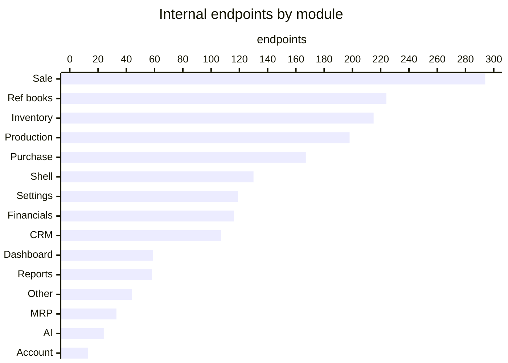
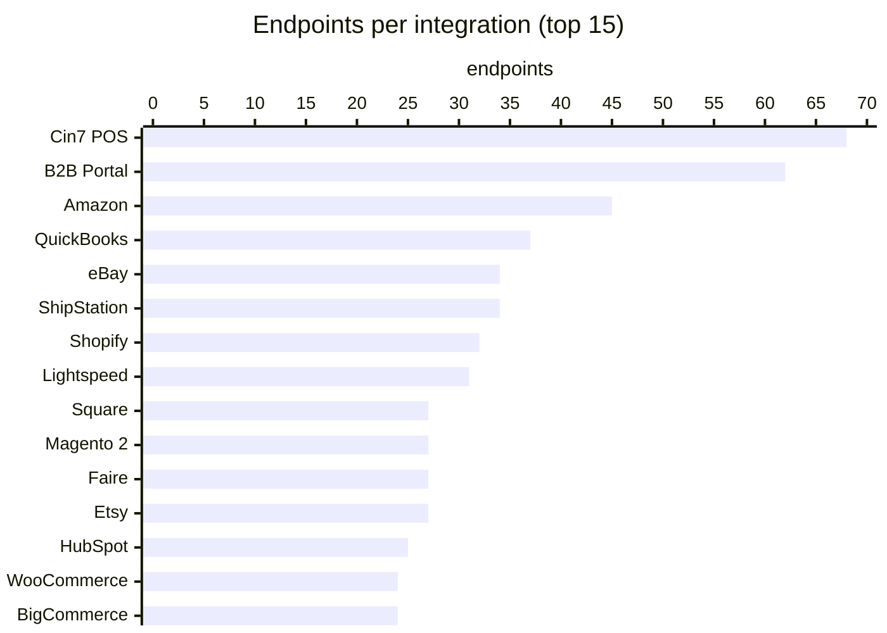
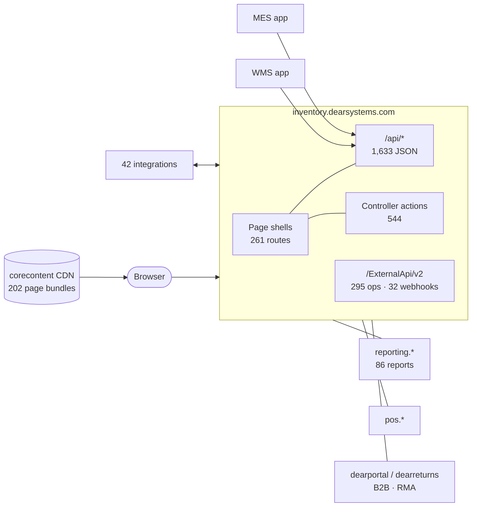
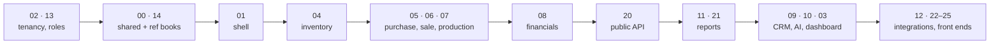

# Cin7 Core rebuild

**Cin7 Core (DEAR Inventory), mapped: every page, endpoint, model and integration, and how to rebuild each module.** Structure, plus [business rules](rules/README.md) for settings, inventory, purchase, sale, production, MRP, reference books, ShipStation and Shopify. Read from the shipped web app, its public scripts and Cin7's published API spec (October 2026).

## At a glance

| 📄 Pages | 🔌 Internal `/api` | 🎛️ Controller actions | 🌍 Public API | 🧱 Models | 📊 Reports | 🔗 Integrations | 🖥️ Front ends |
|:-:|:-:|:-:|:-:|:-:|:-:|:-:|:-:|
| **261** | **1,633** | **544** | **295** ops · 115 paths | **1,024** | **86** | **42** · 751 endpoints | **6** |

## Integration partners

| Category | Endpoints | Partners `endpoints` |
|---|:-:|---|
| 🛒 E-commerce | 134 | [Shopify](modules/12-integrations/shopify/README.md) `32` · [Magento 2](modules/12-integrations/magento-2-x/README.md) `27` · [Magento 1](modules/12-integrations/magento-1-x/README.md) `27` · [WooCommerce](modules/12-integrations/woocommerce/README.md) `24` · [BigCommerce](modules/12-integrations/bigcommerce/README.md) `24` · [Neto](modules/12-integrations/neto/README.md) `0` |
| 🏬 Marketplaces | 202 | [Amazon](modules/12-integrations/amazon/README.md) `45` · [eBay](modules/12-integrations/ebay/README.md) `34` · [Etsy](modules/12-integrations/etsy/README.md) `27` · [Faire](modules/12-integrations/faire/README.md) `27` · [LeafLink](modules/12-integrations/leaflink/README.md) `24` · [FBA](modules/12-integrations/fulfillment-by-amazon/README.md) `23` · [Walmart](modules/12-integrations/walmart/README.md) `22` |
| 🧾 POS | 126 | [Cin7 POS](modules/12-integrations/pos/README.md) `68` · [Lightspeed](modules/12-integrations/lightspeed/README.md) `31` · [Square](modules/12-integrations/square/README.md) `27` |
| 🚚 Shipping | 52 | [ShipStation](modules/12-integrations/shipstation/README.md) `34` · [Shiptheory](modules/12-integrations/shiptheory/README.md) `11` · [StarShipIT](modules/12-integrations/starshipit/README.md) `2` · [Shippit](modules/12-integrations/shippit/README.md) `2` · [ShipRush](modules/12-integrations/shiprush/README.md) `2` · [EasyPost](modules/12-integrations/easypost/README.md) `1` |
| 📒 Accounting | 46 | [QuickBooks](modules/12-integrations/quickbooks/README.md) `37` · [Xero](modules/12-integrations/xero/README.md) `9` · [Synder](modules/12-integrations/synder/README.md) `0` |
| 💳 Payments | 50 | [Cin7 Core Payments](modules/12-integrations/cin7-core-payments/README.md) `20` · [Authorize.Net](modules/12-integrations/authorizenet/README.md) `11` · [PayPal](modules/12-integrations/paypal/README.md) `10` · [Pinch](modules/12-integrations/pinch/README.md) `9` · [Airwallex](modules/12-integrations/airwallex/README.md) `0` |
| 🧮 Tax | 15 | [Avalara](modules/12-integrations/avalara/README.md) `15` |
| 🤝 CRM · loyalty | 36 | [HubSpot](modules/12-integrations/hubspot/README.md) `25` · [Capsule](modules/12-integrations/capsule/README.md) `9` · [LoyaltyLion](modules/12-integrations/loyaltylion/README.md) `2` |
| 🌐 Portals | 74 | [B2B Portal](modules/12-integrations/portal/README.md) `62` · [RMA Portal](modules/12-integrations/rma-portal/README.md) `12` |
| 🔧 Other | 16 | [Cin7 Core API setup](modules/12-integrations/cin7-core-api-setup/README.md) `6` · [Lokad](modules/12-integrations/lokad/README.md) `5` · [Google Workspace](modules/12-integrations/google-workspaces/README.md) `5` · [Zapier](modules/12-integrations/zapier/README.md) `0` · [WMS config](modules/12-integrations/warehouse-application-configuration/README.md) `0` |

All 42, with pages and models: [modules/12-integrations](modules/12-integrations/README.md) · by integration: [endpoints-by-integration](modules/12-integrations/README.md#integrations).

## How Cin7 Core is put together

| Doc | What |
|---|---|
| [ARCHITECTURE](docs/ARCHITECTURE.md) | Hosts, stack, what a page is, build order |
| [INTERNAL-API](docs/INTERNAL-API.md) | `/api` contract: naming, verbs, paging, saves |
| [PUBLIC-API](docs/PUBLIC-API.md) | `/ExternalApi/v2`: auth, paging, errors, shapes |
| [UI](docs/UI.md) | Themes, colours, type, icons, widgets, shell, menu |
| [RELATIONSHIPS](docs/RELATIONSHIPS.md) | Every `*ID` → entity, ER diagram |
| [IMPORTS](docs/IMPORTS.md) · [AUTOMATIONS](docs/AUTOMATIONS.md) | CSV layouts · workflow model and 48 merge fields |

## Modules

Each folder: `README.md` (pages, models, endpoints, API ops, reports, how to rebuild) · `UI.md` (every grid, field, button, dialog) · `schema.sql`.

| # | Module | Endpoints | API ops | # | Module | Endpoints | API ops |
|---|---|:-:|:-:|---|---|:-:|:-:|
| 00 | [Shared models](modules/00-shared/README.md) | | | 13 | [Settings](modules/13-settings/README.md) | 119 | 14 |
| 01 | [Shell](modules/01-shell/README.md) | 130 | | 14 | [Reference books](modules/14-reference-books/README.md) | 224 | 54 |
| 02 | [Account](modules/02-account/README.md) | 13 | | 15 | [Unassigned](modules/15-other/README.md) | 44 | |
| 03 | [Dashboard](modules/03-dashboard/README.md) | 59 | | 16 | [MRP](modules/16-mrp/README.md) | 33 | |
| 04 | [Inventory](modules/04-inventory/README.md) | 215 | 33 | 20 | [Public API + webhooks](modules/20-public-api/README.md) | | 295 |
| 05 | [Purchase](modules/05-purchase/README.md) | 167 | 49 | 21 | [Report service](modules/21-report-service/README.md) | | |
| 06 | [Sale](modules/06-sale/README.md) | 294 | 45 | 22 | [POS](modules/22-pos/README.md) | | |
| 07 | [Production](modules/07-production/README.md) | 198 | 66 | 23 | [WMS handheld](modules/23-wms/README.md) | | |
| 08 | [Financials](modules/08-financials/README.md) | 116 | 18 | 24 | [MES shop floor](modules/24-mes/README.md) | | |
| 09 | [CRM](modules/09-crm/README.md) | 107 | 16 | 25 | [B2B + RMA portals](modules/25-portals/README.md) | | |
| 10 | [AI](modules/10-ai/README.md) | 24 | | 12 | [Integrations](modules/12-integrations/README.md) (42) | 751 | |
| 11 | [Reports](modules/11-reports/README.md) | 58 | | | | | |

## Build order

## Use it

| Want | Go |
|---|---|
| Machine-readable map | [data/](data/) |
| Regenerate `modules/` | `python3 tools/generate.py` |
| Rebuild `data/ui.json` | `node tools/extract_ui.js <bundles> data/ui.json` |
| CLI + MCP server over this map | [cin7-core-cli](https://github.com/fightmilk808/cin7-core-cli) |
| Browser extension starter | [cin7-core-extension-example](https://github.com/fightmilk808/cin7-core-extension-example) |

## Agent skills

Copy a folder from [skills/](skills/) to `~/.claude/skills/` (or your agent's skills folder). Each one works from this map and says plainly where the map has no answer.

| Skill | For |
|---|---|
| [cin7-import-files](skills/cin7-import-files/SKILL.md) | Turn a spreadsheet into a Cin7 import CSV (builds the file; a person uploads it) |
| [cin7-webhooks](skills/cin7-webhooks/SKILL.md) | Pick an event, its payload shape, and a receiver to handle it |
| [cin7-automations](skills/cin7-automations/SKILL.md) | Draft automation rules and notification templates with the right merge fields |
| [cin7-reports](skills/cin7-reports/SKILL.md) | Find the built-in report, filters and columns for a question, or the nearest public API list |
| [cin7-integrations](skills/cin7-integrations/SKILL.md) | How a connector (Shopify, ShipStation, Xero, …) is wired, for troubleshooting |
| [cin7-clone-module](skills/cin7-clone-module/SKILL.md) | Plan and scaffold your own version of a module from its tables, screens and endpoints |
| [cin7-map-endpoint](skills/cin7-map-endpoint/SKILL.md) | Add a missing endpoint to the map from a sanitised HAR capture |
| [cin7-mirror-db](https://github.com/fightmilk808/cin7-core-cli/blob/main/skills/cin7-mirror-db/SKILL.md) · [cin7-core](https://github.com/fightmilk808/cin7-core-cli/blob/main/skills/cin7-core/SKILL.md) | In the CLI repo: mirror Cin7 into a database · look things up |

Independent research, not affiliated with or endorsed by Cin7. Cin7 and DEAR are trademarks of their owners. It records structure only (page names, routes, fields, truncated handler names); no Cin7 source files, customer data or credentials are included. The MIT license covers this repo's own docs and tools. · [MIT](LICENSE)
