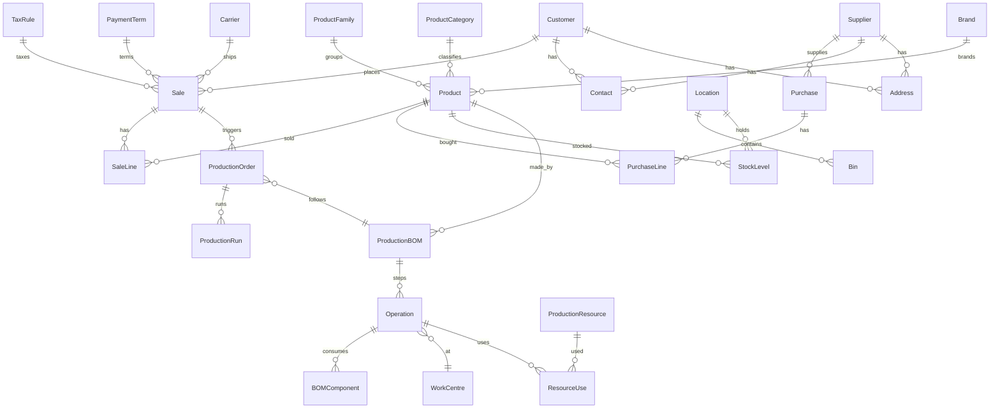

# Relationships

How Cin7 Core's records point at each other, read from the 1,024 data models' field names. Every id is a GUID. A column named `<Entity>ID` (or `<Role><Entity>ID`, like `DefaultLocationID`) references that entity. Each `schema.sql` marks these columns with `-- -> <Entity>`.

## Conventions

- **`TaskID` is the document id.** Sales, purchases, assemblies, disassemblies, transfers, stock adjustments, production orders, jobs, money tasks and CRM records are all *tasks*; their lines, payments, attachments and logs carry `TaskID` (or a typed alias such as `SaleTaskID`, `PurchaseTaskID`, `DropShipTaskID`).
- **`TenantID` scopes everything** to one account.
- **`ConfigID` / `ECSConfigID` point at an integration's configuration** (one per connected store or channel).
- **`FakeID` is a client-side row id** used by grids before a save; it is not a reference.
- **Lines reference their parent and the product:** `TaskID` + `ProductID` (+ `LocationID`, `BinID` for stock).
- **Roles share an entity:** `LocationID`, `DefaultLocationID`, `ReceiptsLocationID`, `OrderLocationID` all point at a location.

## Core entities

## Every referenced entity

| Entity | Columns that reference it | Models referencing it | Likely home model |
|---|---|---:|---|
| **Product** | `ProductID`, `MainProductID`, `ParentProductID`, `ProductId` | 163 | `vProduct`, `Product`, `ProductModel` |
| **ProductFamily** | `FamilyID`, `ProductFamilyID` | 11 | `vProductFamily` |
| **Customer** | `CustomerID`, `ConsolidateToCustomerID`, `SupplierCustomerID` | 74 | `vCustomer`, `Customer` |
| **Supplier** | `SupplierID` | 31 | `vSupplier`, `Supplier` |
| **Location** | `LocationID`, `ReceiptsLocationID`, `OrderLocationID`, `ParentLocationID` | 81 | `vLocation`, `Location` |
| **Bin** | `BinID` | 19 | `vBin` |
| **Sale** | `SaleTaskID`, `SaleTaskId`, `ParentSaleTaskID`, `SaleID` | 20 | `Sale` |
| **Purchase** | `DropShipTaskID`, `PurchaseTaskID`, `SourcePurchaseID` | 9 | `Purchase` |
| **Task (any document)** | `TaskID`, `SourceTaskID`, `CreditSourceTaskID`, `TargetTaskID`, `TaskId` | 173 | `vTask` |
| **ProductionOrder** | `ProductionOrderID`, `LinkedProductionOrderID` | 16 | `vProductionOrder` |
| **ProductionRun** | `ProductionRunID`, `RunID` | 12 | `vProductionRun` |
| **ProductionBOM** | `BomID`, `BOMConfigurationID` | 8 | `vProductionBom` |
| **Operation** | `OperationID`, `SourceOperationID` | 35 |  |
| **ProductionResource** | `ResourceID`, `ProductionResourceID`, `OrderResourceID` | 19 | `vProductionResource`, `vProductionResources` |
| **WorkCentre** | `WorkCenterID` | 10 |  |
| **ProductCategory** | `CategoryID` | 5 |  |
| **Brand** | `BrandID` | 4 | `vBrand`, `Brand` |
| **TaxRule** | `TaxRuleID` | 6 | `vTaxRules` |
| **PaymentTerm** | `TermID` | 4 |  |
| **Carrier** | `CarrierID` | 4 | `Carrier` |
| **Contact** | `ContactID` | 12 | `vContact` |
| **Address** | `AddressID`, `ShipAddressID` | 21 | `vAddress` |
| **User** | `UserID`, `UserId` | 14 | `vUser` |
| **Attachment** | `AttachementID`, `AttachmentID` | 17 | `Attachment` |
| **Account** | `AccountID` | 3 | `vAccount`, `Account`, `accountModel` |
| **Allocation** | `AllocationID` | 3 |  |
| **AlternativeProduct** | `AlternativeProductID` | 1 |  |
| **AmazonConfig** | `AmazonConfigID` | 1 |  |
| **Assembly** | `FinishedGoodsID` | 3 |  |
| **Attribute** | `AttributeID` | 1 |  |
| **AttributeSet** | `SetID`, `CurrentAttributeSetId`, `AttributeSetID`, `AttributeSetId` | 11 | `vAttributeSet` |
| **AuthorizeNetPayment** | `AuthorizeNetPaymentId` | 1 |  |
| **AutoSync_MailList** | `AutoSync_MailListID` | 1 |  |
| **AutomatedWorkflow** | `AutomatedWorkflowID` | 1 | `vAutomatedWorkflow` |
| **AutomatedWorkflowConditionParameter** | `AutomatedWorkflowConditionParameterID` | 1 |  |
| **AvalaraCustomer** | `AvalaraCustomerID` | 1 |  |
| **BOMProductMap** | `BOMProductMapID` | 1 |  |
| **BankAccount** | `BankAccountId` | 1 | `vBankAccount` |
| **BankRule** | `BankRuleID` | 1 | `vBankRule` |
| **BankRuleContact** | `BankRuleContactID` | 1 |  |
| **BankStatement** | `BankStatementID` | 2 | `vBankStatement` |
| **Banknote** | `BanknoteID` | 1 |  |
| **BigcommerceConfig** | `BigcommerceConfigID` | 1 |  |
| **BinGroup** | `BinGroupID` | 2 | `vBinGroup`, `BinGroup` |
| **Blob (stored file)** | `ImageID`, `BlobGUID`, `FileID`, `BlobID` | 55 |  |
| **BomComponent** | `BomComponentID` | 1 |  |
| **BomResource** | `BomResourceID` | 1 |  |
| **BomVariationComponent** | `BomVariationComponentID` | 1 |  |
| **Calculation** | `CalculationID` | 1 |  |
| **Calendar** | `CalendarID` | 3 |  |
| **Cart** | `CartID` | 2 |  |
| **Charge** | `ChargeID` | 1 |  |
| **ChildCustomer** | `ChildCustomerID` | 1 | `vChildCustomer` |
| **ChildEntity** | `ChildEntityID` | 1 |  |
| **ClientTrans** | `ClientTransID` | 1 |  |
| **CompanyContact** | `CompanyContactID` | 1 |  |
| **Component** | `ComponentID`, `OrderComponentID` | 3 |  |
| **ComponentLocation** | `ComponentLocationID` | 1 |  |
| **ComponentProduct** | `ComponentProductID` | 2 |  |
| **Condition** | `ConditionID` | 1 | `vCondition` |
| **ConfigurationOption** | `ConfigurationOptionID` | 1 |  |
| **ConfigurationOptionArt** | `ConfigurationOptionArtID` | 1 |  |
| **ConvertedSaleTask** | `ConvertedSaleTaskID` | 1 |  |
| **Cost** | `OrderCostID` | 1 |  |
| **CostType** | `CostTypeID` | 1 | `CostTypeModel` |
| **CreatedTask** | `CreatedTaskID` | 1 |  |
| **Currency** | `CurrencyID` | 1 | `vCurrency`, `Currency` |
| **CustomFilter** | `CustomFilterID` | 2 |  |
| **CustomFilterCondition** | `CustomFilterConditionID` | 1 | `CustomFilterCondition` |
| **CustomerSupplier** | `CustomerSupplierID` | 1 |  |
| **Day** | `DayID` | 2 |  |
| **Deal** | `DealID` | 4 | `vDeal` |
| **DealDiscount** | `DealDiscountID` | 4 | `vDealDiscount` |
| **DearPaymentGatewayTransaction** | `DearPaymentGatewayTransactionID` | 1 |  |
| **DearPurchase** | `DearPurchaseID` | 1 |  |
| **DearStockAdjustment** | `DearStockAdjustmentID` | 1 |  |
| **DearStockTransfer** | `DearStockTransferID` | 1 |  |
| **DeliveryItem** | `DeliveryItemID` | 1 | `DeliveryItem` |
| **DemandLocation** | `DemandLocationID` | 1 |  |
| **DestinationFulfillmentCenter** | `DestinationFulfillmentCenterId` | 1 |  |
| **DetailedImage** | `DetailedImageID` | 1 |  |
| **Discount** | `DiscountID` | 4 | `vDiscount` |
| **Dispute** | `DisputeID` | 2 | `vDispute` |
| **DisputeItem** | `DisputeItemID` | 1 | `vDisputeItem` |
| **DropShipReplacement** | `DropShipReplacementID` | 2 |  |
| **DropShipSupplier** | `DropShipSupplierID` | 1 |  |
| **ECSLocation** | `ECSLocationID` | 1 |  |
| **ECSProduct** | `ECSProductID` | 1 |  |
| **ECSPurchase** | `ECSPurchaseID` | 1 | `vECSPurchases` |
| **ECSStockAdjustment** | `ECSStockAdjustmentID` | 1 | `vECSStockAdjustments` |
| **ECSStockTransfer** | `ECSStockTransferID` | 1 | `vECSStockTransfers` |
| **ECSTax** | `ECSTaxID` | 1 |  |
| **ECSVariant** | `ECSVariantID` | 1 |  |
| **EbayConfig** | `EbayConfigID` | 1 |  |
| **EcsManualJournalSet** | `EcsManualJournalSetID` | 2 | `vEcsManualJournalSet` |
| **EcsPaymentProcessor** | `EcsPaymentProcessorID` | 2 |  |
| **Email** | `EmailID` | 3 | `Email` |
| **EmailNotificationSettings** | `EmailNotificationSettingsID` | 1 |  |
| **EmailTemplate** | `EmailTemplateID` | 2 |  |
| **Entity (polymorphic)** | `EntityID` | 6 |  |
| **Entry** | `EntryID` | 3 |  |
| **ExecutionLog** | `ExecutionLogID` | 3 |  |
| **ExpenseClaim** | `ExpenseClaimID` | 1 |  |
| **ExpenseClaimReceiptTask** | `ExpenseClaimReceiptTaskId` | 1 | `ExpenseClaimReceiptTask` |
| **ExpenseClaimTask** | `ExpenseClaimTaskID` | 1 | `ExpenseClaimTask` |
| **ExpenseItem** | `ExpenseItemID` | 1 | `vExpenseItem` |
| **ExpenseTask** | `ExpenseTaskID` | 1 |  |
| **External** | `ExternalID` | 1 |  |
| **ExternalOrder** | `ExternalOrderID` | 1 |  |
| **FFProduct** | `FFProductID` | 1 | `vFFProduct` |
| **FailedPayment** | `FailedPaymentID` | 1 |  |
| **FixedAssetType** | `FixedAssetTypeID`, `DefaultFixedAssetTypeID` | 3 | `vFixedAssetType` |
| **Forecast** | `ForecastID` | 1 |  |
| **Fulfillmen** | `FulfillmenID` | 1 |  |
| **FulfillmentOrder** | `FulfillmentOrderId`, `FulfillmentOrderID` | 2 | `vFulfillmentOrder` |
| **Fulfilment** | `FulfilmentTaskID` | 3 |  |
| **FulfilmentOrder** | `FFID`, `FFOrderId`, `FFOrderID` | 6 |  |
| **GD_Dir** | `GD_DirID` | 1 |  |
| **GiftCardProduct** | `GiftCardProductID` | 1 |  |
| **GiftCardSaleTax** | `GiftCardSaleTaxID` | 1 |  |
| **GoogleAnalytics4Tracker** | `GoogleAnalytics4TrackerID` | 1 |  |
| **GoogleAnalyticsTracker** | `GoogleAnalyticsTrackerID` | 1 |  |
| **GroupedAdditionalCharge** | `GroupedAdditionalChargeID` | 1 | `GroupedAdditionalCharge` |
| **Holiday** | `HolidayID` | 1 |  |
| **HubSpot** | `HubSpotID` | 2 | `vHubSpot` |
| **HubSpotCatalog** | `HubSpotCatalogID` | 1 |  |
| **HubSpotDeal** | `HubSpotDealId` | 1 |  |
| **HubSpotObject** | `HubSpotObjectID` | 1 |  |
| **HubSpotPipeLine** | `HubSpotPipeLineID` | 1 |  |
| **HubSpotStage** | `HubSpotStageID` | 2 | `HubSpotStage` |
| **ImpersonatedTenant** | `ImpersonatedTenantID` | 1 |  |
| **InboundShipment** | `InboundShipmentID` | 7 |  |
| **IntegrationConfig** | `ConfigID`, `ECSConfigID`, `ConfigurationID`, `EcsConfigID` | 48 |  |
| **Internal** | `InternalId` | 1 |  |
| **InventoryCard** | `CardID`, `CardDetailsID`, `InventoryCardID` | 12 |  |
| **InventoryTask** | `InventoryTaskID` | 1 | `vInventoryTask` |
| **Invitation** | `InvitationID` | 1 |  |
| **Invoice** | `InvoiceID` | 1 |  |
| **InvoiceCost** | `InvoiceCostID` | 2 |  |
| **InvoiceTaskForCreditNote** | `InvoiceTaskForCreditNoteID` | 1 |  |
| **InvoiceTemplate** | `InvoiceTemplateID` | 1 | `vInvoiceTemplate` |
| **Item (context-specific)** | `ItemID`, `ItemId` | 7 |  |
| **Job** | `JobID` | 13 |  |
| **JobMilestone** | `JobMilestoneID` | 5 | `vJobMilestone` |
| **Journal** | `JournalID` | 1 |  |
| **JournalLine** | `JournalLineID` | 1 | `vJournalLine` |
| **Lead** | `LeadID` | 6 | `vLead` |
| **LeadSafetyOption** | `LeadSafetyOptionID` | 1 |  |
| **Line (parent document's line)** | `LineID`, `OrderLineID`, `InvoiceLineID`, `SourceLineID`, `QuoteLineID` | 25 |  |
| **LineConfiguration** | `LineConfigurationID` | 1 |  |
| **Log** | `LogID` | 7 | `vLog` |
| **MRP** | `MRPID` | 1 | `vMRP` |
| **MRPSettings** | `MRPSettingsID` | 2 | `vMRPSettings` |
| **MRPTask** | `MRPTaskID` | 1 |  |
| **Magento2Config** | `Magento2ConfigID` | 1 |  |
| **MagentoConfig** | `MagentoConfigID` | 1 |  |
| **MailingList** | `MailingListID` | 3 | `vMailingList`, `MailingList` |
| **MakeToOrderConfiguration** | `MakeToOrderConfigurationID` | 1 |  |
| **ManualJournal** | `ManualJournalID` | 2 | `ManualJournal` |
| **MappedProduct** | `MappedProductID` | 2 |  |
| **MarkupRounding** | `MarkupRoundingID` | 1 | `vMarkupRounding` |
| **MasterEntity** | `MasterEntityID` | 1 |  |
| **MenuConfiguration** | `MenuConfigurationID` | 10 |  |
| **MenuConfigurationCondition** | `MenuConfigurationConditionID` | 1 |  |
| **Milestone** | `MilestoneID` | 2 | `vMilestone` |
| **MoneyTask** | `MoneyTaskID` | 2 | `vMoneyTask` |
| **MrpSupplySuggestion** | `MrpSupplySuggestionID` | 1 |  |
| **Note** | `NoteID` | 4 |  |
| **NotificationExecutionLog** | `NotificationExecutionLogID` | 1 |  |
| **NotificationSettings** | `NotificationSettingsID` | 4 | `vNotificationSettings` |
| **NotitifcationWorkflow** | `NotitifcationWorkflowID` | 1 |  |
| **Observer** | `ObserverID` | 1 |  |
| **OperationAttachment** | `OrderOperationAttachmentID` | 1 |  |
| **Opportunity** | `OpportunityID` | 4 | `Opportunity` |
| **OpportunityLine** | `OpportunityLineID` | 1 | `vOpportunityLines` |
| **OpportunityLocation** | `OpportunityLocationID` | 1 |  |
| **Order (context-specific)** | `OrderID` | 3 |  |
| **Package** | `PackageID` | 1 |  |
| **Page** | `PageID` | 1 |  |
| **Parent** | `ParentID` | 2 | `Parent` |
| **Path** | `PathID` | 1 |  |
| **PayPalPayment** | `PayPalPaymentId` | 1 |  |
| **Payment** | `PaymentID`, `PaymentId` | 7 |  |
| **PaymentMethod** | `PaymentMethodId`, `PaymentMethodID` | 2 | `vPaymentMethod` |
| **PaymentProcessor** | `PaymentProcessorID` | 1 |  |
| **Payout** | `PayoutID` | 2 | `vPayout` |
| **PayoutItem** | `PayoutItemID` | 1 | `vPayoutItem` |
| **Portal** | `WebPortalID`, `PortalId`, `WebPortalId` | 10 |  |
| **PosOutlet** | `PosOutletID` | 3 | `vPosOutlets` |
| **PredecessorProduct** | `PredecessorProductID` | 1 |  |
| **PriceListTemplate** | `PriceListTemplateID` | 1 |  |
| **ProducedProduct** | `ProducedProductID` | 1 |  |
| **ProductAttachment** | `ProductAttachmentID` | 1 |  |
| **ProductRule** | `ProductRuleID` | 1 |  |
| **ProductionOrderConfiguration** | `ProductionOrderConfigurationID` | 1 | `vProductionOrderConfiguration` |
| **Profile** | `ProfileID` | 1 |  |
| **PurchaseCost** | `PurchaseCostID` | 3 |  |
| **PurchaseDeposit** | `PurchaseDepositID` | 1 | `vPurchaseDeposits` |
| **PurchaseFulfillmentTask** | `PurchaseFulfillmentTaskID` | 1 |  |
| **PurchasePayment** | `PurchasePaymentID` | 1 |  |
| **PutAway** | `PutAwayID` | 1 |  |
| **QB** | `QBID` | 1 |  |
| **QBO** | `QBOID` | 1 |  |
| **QuickKey** | `QuickKeyID` | 2 |  |
| **QuoteCost** | `QuoteCostID` | 1 |  |
| **RMA** | `RmaTaskID` | 5 | `vRMA` |
| **RMACostType** | `RMACostTypeID` | 1 | `vRMACostType` |
| **RMAProduct** | `RMAProductID` | 1 | `vRMAProducts` |
| **RMAReturnOrderTask** | `RMAReturnOrderTaskID` | 1 |  |
| **RMAReturnPolicy** | `RMAReturnPolicyID` | 3 | `RMAReturnPolicy` |
| **RMATask** | `RMATaskID` | 1 |  |
| **ROTask** | `ROTaskID` | 1 |  |
| **ReadinessState** | `ReadinessStateId` | 1 | `vReadinessState` |
| **ReasonForReturn** | `ReasonForReturnID` | 3 | `ReasonForReturn` |
| **Receipt** | `ReceiptID` | 2 |  |
| **Reconcile** | `ReconcileID` | 1 |  |
| **Refund** | `RefundID` | 3 |  |
| **Registry** | `RegistryID` | 1 |  |
| **RelatedMenuConfiguration** | `RelatedMenuConfigurationID` | 1 |  |
| **RelatedOperation** | `RelatedOperationID` | 2 |  |
| **RelatedTask** | `RelatedTaskID` | 2 | `RelatedTask` |
| **Remark** | `RemarkID` | 1 |  |
| **Rep** | `RepID` | 1 |  |
| **Report** | `ReportID` | 3 | `vReport` |
| **ReportGenerationLog** | `ReportGenerationLogID` | 1 | `vReportGenerationLog` |
| **Resolution** | `ResolutionID` | 1 | `Resolution` |
| **ResourceCapacity** | `ResourceCapacityID` | 1 |  |
| **ResourceCost** | `ResourceCostID` | 1 |  |
| **ResourceDay** | `ResourceDayID` | 1 |  |
| **ResourceUnit** | `ResourceUnitID` | 1 |  |
| **RestockLocation** | `RestockLocationID` | 1 |  |
| **RestockToProduct** | `RestockToProductID` | 2 |  |
| **Retail** | `RetailID` | 1 |  |
| **RetailLocation** | `RetailLocationID` | 1 |  |
| **ReturnDeliveryLocation** | `ReturnDeliveryLocationID` | 1 |  |
| **ReturnLocation** | `DefaultReturnLocationID` | 1 |  |
| **ReturnOrderTask** | `ReturnOrderTaskID` | 1 |  |
| **ReturnPolicy** | `ReturnPolicyID` | 2 |  |
| **Rma** | `RmaID` | 1 | `vRMA` |
| **RmaPortal** | `RmaPortalID` | 1 |  |
| **RmaProduct** | `RmaProductID` | 8 | `vRMAProducts` |
| **RmaReturnOrderProduct** | `RmaReturnOrderProductID` | 1 | `vRMAReturnOrderProducts` |
| **RmaReturnOrderTask** | `RmaReturnOrderTaskID` | 2 |  |
| **Role** | `RoleID`, `RoleId` | 2 |  |
| **Rule (context-specific)** | `RuleID` | 11 |  |
| **RulePredecessorProduct** | `RulePredecessorProductID` | 1 |  |
| **RunComponent** | `RunComponentID` | 1 | `vRunComponent` |
| **RunCost** | `RunCostID` | 1 |  |
| **RunOnAccount** | `RunOnAccountID` | 1 |  |
| **RunOperation** | `RunOperationID` | 2 |  |
| **RunResource** | `RunResourceID` | 1 | `vRunResources` |
| **SIM** | `SIMID` | 2 |  |
| **SIMFamily** | `SIMFamilyID` | 1 |  |
| **SIMProduct** | `SIMProductID` | 1 |  |
| **SaleCreditNote** | `SaleCreditID` | 6 |  |
| **SalePayment** | `SalePaymentID` | 2 |  |
| **SaleTaxManagementRule** | `SaleTaxManagementRuleID` | 1 |  |
| **SelectedDropShipSupplier** | `SelectedDropShipSupplierID` | 1 |  |
| **Setting** | `SettingID` | 1 | `vSettings` |
| **ShopFloorLocation** | `ShopFloorLocationID` | 1 |  |
| **ShopifyConfig** | `ShopifyConfigID` | 1 |  |
| **ShopifyLocation** | `ShopifyLocationID` | 1 | `vShopifyLocation` |
| **SketchImage** | `SketchImageID` | 1 |  |
| **Slip** | `SlipID` | 1 |  |
| **SquareIntegration** | `SquareIntegrationID` | 1 | `vSquareIntegration` |
| **State** | `StateID` | 1 | `State` |
| **Statement** | `StatementID` | 1 |  |
| **StationConfig** | `ShipStationConfigID` | 1 |  |
| **Status** | `StatusID` | 2 | `Status` |
| **StockTranferTask** | `StockTranferTaskID` | 2 |  |
| **StockTransfer** | `TransferOrderID` | 5 |  |
| **StripeCustomer** | `StripeCustomerID` | 2 |  |
| **StripePayment** | `StripePaymentId` | 1 |  |
| **SupplierProduct** | `SupplierProductID` | 1 | `vSupplierProduct` |
| **Supply** | `SupplyID` | 1 |  |
| **SupplyInterval** | `SupplyIntervalID` | 1 | `SupplyInterval` |
| **Surcharge** | `SurchargeID` | 1 | `vSurcharge` |
| **Sync** | `SyncID` | 1 |  |
| **TaskCategory** | `TaskCategoryID` | 4 | `vTaskCategory` |
| **Template** | `TemplateID`, `DefaultTemplateID` | 17 | `vTemplate`, `Template` |
| **Tenant** | `TenantID` | 24 | `vTenant`, `vTenants` |
| **TenantAddress** | `TenantAddressID` | 1 | `vTenantAddress` |
| **TenantContact** | `TenantContactID` | 1 | `vTenantContact` |
| **Traceability** | `TraceabilityID` | 2 |  |
| **Trans** | `TransID` | 1 |  |
| **Transaction** | `TransactionID` | 2 | `vTransaction`, `TransactionModel` |
| **TransferTask** | `TransferTaskID` | 1 |  |
| **TriPOSAcceptor** | `TriPOSAcceptorID` | 1 |  |
| **TriPOSAccount** | `TriPOSAccountID` | 1 |  |
| **TriPOSLane** | `TriPOSLaneID` | 1 |  |
| **TyroMerchant** | `TyroMerchantID` | 1 |  |
| **TyroTerminal** | `TyroTerminalID` | 1 |  |
| **UnitOfMeasure** | `UnitOfMeasureID` | 1 |  |
| **UsedProduct** | `UsedProductID` | 1 |  |
| **VendConfig** | `VendConfigID` | 1 |  |
| **Warehouse** | `WarehouseID`, `WarehouseId` | 2 |  |
| **WarehouseLocation** | `WarehouseLocationID` | 1 | `WarehouseLocation` |
| **WarrantySetup** | `WarrantySetupID` | 2 | `vWarrantySetup` |
| **Wastage** | `WastageID` | 1 |  |
| **WebPortalPage** | `WebPortalPageID` | 1 |  |
| **WebPortalPageElement** | `WebPortalPageElementId` | 1 | `vWebPortalPageElements` |
| **WebPortalPriceList** | `WebPortalPriceListID` | 3 |  |
| **WooCommerceConfig** | `WooCommerceConfigID` | 1 |  |
| **Workflow** | `WorkflowID` | 7 | `vWorkflow` |
| **WorkflowHistory** | `WorkflowHistoryID` | 1 | `WorkflowHistory` |
| **WorkflowProcess** | `WorkflowProcessID` | 3 | `vWorkflowProcess` |
| **WorkflowStep** | `WorkflowStepID` | 1 | `vWorkflowStep` |
| **Zone** | `ZoneID` | 2 |  |
| **ment** | `ShipmentID` | 3 |  |
| **mentLine** | `ShipmentLineID` | 1 |  |
| **pingProfile** | `ShippingProfileID` | 1 |  |
| **pingService** | `ShippingServiceID` | 1 |  |
| **reportType** | `reportTypeId` | 1 |  |
