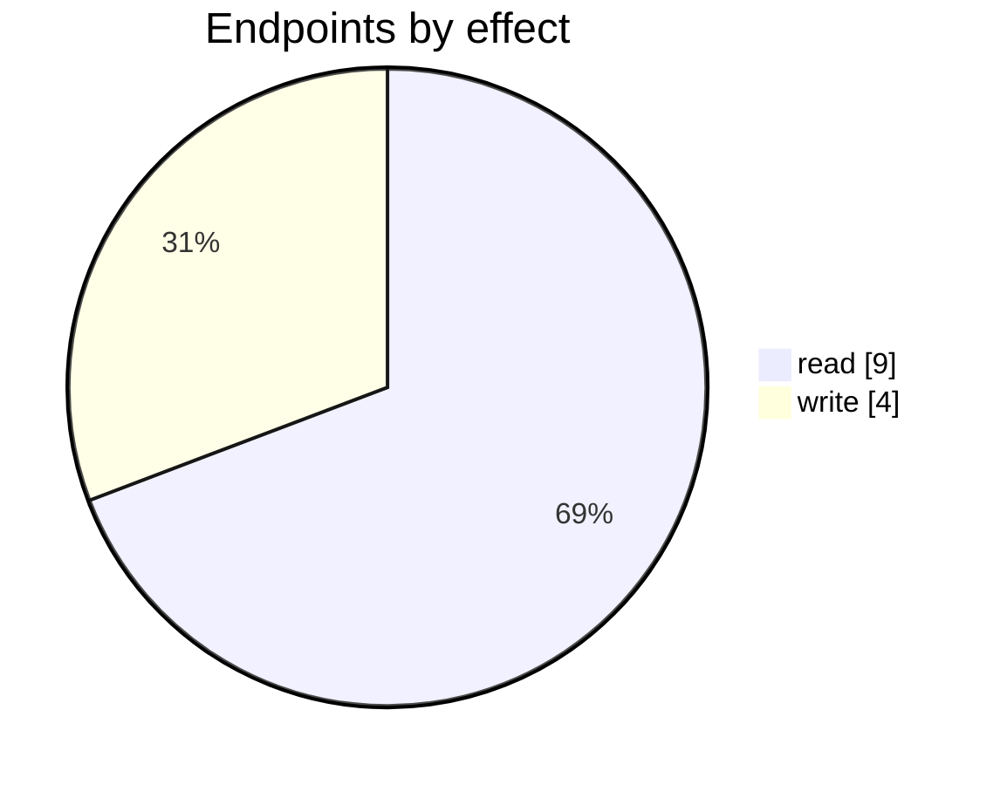
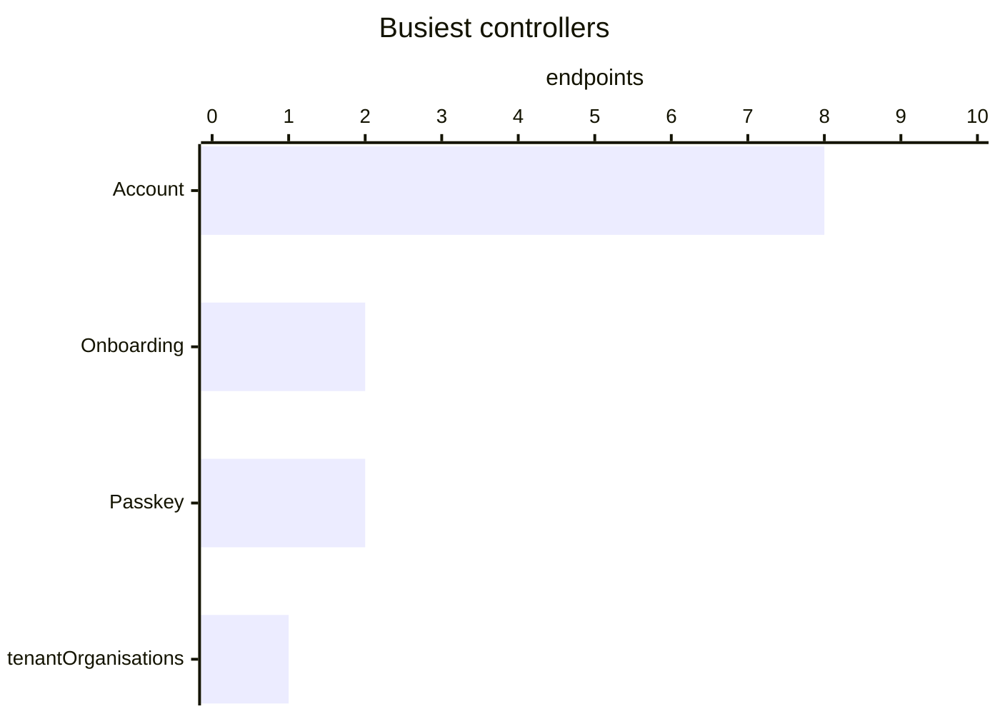

# Sign-in and account

Sign-in, sign-out, password change, organisation switching and impersonation. Server-rendered MVC actions under `/Account/*`; a signed-in session is a cookie.

| 📄 Pages | 🧱 Models | 🔌 Endpoints | ✍️ Can write | 🌍 Public API |
|:-:|:-:|:-:|:-:|:-:|
| **0** | **0** + [shared](../00-shared/README.md) | **13** | 4 | **0** |

[🔌 Endpoints (13)](#internal-endpoints)

## How to rebuild it

| # | Build | How |
|:-:|---|---|
| 1 | 🔌 Internal API | Each controller's verbs · [contract](../../docs/INTERNAL-API.md) · paged `{root, total}` · saves `{ID, HasErrors, Original, Updated}` |

## Internal endpoints

Grouped by controller. Effect: 🟢 read · 🟠 read + write at the same URL · 🔴 write. `api` = JSON under `/api/`, `mvc` = controller action.

### Account

| URL | Kind | Methods | Effect | Params | Body keys | Reader root |
|---|---|---|---|---|---|---|
| `/Account/DemoOrganisation` | mvc | GET(navigate) | 🔴 write | requestID |  |  |
| `/Account/GetTimeZoneAndCountry` | mvc | POST | 🟢 read |  |  |  |
| `/Account/IntuitOrganisationSelection` | mvc |  | 🔴 write | TenantID realmid |  |  |
| `/Account/LoggedInAction` | mvc | GET(navigate) | 🟢 read | returnUrl |  |  |
| `/Account/RegisterDearPartnerPerson` | mvc | GET(navigate) | 🔴 write | requestID |  |  |
| `/api/Account_PhoneCountryCode` | api | REST(GET read; POST/PUT/DELETE on store.sync) | 🟢 read |  |  | root |
| `/api/Account_QBOOrganisations` | api | REST(GET read; POST/PUT/DELETE on store.sync) | 🟢 read | realmid |  |  |
| `/api/Account_Timezone` | api | REST(GET read; POST/PUT/DELETE on store.sync) | 🟢 read |  |  |  |

### Onboarding

| URL | Kind | Methods | Effect | Params | Body keys | Reader root |
|---|---|---|---|---|---|---|
| `/Onboarding/CheckDomainAndReferralCode` | mvc | POST | 🟢 read |  |  |  |
| `/Onboarding/Index` | mvc | GET(navigate) | 🟢 read | requestID |  |  |

### Passkey

| URL | Kind | Methods | Effect | Params | Body keys | Reader root |
|---|---|---|---|---|---|---|
| `/api/Passkey/AuthComplete` | api | POST | 🔴 write |  |  |  |
| `/api/Passkey/AuthOptions` | api |  | 🟢 read | sessionToken |  |  |

### tenantOrganisations

| URL | Kind | Methods | Effect | Params | Body keys | Reader root |
|---|---|---|---|---|---|---|
| `/api/tenantOrganisations` | api | REST(GET read; POST/PUT/DELETE on store.sync) | 🟢 read |  |  |  |
