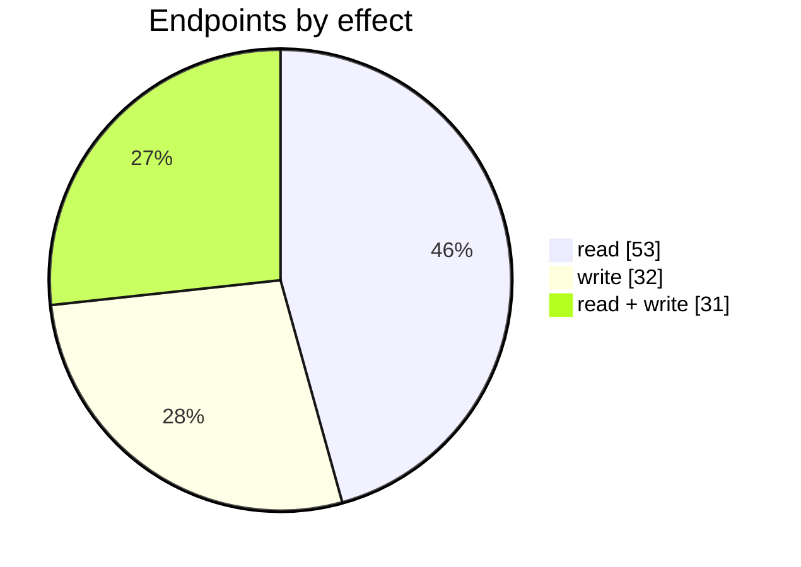
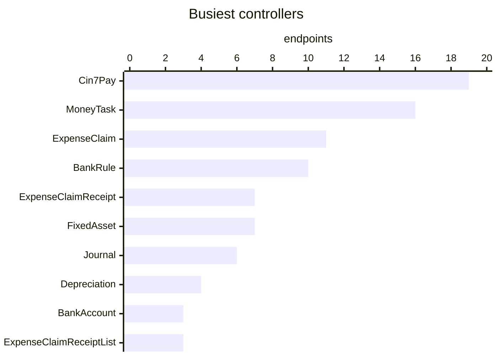
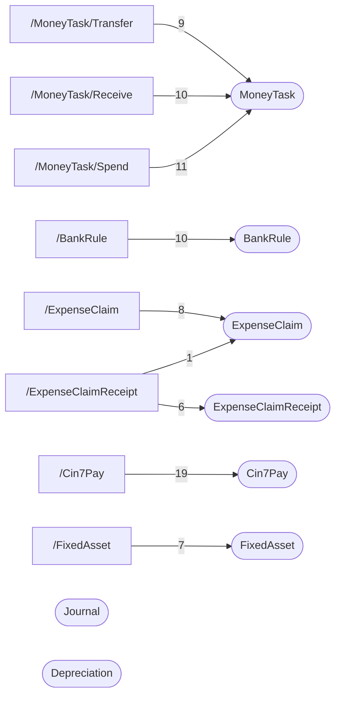

# Financials

Money in and out outside sale and purchase documents: receive, spend and transfer money tasks, journals, expense claims, fixed assets and depreciation, bank accounts and bank rules, Cin7 Pay and Cin7 Capital.

| 📄 Pages | 🧱 Models | 🔌 Endpoints | ✍️ Can write | 🌍 Public API |
|:-:|:-:|:-:|:-:|:-:|
| **17** | **71** + [shared](../00-shared/README.md) | **116** | 63 | **18** |

[📄 Pages (17)](#pages) · [🧱 Models (71)](#data-models) · [🔌 Endpoints (116)](#internal-endpoints) · [🌍 Public API (18)](#public-api-externalapiv2) · [🖼️ UI](UI.md) · [🗄️ schema.sql](schema.sql)

Pages (left) and the controllers they call (right), busiest 8 pages and 8 controllers; numbers are endpoints.

## How to rebuild it

| # | Build | How |
|:-:|---|---|
| 1 | 🗄️ Schema | 71 tables from [`schema.sql`](schema.sql); GUID ids, join on `*ID` |
| 2 | 🔌 Internal API | Each controller's verbs · [contract](../../docs/INTERNAL-API.md) · paged `{root, total}` · saves `{ID, HasErrors, Original, Updated}` |
| 3 | 🖥️ Screens | Server-rendered shell + page app, record from `#<guid>` · [page model](../../docs/ARCHITECTURE.md#what-a-page-is) · every control in [UI.md](UI.md) |
| 4 | 🌍 Public API | 18 ops under `/ExternalApi/v2`, header auth · [contract](../../docs/PUBLIC-API.md) |

## Pages

| Route | Menu label | Title | Bundle | Endpoints (write) |
|---|---|---|---|---:|
| `/BankAccount` | Bank account | Bank accounts | `BankAccounts2019` | 2 (1) |
| `/BankRule` | Bank rule | Bank rules | `BankRule2019` | 14 (4) |
| `/BankStatement` | Bank statement | Bank accounts | `BankAccounts2019` | 2 (1) |
| `/Cin7Capital` | Cin7 Capital | Cin7 Capital | `Cin7Capital2019` | 0 (2) |
| `/Cin7Pay` | Cin7 Pay | Cin7 Pay | `Cin7Pay2019` | 12 (19) |
| `/Depreciation` | Depreciations | Depreciations | `Depreciations2019` | 4 (1) |
| `/ExpenseClaim` | Expense claim | Expense claim | `ExpenseClaim2019` | 10 (7) |
| `/ExpenseClaimList` | Expense claims | Expense claims | `ExpenseClaimList2019` | 3 (1) |
| `/ExpenseClaimReceipt` | Receipt | Expense claim receipt | `ExpenseClaimReceipt2019` | 13 (9) |
| `/ExpenseClaimReceiptList` | Receipts | Expense claims - Receipts | `ExpenseClaimReceiptList2019` | 4 (2) |
| `/FixedAsset` | Fixed assets | Fixed assets | `FixedAsset2019` | 8 (6) |
| `/Journal` | Journal | Journal | `Journal2019` | 8 (6) |
| `/JournalList` | Journals | Journals | `JournalList2019` | 1 (0) |
| `/MoneyTask/Receive` | Receive money | Receive money | `MoneyTaskReceive2019` | 16 (7) |
| `/MoneyTask/Spend` | Spend money | Spend money | `MoneyTaskSpend2019` | 17 (7) |
| `/MoneyTask/Transfer` | Transfer money | Transfer money | `MoneyTaskTransfer2019` | 9 (4) |
| `/MoneyTaskList` | Money tasks | Money operations | `MoneyTaskList2019` | 3 (1) |

## Data models

ExtJS models the pages use; `v` prefix = view-model. Full DDL in [`schema.sql`](schema.sql).

| Model | Fields |
|---|---|
| `AccessPermission` | Name:string, Title:string |
| `Cin7PayWrapper` | AccuralAccountCode:string, BankAccountCode:string, PaymentFeeAccountCode:string, SurchargeAccountCode:string, LoanLiabilityAccountCode:string, FinancingFeeAccountCode:string, IsB2BPortal:bool, PayByInvoice:bool, PayWithSales:bool, CardOnFile:bool, IsSurchargeEnabled:bool, Status:string, IsMerchantReceiptNotificationEnabled:bool, IsCustomerReceiptNotificationEnabled:bool, IsMerchantRefundNotificationEnabled:bool, MerchantNotificationEmail:string, AdditionalNotificationEmails:string |
| `DepreciationTask` | TaskID:string, Status:string, StartDate:date, EndDate:date, CreatedDate:date, TotalItems:float, TotalAmount:float |
| `DepreciationTaskLine` | TaskID:string, LineID:string, InventoryCardID:string, FixedAssetName:string, SerialNumber:string, AccumulatedDepreciationAccountName:string, DepreciationExpenseAccountName:string, Amount:float |
| `ECommerceShop` | ConfigID:string, ShopName:string |
| `ExpenseClaimReceiptReferenceData` | ID:int, ExpenseClaimReceiptCreationPermission:string, ExpenseClaimApprovePermission:string, ExpenseClaimCreatePaymentPermission:string, ExpenseClaimUndoVoidPermission:string, ProductFamilyCount:int, DefaultAccount:string, TaxCalculationMethod:string, HeadersVisible:string, TenantCurrency:string |
| `ExpenseClaimReceiptTask` | TaskID:string, ReceiptNumber:string, SupplierID:string, SupplierName:string, Currency:string, Date:date, Reference:string, Tax:float, TotalAmount:float, CurrencyConversionRate:float, ItemsNumber:int, TaxPercent:float, TaxInclusive:bool, Status:string, TaxSchema:string, DefaultAccount:string, Employee:string, CreatedDate:date, CreatedBy:string, LastUpdatedDate:date, LastUpdatedBy:string, ValidationText:string, ValidationState:string |
| `ExpenseClaimReceiptTaskWrapper` | ID:string, ClientDateTime:date, HasErrors:bool |
| `ExpenseClaimReferenceData` | ID:int, ExpenseClaimReceiptCreationPermission:string, ExpenseClaimApprovePermission:string, ExpenseClaimCreatePaymentPermission:string, ExpenseClaimUndoVoidPermission:string, ExpenseClaimIsReconciled:bool, ProductFamilyCount:int, DefaultAccount:string, TaxCalculationMethod:string, HeadersVisible:string |
| `ExpenseClaimTask` | TaskID:string, DateSubmitted:date, EffectiveDate:date, PaymentDueDate:date, MemoInternal:string, ClaimTotalAmount:float, ApprovedTotalAmount:float, ReceiptsNumber:int, Status:string, IsAuthorised:bool, Employee:string, IsAuthorised:bool, ValidationText:string, ValidationState:string |
| `ExpenseClaimTaskWrapper` | ID:string, ClientDateTime:date, HasErrors:bool |
| `JournalWrapper` | ID:int, HasErrors:bool |
| `MoneyTaskReferenceData` | ID:int, RevenueAccount:string, ApprovePermission:string, UndoPermission:string, VoidPermission:string, DefaultTaxRule:string |
| `MoneyTaskWrapper` | ID:string, ClientDateTime:date, HasErrors:bool |
| `MoneyTask_SearchProduct` | ProductID:string, ProductCode:string, Name:string, Type:string, Price:float, DefaultTaxRule:string, DefaultAccount:string |
| `PeriodModel` | Period:string, Name:string |
| `ReferenceData` | ID:string |
| `Status` | Value:string, Name:string |
| `SupplierCustomerSelect` | ID:string, Name:string, Type:string, DisplayName:string |
| `vAccount` | Code:string, DisplayName:string |
| `vAccountClassTypes` | Class:string |
| `vAccountStatusCode` | Value:string, Name:string |
| `vAccountTypesAndClasses` | Description:string, AccountType:string, AccountClass:string, IsFirst:bool |
| `vAccountingDimensionAttribute` | AttributeID:string, Name:string, Type:string, ListValues:string, IsActive:boolean, ValidationText:string, ValidationState:string |
| `vBankAccount` | AccountCode:string, DisplayName:string |
| `vBankAccountToShow` | AccountID:string, Bank:string, AccountName:string, AccountCode:string, AccountNumber:string, Currency:string, StatementBalance:float, BalanceInDear:float, BalanceInDearInBankAccountCurrency:float, InitialBalance:float, LastDate:date, TransactionCount:int |
| `vBankRule` | RuleID:string, Description:string, RuleName:string, ConditionCase:string, RunOnAccountID:string, CustomerSupplierID:string, Active:bool, Priority:int, ReferenceField:string |
| `vBankRuleAccountMapping` | AccountID:string, Selected:bool, AccountName:string, Currency:string, AccountCode:string |
| `vBankRuleChartOfAccounts` | Code:string, Status:string, Name:string, Type:string, DisplayName:string, Description:string, Class:string, ForPayments:bool, IsFirst:bool |
| `vBankRuleContitionType` | Name:string, Value:string |
| `vBankRuleCustomerWithSupplier` | ID:string, Name:string, DefaultTaxRule:string, DefaultAccount:string, Type:string |
| `vBankRuleFilter` | ID:string, Value:string, FilterType:string, IsSeparator:bool, AccountCode:string |
| `vBankRuleLine` | LineID:string, Name:string, AccountCode:string, TaxRule:string, Amount:float |
| `vBankRuleListItem` | RuleID:string, Priority:int, Active:bool, RuleType:string, Description:string, RuleName:string, AccountCode:string, AccountName:string, Selected:bool |
| `vBankRulePriority` | Name:string, Value:int |
| `vBankRuleTenantTaxationRule` | RuleID:string, Description:string, EffectivePercentExclusive:float, EffectivePercentInclusive:float, EffectivePercent:float, Inclusive:bool |
| `vCardOnFileCustomers` | Name:string, CustomerID:string, Status:string |
| `vCin7PayCardOnFileCardInfo` | CustomerID:string, PaymentMethodId:string, Last4:string, ExpMonth:string, ExpYear:string, Type:string, Provider:string, CreatedDate:string |
| `vCin7PayCustomer` | CustomerID:string, Name:string, StripeCustomerID:string, IsMigrated:bool, MaxRows:int |
| `vCondition` | ConditionID:string, Field:string, Condition:string, Expected:string, LineOrder:int |
| `vConditionField` | name:string, type:string, description:string |
| `vConditionType` | name:string, description:string |
| `vCustomerPaymentsDue` | TaskID:string, CustomerID:string, InvoiceNumber:string, InvoiceDate:date, DueDate:date, SONumber:string, InvoiceAmount:float, PaidAmount:float, DueAmount:float, DaysOverdue:int, AllocatedAmount:float, SourceChannel:string |
| `vDepreciation` | FixedAssetName:string, SerialNumber:string, EffectiveDate:date, Amount:float |
| `vExpenseClaimLines` | FakeID:int, TaskID:string, LineID:string, LineOrder:int, ExpenseClaimReceiptTaskId:string, ReceiptNumber:string, Status:string, SupplierName:string, ReceiptDate:date, ReceiptCurrency:string, ReceiptItemsNumber:int, ReceiptReference:string, ReceiptStatus:string, ReceiptAmount:float, ReceiptOriginalAmount:float, ValidationText:string, ValidationState:string |
| `vExpenseClaimPaymentLine` | FakeID:int, TaskID:string, LineID:string, LineOrder:int, Reference:string, DatePaid:date, Amount:float, AccountCode:string, ValidationText:string, ValidationState:string |
| `vExpenseClaimReceiptAttachement` | TaskID:string, AttachementID:string, BlobGUID:string, ContentType:string, FileName:string, Date:date, UserName:string, IsProcessed:bool |
| `vExpenseClaimReceiptLines` | FakeID:int, TaskID:string, LineID:string, Quantity:float, Price:float, LineOrder:int, Description:string, Tax:float, Total:float, TaxRule:string, TaxPercent:float, AccountCode:string, ValidationText:string, ValidationState:string |
| `vExpenseClaimReceipt_Supplier` | SupplierID:string, Name:string, Currency:string, PaymentTerm:string, TaxRule:string, Comments:string, Discount:float |
| `vExpenseClaimTaskList` | Selected:bool, TaskID:string, Status:string, DateSubmitted:date, EffectiveDate:date, PaymentDueDate:date, ClaimTotalAmount:float, ApprovedTotalAmount:float, PaidAmount:float, DueAmount:float, ReceiptsNumber:int, ReceiptNumbers:string |
| `vExpenseItem` | ExpenseItemID:string, Description:string, AccountCode:string |
| `vFixedAsset` | Selected:bool, InventoryCardID:string, CategoryID:string, CategoryName:string, ProductID:string, ProductName:string, LocationID:string, LocationName:string, BinID:string, BinName:string, SerialNumber:string, OnHand:float, Registered:bool, AccumulatedDepreciation:float, RegistrationDate:date, RegisteredBy:string, DefaultFixedAssetTypeID:string, PurchaseDate:date, DisposalDate:date, PurchaseCost:float, SalvageValue:float, BusinessUse:float, BookValue:float, DefaultFixedAssetTypeName:string, StartAccumulatedDepreciationDate:date, StartAccumulatedDepreciationAmount:float, DepreciationStartDate:da… |
| `vFixedAssetAttachement` | InventoryCardID:string, AttachementID:string, BlobGUID:string, ContentType:string, FileName:string, Date:date, UserName:string, IsProcessed:bool, ExternalDownloadLink:string, ExternalViewLink:string |
| `vJournalAccountingDimension` | JournalLineID:string, Type:string, AttributeName:string, AttributeValue:string, CustomerID:string, CompanyContactID:string, ProductID:string, SupplierID:string, ProductionResourceID:string, ExpenseClaimID:string |
| `vJournalAttachement` | TaskID:string, AttachementID:string, BlobGUID:string, ContentType:string, FileName:string, Date:date, UserName:string, ExternalDownloadLink:string, ExternalViewLink:string |
| `vJournalLine` | FakeID:int, ID:string, TaskID:string, Reference:string, Amount:float, BaseAmount:float, Debit:string, Credit:string, DebitDisplayName:string, CreditDisplayName:string, ValidationText:string, ValidationState:string |
| `vJournalList` | TaskID:string, JournalNumber:string, CreatedDate:date, EffectiveDate:date, Status:string, Narration:string |
| `vJournalTask` | TaskID:string, JournalNumber:string, Status:string, CreatedDate:date, EffectiveDate:date, Narration:string, Notes:string, Currency:string, SyncRequest:bool, CurrencyConversionRate:float, IsSystemJournal:bool, SystemJournalTypeNo:int, ValidationText:string, ValidationState:string |
| `vMoneyTask` | TaskID:string, TaskType:string, BankAccountCode:string, CustomerID:string, SupplierID:string, SupplierCustomerName:string, TaxInclusive:bool, Date:date, BankAccountCurrency:string, TenantCurrency:string, CurrencyConversionRate:float, Memo:string, Reference:string, Status:string, TotalAmount:float, TotalTaxAmount:float, ValidationText:string, ValidationState:string, CustomField1:string, CustomField2:string, CustomField3:string, CustomField4:string, CustomField5:string, CustomField6:string, CustomField7:string, CustomField8:string, CustomField9:string, CustomField10:string, AttributeSetID:string |
| `vMoneyTaskAttachement` | TaskID:string, AttachementID:string, BlobGUID:string, ContentType:string, FileName:string, Date:date, UserName:string, IsProcessed:bool, ExternalDownloadLink:string, ExternalViewLink:string |
| `vMoneyTaskLine` | LineID:string, Name:string, AccountCode:string, TaxRule:string, Amount:float |
| `vPaymentMethod` | Value:string, Name:string |
| `vReceiptTaskList` | Selected:bool, TaskID:string, ReceiptNumber:string, SupplierName:string, Employee:string, Date:date, Reference:string, Currency:string, TotalAmount:float, Status:string |
| `vSurcharge` | PaymentMethod:string, Type:string, FlatAmount:float, Rate:float, MaxAmount:float |
| `vSurchargeType` | Value:string, Name:string |
| `vSystemAccount` | Code:string, Name:string |
| `vSystemAccountInfo` | Code:string, Name:string, MultipleAllowed:string |
| `vTenantCarrierWithShippingOptions` | CarrierID:string, Code:string, Description:string, ExternalService:string, IsDefault:bool |
| `vTextField` | name:string, description:string |
| `vUnlinkedCoreCustomer` | Name:string, CustomerID:string |
| `vUnlinkedStripeCustomer` | Name:string, StripeCustomerID:string, CustomerID:string, Email:string, CustomerName:string, PreviousBatchReference:string, NextBatchReference:string |

## Internal endpoints

Grouped by controller. Effect: 🟢 read · 🟠 read + write at the same URL · 🔴 write. `api` = JSON under `/api/`, `mvc` = controller action.

### AccountingDimensions

| URL | Kind | Methods | Effect | Params | Body keys | Reader root |
|---|---|---|---|---|---|---|
| `/api/AccountingDimensions_Index_RealDimensions` | api | REST(GET read; POST/PUT/DELETE on store.sync) | 🟢 read |  |  |  |

### BankAccount

| URL | Kind | Methods | Effect | Params | Body keys | Reader root |
|---|---|---|---|---|---|---|
| `/api/BankAccount_Index_vCustomer` | api | REST(GET read; POST/PUT/DELETE on store.sync) | 🟠 read + write |  |  |  |
| `/api/BankAccount_Index_vReference` | api | REST(GET read; POST/PUT/DELETE on store.sync) | 🟢 read |  |  | ReferenceData |
| `/api/BankAccount_Index_vSupplier` | api | REST(GET read; POST/PUT/DELETE on store.sync) | 🟠 read + write |  |  |  |

### BankAccountList

| URL | Kind | Methods | Effect | Params | Body keys | Reader root |
|---|---|---|---|---|---|---|
| `/api/BankAccountList_Index_vBankAccounts` | api | REST(GET read; POST/PUT/DELETE on store.sync) | 🟢 read |  |  |  |

### BankRule

| URL | Kind | Methods | Effect | Params | Body keys | Reader root |
|---|---|---|---|---|---|---|
| `/api/BankRule_Index_vBankAccountList` | api | REST(GET read; POST/PUT/DELETE on store.sync) | 🟢 read |  |  |  |
| `/api/BankRule_Index_vChartOfAccounts` | api | REST(GET read; POST/PUT/DELETE on store.sync) | 🟢 read | type |  |  |
| `/api/BankRule_Index_vConditionFields` | api | REST(GET read; POST/PUT/DELETE on store.sync) | 🟢 read |  |  |  |
| `/api/BankRule_Index_vContacts` | api | REST(GET read; POST/PUT/DELETE on store.sync) | 🟢 read | ContactType id search |  |  |
| `/api/BankRule_Index_vFilter` | api | REST(GET read; POST/PUT/DELETE on store.sync) | 🟢 read |  |  | root |
| `/api/BankRule_Index_vList` | api | DELETE REST(GET read; POST/PUT/DELETE on store.sync) | 🟠 read + write | filter search |  | root |
| `/api/BankRule_Index_vRule` | api | REST(GET read; POST/PUT/DELETE on store.sync) | 🟢 read | RuleID |  | root |
| `/api/BankRule_Index_vSave` | api | POST | 🔴 write |  |  |  |
| `/api/BankRule_Index_vTax` | api | REST(GET read; POST/PUT/DELETE on store.sync) | 🟢 read | type |  |  |
| `/api/BankRule_Index_vTextFields` | api | REST(GET read; POST/PUT/DELETE on store.sync) | 🟢 read |  |  |  |

### ChartOfAccounts

| URL | Kind | Methods | Effect | Params | Body keys | Reader root |
|---|---|---|---|---|---|---|
| `/api/ChartOfAccounts_Index_ReferenceData` | api | REST(GET read; POST/PUT/DELETE on store.sync) | 🟢 read |  |  |  |
| `/api/ChartOfAccounts_Index_vBankAccounts` | api | GET POST PUT REST(GET read; POST/PUT/DELETE on store.sync) | 🟠 read + write | accountId limit page start |  |  |

### Cin7Capital

| URL | Kind | Methods | Effect | Params | Body keys | Reader root |
|---|---|---|---|---|---|---|
| `/Cin7Capital/GenerateConnectTokenForIntegrations` | mvc | POST | 🔴 write |  |  |  |
| `/Cin7Capital/InitialiseNewBusiness` | mvc | POST | 🔴 write |  |  |  |

### Cin7Pay

| URL | Kind | Methods | Effect | Params | Body keys | Reader root |
|---|---|---|---|---|---|---|
| `/Cin7Pay/BulkPayDoc` | mvc |  | 🔴 write | doc |  |  |
| `/Cin7Pay/CompleteCin7PayByBulkInvoiceCallBack` | mvc |  | 🔴 write | token |  |  |
| `/Cin7Pay/CompleteCin7PayByInvoiceCallBack` | mvc |  | 🔴 write | token |  |  |
| `/Cin7Pay/CompleteCin7PayPaymentMethodSetupByRedirect` | mvc |  | 🔴 write |  |  |  |
| `/Cin7Pay/Create` | mvc | POST | 🔴 write |  |  |  |
| `/Cin7Pay/CreateBulkPaymentByInvoice` | mvc | POST | 🔴 write |  |  |  |
| `/Cin7Pay/CreateCin7PayByInvoice` | mvc | POST | 🔴 write | amount doc taskid templateType |  |  |
| `/Cin7Pay/Pay` | mvc |  | 🔴 write | doc |  |  |
| `/Cin7Pay/UploadDefaultTemplates` | mvc | POST | 🔴 write |  |  |  |
| `/api/Cin7Pay_BulkPayment_Index_vPaymentsDue` | api | REST(GET read; POST/PUT/DELETE on store.sync) | 🟠 read + write | From To customerId doc period |  | root |
| `/api/Cin7Pay_Index_Capital` | api |  | 🟢 read |  |  |  |
| `/api/Cin7Pay_Index_SearchCardOnFileCustomers` | api | REST(GET read; POST/PUT/DELETE on store.sync) | 🟠 read + write |  |  | root |
| `/api/Cin7Pay_Index_vAccounts` | api | REST(GET read; POST/PUT/DELETE on store.sync) | 🟠 read + write |  |  |  |
| `/api/Cin7Pay_Index_vCin7PayCardOnFileCustomers` | api | DELETE POST REST(GET read; POST/PUT/DELETE on store.sync) | 🟠 read + write | CustomerName Id IsMigrated MaskedDetails Type customerId |  | root |
| `/api/Cin7Pay_Index_vCin7PayCardOnFileUnlinkedCoreCustomers` | api | REST(GET read; POST/PUT/DELETE on store.sync) | 🟠 read + write |  |  | root |
| `/api/Cin7Pay_Index_vCin7PayCardOnFileUnlinkedStripeCustomers` | api | POST REST(GET read; POST/PUT/DELETE on store.sync) | 🟠 read + write |  |  | root |
| `/api/Cin7Pay_Index_vCin7PaySurcharge` | api | DELETE POST REST(GET read; POST/PUT/DELETE on store.sync) | 🟠 read + write | paymentMethod |  | root |
| `/api/Cin7Pay_Index_vCin7PayTask` | api | PUT REST(GET read; POST/PUT/DELETE on store.sync) | 🟠 read + write |  |  |  |
| `/api/Cin7Pay_PayDoc_Page` | api |  | 🟢 read | doc |  |  |

### currency

| URL | Kind | Methods | Effect | Params | Body keys | Reader root |
|---|---|---|---|---|---|---|
| `/api/currency` | api | REST(GET read; POST/PUT/DELETE on store.sync) | 🟢 read |  |  |  |

### DefaultFieldValues

| URL | Kind | Methods | Effect | Params | Body keys | Reader root |
|---|---|---|---|---|---|---|
| `/api/DefaultFieldValues` | api | GET POST | 🟠 read + write | entityType |  |  |

### Depreciation

| URL | Kind | Methods | Effect | Params | Body keys | Reader root |
|---|---|---|---|---|---|---|
| `/api/Depreciation_Index_GetDetails` | api | REST(GET read; POST/PUT/DELETE on store.sync) | 🟢 read | depreciationTaskID endMonth endYear startDay startMonth year |  |  |
| `/api/Depreciation_Index_GetLastDepreciation` | api |  | 🟢 read |  |  |  |
| `/api/Depreciation_Index_GetStartDate` | api |  | 🟢 read |  |  |  |
| `/api/Depreciation_Index_vDepreciation` | api | DELETE POST PUT REST(GET read; POST/PUT/DELETE on store.sync) | 🟠 read + write | id |  | list |

### ECommerce

| URL | Kind | Methods | Effect | Params | Body keys | Reader root |
|---|---|---|---|---|---|---|
| `/api/ECommerce_Common_BulkListing/product/brands` | api | REST(GET read; POST/PUT/DELETE on store.sync) | 🟠 read + write |  |  |  |
| `/api/ECommerce_Common_BulkListing/shops` | api | REST(GET read; POST/PUT/DELETE on store.sync) | 🟠 read + write | currentConfigID |  |  |

### ExpenseClaim

| URL | Kind | Methods | Effect | Params | Body keys | Reader root |
|---|---|---|---|---|---|---|
| `/ExpenseClaim/Cancel` | mvc | POST | 🔴 write | TaskID |  |  |
| `/ExpenseClaim/Undo` | mvc | POST | 🔴 write | TaskID |  |  |
| `/api/ExpenseClaim_Index_Approve` | api | POST | 🔴 write |  |  |  |
| `/api/ExpenseClaim_Index_Authorise` | api | POST | 🔴 write |  |  |  |
| `/api/ExpenseClaim_Index_Decline` | api | POST | 🔴 write |  |  |  |
| `/api/ExpenseClaim_Index_History` | api |  | 🟢 read |  |  |  |
| `/api/ExpenseClaim_Index_Transactions` | api | REST(GET read; POST/PUT/DELETE on store.sync) | 🟢 read | id |  |  |
| `/api/ExpenseClaim_Index_vExpenseClaimList` | api | REST(GET read; POST/PUT/DELETE on store.sync) | 🟢 read | filter search |  | root |
| `/api/ExpenseClaim_Index_vExpenseClaimTask` | api | POST PUT REST(GET read; POST/PUT/DELETE on store.sync) | 🟠 read + write | id | ClientDateTime HasErrors ID Original Updated |  |
| `/api/ExpenseClaim_Index_vReceiptList` | api | REST(GET read; POST/PUT/DELETE on store.sync) | 🟢 read | filter search |  | root |
| `/api/ExpenseClaim_Index_vReceiptTask` | api | POST PUT REST(GET read; POST/PUT/DELETE on store.sync) | 🟠 read + write | id | ClientDateTime HasErrors ID Original Updated |  |

### ExpenseClaimList

| URL | Kind | Methods | Effect | Params | Body keys | Reader root |
|---|---|---|---|---|---|---|
| `/api/ExpenseClaimList_Email` | api | POST | 🔴 write | CaptchaToken ID TemplateID lang |  |  |
| `/api/ExpenseClaimList_ReportTemplates` | api | REST(GET read; POST/PUT/DELETE on store.sync) | 🟢 read |  |  |  |

### ExpenseClaimReceipt

| URL | Kind | Methods | Effect | Params | Body keys | Reader root |
|---|---|---|---|---|---|---|
| `/ExpenseClaimReceipt/Cancel` | mvc | POST | 🔴 write | TaskID |  |  |
| `/ExpenseClaimReceipt/Download` | mvc | GET | 🟢 read | PrintEntityID PrintTemplateID |  |  |
| `/ExpenseClaimReceipt/Print` | mvc | GET | 🟢 read (logs) | PrintEntityID PrintTemplateID |  |  |
| `/ExpenseClaimReceipt/Upload` | mvc | POST | 🔴 write |  |  |  |
| `/api/ExpenseClaimReceipt_Index_vExpenseClaimReceiptAttachement` | api | REST(GET read; POST/PUT/DELETE on store.sync) | 🟠 read + write |  |  |  |
| `/api/ExpenseClaimReceipt_Index_vSupplier` | api | REST(GET read; POST/PUT/DELETE on store.sync) | 🟠 read + write |  |  |  |
| `/api/ExpenseClaimReceipt_SubmitForApproval` | api | POST | 🔴 write |  |  |  |

### ExpenseClaimReceiptList

| URL | Kind | Methods | Effect | Params | Body keys | Reader root |
|---|---|---|---|---|---|---|
| `/ExpenseClaimReceiptList/Print` | mvc | POST | 🟢 read (logs) | IDList TemplateID |  |  |
| `/api/ExpenseClaimReceiptList_Email` | api | POST | 🔴 write | CaptchaToken ID TemplateID lang |  |  |
| `/api/ExpenseClaimReceiptList_ReportTemplates` | api | REST(GET read; POST/PUT/DELETE on store.sync) | 🟢 read |  |  |  |

### ExpenseItemList

| URL | Kind | Methods | Effect | Params | Body keys | Reader root |
|---|---|---|---|---|---|---|
| `/api/ExpenseItemList/ExpenseItems` | api | REST(GET read; POST/PUT/DELETE on store.sync) | 🟢 read |  |  |  |

### FixedAsset

| URL | Kind | Methods | Effect | Params | Body keys | Reader root |
|---|---|---|---|---|---|---|
| `/FixedAsset/Download` | mvc |  | 🟢 read |  |  |  |
| `/FixedAsset/Upload` | mvc | POST | 🔴 write |  |  |  |
| `/api/FixedAsset_Index_GetDepreciations` | api | REST(GET read; POST/PUT/DELETE on store.sync) | 🟢 read | inventoryCardID |  | root |
| `/api/FixedAsset_Index_Register` | api | POST | 🔴 write |  |  |  |
| `/api/FixedAsset_Index_Unregister` | api | POST | 🔴 write |  |  |  |
| `/api/FixedAsset_Index_vFixedAsset` | api | POST PUT | 🔴 write | checkMovements search |  | root |
| `/api/FixedAsset_Index_vFixedAssetAttachement` | api | REST(GET read; POST/PUT/DELETE on store.sync) | 🟠 read + write | InventoryCardID |  |  |

### FixedAssetType

| URL | Kind | Methods | Effect | Params | Body keys | Reader root |
|---|---|---|---|---|---|---|
| `/api/FixedAssetType_Index_vChartOfAccountsExpense` | api | REST(GET read; POST/PUT/DELETE on store.sync) | 🟢 read |  |  |  |
| `/api/FixedAssetType_Index_vChartOfAccountsFixedAsset` | api | REST(GET read; POST/PUT/DELETE on store.sync) | 🟢 read |  |  |  |
| `/api/FixedAssetType_Index_vFixedAssetType` | api | POST PUT REST(GET read; POST/PUT/DELETE on store.sync) | 🟠 read + write | filter id search |  | vFixedAssetTypes |

### GetHistoricalRate

| URL | Kind | Methods | Effect | Params | Body keys | Reader root |
|---|---|---|---|---|---|---|
| `/api/GetHistoricalRate` | api | GET | 🟢 read | From |  |  |

### GetRate

| URL | Kind | Methods | Effect | Params | Body keys | Reader root |
|---|---|---|---|---|---|---|
| `/api/GetRate` | api | GET | 🟢 read | From |  |  |

### Journal

| URL | Kind | Methods | Effect | Params | Body keys | Reader root |
|---|---|---|---|---|---|---|
| `/Journal/Cancel` | mvc | POST | 🔴 write | TaskID |  |  |
| `/Journal/Undo` | mvc | POST | 🔴 write | TaskID |  |  |
| `/Journal/Upload` | mvc | POST | 🔴 write |  |  |  |
| `/api/Journal_Index_Attachement` | api | REST(GET read; POST/PUT/DELETE on store.sync) | 🟠 read + write | TaskID |  |  |
| `/api/Journal_Index_History` | api | REST(GET read; POST/PUT/DELETE on store.sync) | 🟢 read |  |  |  |
| `/api/Journal_Index_vJournalTask` | api | POST PUT REST(GET read; POST/PUT/DELETE on store.sync) | 🟠 read + write |  | HasErrors ID Original Updated |  |

### JournalList

| URL | Kind | Methods | Effect | Params | Body keys | Reader root |
|---|---|---|---|---|---|---|
| `/api/JournalList_Index_vJournalTask` | api | REST(GET read; POST/PUT/DELETE on store.sync) | 🟢 read |  |  | root |

### MoneyTask

| URL | Kind | Methods | Effect | Params | Body keys | Reader root |
|---|---|---|---|---|---|---|
| `/MoneyTask/Cancel` | mvc | POST | 🔴 write | RemoveAllocations TaskID |  |  |
| `/MoneyTask/DepositValidate` | mvc | POST | 🟢 read | TaskID |  |  |
| `/MoneyTask/Receive` | mvc |  | 🟢 read |  |  |  |
| `/MoneyTask/Spend` | mvc |  | 🟢 read |  |  |  |
| `/MoneyTask/Transfer` | mvc |  | 🟢 read |  |  |  |
| `/MoneyTask/Undo` | mvc | POST | 🔴 write | RemoveAllocations TaskID |  |  |
| `/api/MoneyTask_History` | api | REST(GET read; POST/PUT/DELETE on store.sync) | 🟢 read |  |  |  |
| `/api/MoneyTask_Product` | api | REST(GET read; POST/PUT/DELETE on store.sync) | 🟢 read |  |  |  |
| `/api/MoneyTask_Transactions` | api | REST(GET read; POST/PUT/DELETE on store.sync) | 🟢 read |  |  |  |
| `/api/MoneyTask_XeroLink` | api | REST(GET read; POST/PUT/DELETE on store.sync) | 🟢 read | TaskID |  |  |
| `/api/MoneyTask_vAttachments` | api | REST(GET read; POST/PUT/DELETE on store.sync) | 🟠 read + write | TaskID |  |  |
| `/api/MoneyTask_vCustomer` | api | REST(GET read; POST/PUT/DELETE on store.sync) | 🟠 read + write |  |  |  |
| `/api/MoneyTask_vMoneyTask` | api | POST PUT REST(GET read; POST/PUT/DELETE on store.sync) | 🟠 read + write | TaskType id taskType | HasErrors ID Original SuppressTransactions Updated |  |
| `/api/MoneyTask_vMoneyTaskList` | api | REST(GET read; POST/PUT/DELETE on store.sync) | 🟢 read | filter search |  | root |
| `/api/MoneyTask_vSupplier` | api | REST(GET read; POST/PUT/DELETE on store.sync) | 🟠 read + write |  |  |  |
| `/api/MoneyTask_vSupplierCustomer` | api | REST(GET read; POST/PUT/DELETE on store.sync) | 🟢 read |  |  |  |

### MoneyTaskList

| URL | Kind | Methods | Effect | Params | Body keys | Reader root |
|---|---|---|---|---|---|---|
| `/api/MoneyTaskList_AccessPermissions` | api | REST(GET read; POST/PUT/DELETE on store.sync) | 🟢 read |  |  |  |

### Purchase

| URL | Kind | Methods | Effect | Params | Body keys | Reader root |
|---|---|---|---|---|---|---|
| `/api/Purchase_Index_Product` | api | REST(GET read; POST/PUT/DELETE on store.sync) | 🟠 read + write | HideNonInventory SupplierID lang |  |  |
| `/api/Purchase_Index_vPurchase_Supplier` | api | REST(GET read; POST/PUT/DELETE on store.sync) | 🟢 read | CountrySpecificKey Name lang |  |  |

### SalePayDoc

| URL | Kind | Methods | Effect | Params | Body keys | Reader root |
|---|---|---|---|---|---|---|
| `/SalePayDoc/GetCsv` | mvc | GET(navigate) | 🟢 read | doc |  |  |
| `/SalePayDoc/GetPdf` | mvc | GET(navigate) | 🟢 read | doc |  |  |

### TaskShared

| URL | Kind | Methods | Effect | Params | Body keys | Reader root |
|---|---|---|---|---|---|---|
| `/api/TaskShared_TaskList_vTask` | api |  | 🟢 read |  |  |  |
| `/api/TaskShared_Workflow_WorkflowProcess` | api | DELETE | 🔴 write | id |  |  |
| `/api/TaskShared_Workflow_vWorkflow` | api |  | 🟢 read |  |  |  |

### TenantAttributeSet

| URL | Kind | Methods | Effect | Params | Body keys | Reader root |
|---|---|---|---|---|---|---|
| `/api/TenantAttributeSet_Index_vTenantAttributeSet` | api | DELETE REST(GET read; POST/PUT/DELETE on store.sync) | 🟠 read + write | id |  |  |
| `/api/TenantAttributeSet_Index_vTenantAttributeSet/GetCopyFrom` | api | GET | 🟢 read | entityID entityType fromID id |  |  |

### TenantContact

| URL | Kind | Methods | Effect | Params | Body keys | Reader root |
|---|---|---|---|---|---|---|
| `/api/TenantContact_Index_vTenantContact` | api | DELETE DELETE* POST* PUT* REST(GET read; POST/PUT/DELETE on store.sync) | 🟠 read + write | id |  |  |

## Public API (`/ExternalApi/v2`)

Fields, parameters and body shapes: [Bank Accounts](../20-public-api/groups/bank-accounts.md) · [Fixed Asset Type](../20-public-api/groups/fixed-asset-type.md) · [Journal](../20-public-api/groups/journal.md) · [Money Task](../20-public-api/groups/money-task.md) · [Transactions](../20-public-api/groups/transactions.md).

| Group | Method | Path | Query / params |
|---|---|---|---|
| Bank Accounts | GET | `/ref/account/bank` | Page,Limit,ID,Name,Bank |
| Fixed Asset Type | GET | `/ref/fixedassettype` | Page,Limit,ID,Name |
| Fixed Asset Type | POST | `/ref/fixedassettype` |  |
| Fixed Asset Type | PUT | `/ref/fixedassettype` |  |
| Journal | DELETE | `/journal` | ID,Void |
| Journal | GET | `/journal` | Page,Limit,TaskID,Status,Search |
| Journal | POST | `/journal` |  |
| Journal | PUT | `/journal` |  |
| Money Task | DELETE | `/bankTransfer` | ID,Void |
| Money Task | GET | `/bankTransfer` | TaskID |
| Money Task | POST | `/bankTransfer` |  |
| Money Task | PUT | `/bankTransfer` |  |
| Money Task | DELETE | `/moneyOperation` | ID,Void |
| Money Task | GET | `/moneyOperation` | TaskID |
| Money Task | POST | `/moneyOperation` |  |
| Money Task | PUT | `/moneyOperation` |  |
| Money Task | GET | `/moneyTaskList` | Page,Limit,Status,Search,TaskType |
| Transactions | GET | `/transactions` | Page,Limit,FromDate,ToDate,Account |
