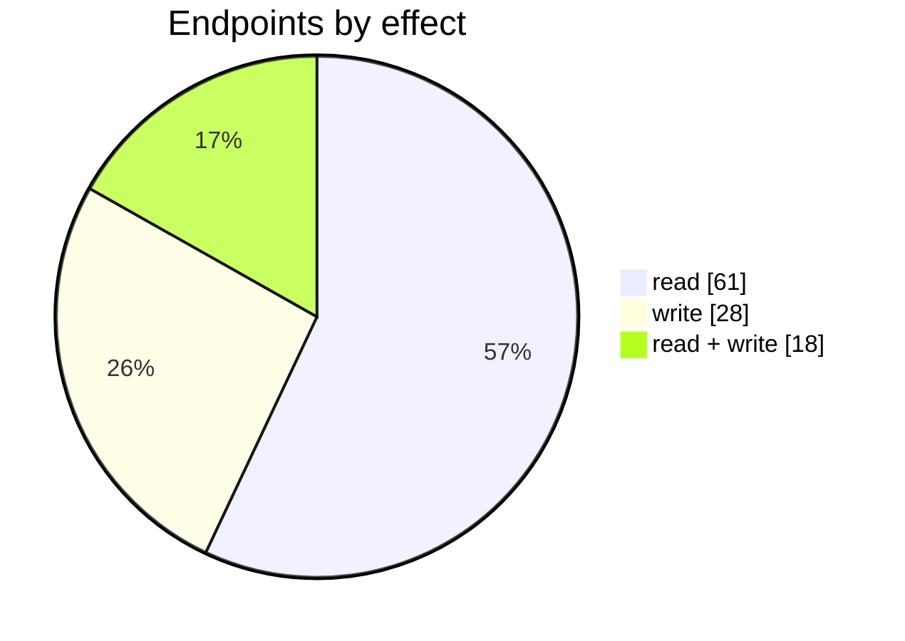
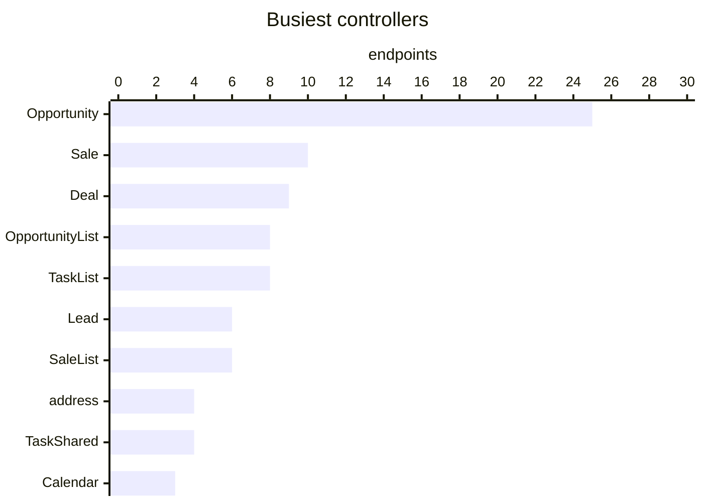
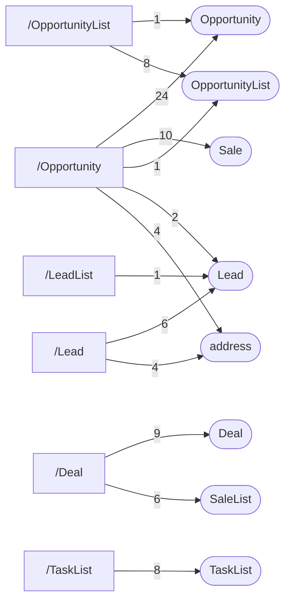

# CRM

Leads, opportunities, deals and tasks.

| 📄 Pages | 🧱 Models | 🔌 Endpoints | ✍️ Can write | 🌍 Public API |
|:-:|:-:|:-:|:-:|:-:|
| **6** | **61** + [shared](../00-shared/README.md) | **107** | 46 | **16** |

[📄 Pages (6)](#pages) · [🧱 Models (61)](#data-models) · [🔌 Endpoints (107)](#internal-endpoints) · [🌍 Public API (16)](#public-api-externalapiv2) · [🖼️ UI](UI.md) · [🗄️ schema.sql](schema.sql)

Pages (left) and the controllers they call (right), busiest 6 pages and 8 controllers; numbers are endpoints.

## Integration endpoints this module calls

Filed under their integration; listed here because pages in this module call them.

| Integration | Endpoints |
|---|---|
| [avalara](../12-integrations/avalara/README.md) | `/api/Avalara_Index_vTaxCodeList/TaxExemptionReason` |
| [quickbooks](../12-integrations/quickbooks/README.md) | `/api/Quickbooks_HasConsolidatedTranscations` |

## How to rebuild it

| # | Build | How |
|:-:|---|---|
| 1 | 🗄️ Schema | 61 tables from [`schema.sql`](schema.sql); GUID ids, join on `*ID` |
| 2 | 🔌 Internal API | Each controller's verbs · [contract](../../docs/INTERNAL-API.md) · paged `{root, total}` · saves `{ID, HasErrors, Original, Updated}` |
| 3 | 🖥️ Screens | Server-rendered shell + page app, record from `#<guid>` · [page model](../../docs/ARCHITECTURE.md#what-a-page-is) · every control in [UI.md](UI.md) |
| 4 | 🌍 Public API | 16 ops under `/ExternalApi/v2`, header auth · [contract](../../docs/PUBLIC-API.md) |

## Pages

| Route | Menu label | Title | Bundle | Endpoints (write) |
|---|---|---|---|---:|
| `/Deal` | Deal | Deal | `Deal2019` | 13 (7) |
| `/Lead` | Lead | Lead | `MultilingualSupport2019 LeadEdit2019` | 15 (6) |
| `/LeadList` | Leads | Leads | `LeadList2019` | 3 (3) |
| `/Opportunity` | Opportunity | Opportunity | `Opportunity2019` | 44 (21) |
| `/OpportunityList` | Opportunities | Opportunities | `OpportunityList2019` | 3 (5) |
| `/TaskList` | Tasks | Tasks | `TaskList2019` | 11 (7) |

## Data models

ExtJS models the pages use; `v` prefix = view-model. Full DDL in [`schema.sql`](schema.sql).

| Model | Fields |
|---|---|
| `AccountCurrency` | Code:string, Currency:string |
| `AvalaraSaleTaxCode` | Code:string, Name:string |
| `CalegoryModel` | id:string, name:string |
| `CustomerDefaultTemplate` | DefaultTemplateID:string, TemplateID:string, Type:string |
| `DealWrapper` | ID:int, HasErrors:bool |
| `FamilyOption` | value:string |
| `FamilyProduct` | ProductID:string, ProductCode:string, Name:string, UnitOfMeasure:string, Price:float, CostingMethod:string, RevenueAccount:string, DropShipMode:string, TaxRule:string, ImageID:string, NonInventory:bool |
| `GiftCardGlobalSettings` | GiftCardProductID:string, IsGiftCardEnabled:bool, DefaultGiftCardExpirationPeriod:string, CanGiftCardExpire:bool, GiftCardSaleTaxID:string, GiftProductName:string, GiftProductCode:string, GiftCardRevenueAccount:string, GiftCardRevenueAccountName:string, CanGiftCardRefund:bool |
| `JobCosting` | CustomerID:string, CustomerName:string, Comments:string, Contact:string, AddressLine1:string, AddressLine2:string, CustomerCurrency:string, Phone:string, PaymentTerm:string, TaxRuleID:string, DefaultSalesRepresentative:string, Discount:float, SalePriceTier:int, CreditLimit:float, SaleAccount:string, DefaultLocation:string |
| `LeadStatus` | Value:string, Name:string |
| `LeadStatusList` | StatusID:string, Name:string, IsKanban:bool, Position:int, PositionLocal:int |
| `LeadWrapper` | ID:int, HasErrors:bool |
| `LookupCarrierModel` | FakeID:string, CarrierCode:string, ServiceCode:string, Highlighted:bool, DisplayName:string |
| `NewvTenantContact` | ContactID:string, Name:string, Phone:string, Fax:string, Email:string, Website:string, Type:string, DefaultForType:bool, Comment:string |
| `Opportunity` | OpportunityID:string, CustomerID:string, LeadID:string, CustomerName:string, Contact:string, Phone:string, Email:string, DefaultAccount:string, BillingAddressLine1:string, BillingAddressLine2:string, Currency:string, TaxPercent:float, TaxInclusive:bool, TaxSchema:string, Discount:float, TermDays:int, TermMethod:int, Terms:string, PriceTier:int, ShippingAddressLine1:string, ShippingAddressLine2:string, OpportunityLocationID:string, OpportunityLocation:string, OpportunityNumber:string, OpportunityDate:date, OpportunityMemo:string, OpportunityComment:string, OpportunityStatus:string, CustomerRef… |
| `OpportunityReferenceData` | ID:int, DefaultTaxRule:string, DefaultAccountCode:string, ProductFamilyCount:int, DiscountCount:int, ChangePricesDiscountsPermission:string, HasPriceInfoAccess:bool, UndoPermission:string, VoidPermission:string, ApprovePermission:string, AddEditPermission:string, ConvertToSalePermission:string, CSVImportPermission:string, TasksViewPermission:string, CurrentAttributeSetId:string, EnableOpportunityApproval:bool, TaxCalculationMethod:string, DiscountCalculationMethod:string, HeadersVisible:bool, ForceHideLookup:bool, AttributeSetCopyFrom:string |
| `OpportunityWrapper` | ID:string, HasErrors:bool, DiscountsDesciption:string, HasAvalaraIntegration:bool, AvalaraTaxExemptionCode:string, Warnings:string, ConvertedSaleTaskID:string |
| `PickLocations` | FakeKey:string, ProductID:string, ProductCode:string, Name:string, UnitOfMeasure:string, LocationID:string, Location:string, CostingMethod:string, BatchSN:string, ExpiryDate:date, Available:float, ImageID:string, IsFirst:bool, NonInventory:bool |
| `RecurringFrequency` | Value:string, Name:string |
| `SaleQuoteLineUploadError` | ValidationState:string, ValidationText:string, Line:int, SKU:string, SKUError:string, Name:string, NameError:string, Comment:string, CommentError:string, Quantity:string, QuantityError:string, Price:string, PriceError:string, Discount:string, DiscountError:string |
| `ShipBox` | Box:string |
| `TaskCalendarSettingsModel` | FirstDayOfWeek:string, WeekendDays:string |
| `TaskReferenceData` | ID:int, UserName:string, UserID:string, TaskApprovalPermission:bool, TaskViewPermission:bool, ChangeAssigneePermission:bool, ViewAllTasksPermission:bool |
| `vCouponReport` | ID:string, SaleTaskID:string, SaleOrderDate:date, SaleOrderDateString:string, OrderNumber:string, CustomerName:string, TotalAmount:float, CouponCode:string, MaxRows:int, TT:int |
| `vCustomerAddress` | CustomerID:string, AddressID:string, Line1:string, Line2:string, CitySuburb:string, StateProvince:string, ZipPostCode:string, Country:string, Type:string, DefaultForType:bool |
| `vCustomerContact` | CustomerID:string, ContactID:string, Name:string, JobTitle:string, Phone:string, MobilePhone:string, Fax:string, Email:string, Website:string, IsDefault:bool, Comment:string |
| `vDeal` | ID:string, Name:string, DateFrom:date, DateTo:date, IsActive:bool, AllowCoupons:bool, SingleCouponCodeUsage:bool, CouponCodes:string, CustomersGroup:string, ValidationText:string, ValidationState:string |
| `vDealCustomer` | ID:string, CustomerID:string, CustomerName:string, DealID:string |
| `vDealCustomerTag` | ID:string, TagName:string, DealID:string |
| `vDealDiscount` | ID:string, DiscountID:string, DiscountName:string, DiscountType:string, DealID:string, ValidationText:string, ValidationState:string, Sequence:int, IsOrderLevel:bool, BuyType:string, BuyValue:decimal, BuyValueType:string, BuyMore:bool, GetType:string, GetValue:decimal, GetValueType:string |
| `vDealDiscountBrand` | ID:string, BrandID:string, BrandName:string, DealDiscountID:string, Type:string |
| `vDealDiscountCategory` | ID:string, CategoryID:string, CategoryName:string, DealDiscountID:string, Type:string |
| `vDealDiscountProduct` | ID:string, ProductID:string, ProductName:string, DealDiscountID:string, Type:string, IsFamily:bool |
| `vDealDiscountTag` | ID:string, TagName:string, DealDiscountID:string, Type:string |
| `vExpenseAccounts` | Code:string, DisplayName:string, Class:string, ForPayments:bool, Type:string |
| `vFulfillmentOrder` | ID:string, FFOrderId:string, ExternalOrderID:string, ConfigID:string, Date:date, SaleTaskID:string, Currency:string, SaleOrderNumber:string, Memo:string, Status:string, Source:string, CustomerName:string, ContactName:string, ContactPhone:string, AddressZipPostCode:string, AddressCountry:string, AddressStateProvince:string, AddressCitySuburb:string, AddressLine1:string, AddressLine2:string, ShippingMethod:string, CanBeCancelled:bool, ShipmentLineID:string |
| `vLead` | LeadID:string, LeadStatus:string, Name:string, Currency:string, Amount:float, SalesRepresentative:string, CloseChance:string, CloseDate:date, Comments:string, PriceTier:float, TermID:string, TaxSchema:string, ValidationText:string, ValidationState:string |
| `vLeadAddress` | Edit:string, FakeID:int, LeadID:string, AddressID:string, Line1:string, Line2:string, CitySuburb:string, StateProvince:string, ZipPostCode:string, Country:string, Type:string, DefaultForType:bool, TaxExemptionReasonCode:string, ValidationText:string, ValidationState:string |
| `vLeadContact` | Edit:string, FakeID:int, LeadID:string, ContactID:string, Name:string, Phone:string, Fax:string, Email:string, JobTitle:string, MobilePhone:string, Website:string, IsDefault:bool, Comment:string, IncludeInEmail:bool, ValidationText:string, ValidationState:string |
| `vLeadFile` | FileID:string, LeadID:string, FileName:string, ContentType:string, UserName:string, UploadedDate:date, ExternalDownloadLink:string, ExternalViewLink:string |
| `vLeadList` | Expand:string, LeadID:string, CustomerID:string, LeadStatus:string, Name:string, Contact:string, Phone:string, Mobile:string, Email:string, Website:string, Address:string, Currency:string, Amount:float, SalesRepresentative:string, SalesRepName:string, CloseChance:float, CloseDate:date, CreatedDate:date, Comments:string, PriceTier:int, TermID:string, TaxSchema:string, TaskCount:int, Edit:string |
| `vOpportunityAdditionalCharges` | FakeID:int, OpportunityID:string, ChargeID:string, Description:string, Quantity:float, Amount:float, Discount:float, TaxRule:string, Tax:float, Total:float, TaxPercent:float, LineOrder:int, RevenueAccount:string, ValidationText:string, ValidationState:string, Comment:string |
| `vOpportunityAllocations` | SaleCreditID:string, AllocationID:string, SalePaymentID:string, TaskID:string, Flag:bool |
| `vOpportunityAttachement` | OpportunityID:string, AttachementID:string, BlobGUID:string, ContentType:string, FileName:string, Date:date, UserName:string, IsProcessed:bool |
| `vOpportunityCreditWithDetails` | SaleCreditID:string, CustomerID:string, Currency:string, Amount:float, RemainingAmount:float, Account:string, Description:string, Date:date, AllocatedAmount:float, Selected:bool, ConvRate:float |
| `vOpportunityCredits` | SaleCreditID:string, CustomerID:string, CustomerName:string, Currency:string, Amount:float, RemainingAmount:float, Account:string, SourceLineID:string, CreditSourceTaskID:string, OrigTaskType:string, Type:string, Date:date |
| `vOpportunityLines` | FakeID:int, OpportunityID:string, OpportunityLineID:string, ProductID:string, Quantity:float, Price:float, Discount:float, Tax:float, Total:float, LineOrder:int, Name:string, UnitOfMeasure:string, ProductCode:string, AverageCost:float, CostingMethod:string, RevenueAccount:string, DropShipMode:string, TaxRule:string, TaxPercent:float, Comment:string, ImageID:string, ValidationText:string, ValidationState:string |
| `vOpportunity_Customer` | CustomerID:string, isLead:bool, Name:string, Currency:string, PaymentTerm:string, TaxRule:string, Comments:string, DefaultSalesRepresentative:string, AccountCode:string, DefaultLocation:string, Discount:float, DefaultCarrier:string, SalePriceTier:int, CreditLimit:float, AttributeSet:string |
| `vOpportunity_CustomerAddress` | CustomerID:string, AddressID:string, Line1:string, Line2:string, Type:string, DefaultForType:bool, Type:string, AddressLine1:string, AddressLine2:string, AddressCitySuburb:string, AddressStateProvince:string, AddressCountry:string, AddressZipPostCode:string, TaxExemptionReasonCode:string |
| `vOpportunity_CustomerContact` | CustomerID:string, ContactID:string, Name:string, IsDefault:bool, Phone:string, Email:string |
| `vOpportunity_TenantAddress` | AddressID:string, Line1:string, Line2:string, Type:string, DefaultForType:bool |
| `vSaleGiftCards` | ID:string, TaskID:string, GiftCardCode:string, InitialBalance:float, CurrentBalance:float, Date:date, ExpirationDate:date, RefundID:string |
| `vShippingLabelAttachment` | BlobGUID:string, TrackNumber:string |
| `vShippingRateOrLabelProvider` | ID:string, IsDefault:bool, Name:string, SupportsConsolidatedShipment:bool |
| `vTaskList` | Expand:string, TaskID:string, DueName:string, TaskCategoryID:string, TaskCategoryName:string, WorkflowID:string, UserID:string, AssignedToName:string, Name:string, Details:string, StartDate:date, EndDate:date, CompletedDate:date, Sequence:string, WorkflowProcessID:string, IsAllDay:bool, EntityType:string, EntityID:string, TaskStatus:string, LinkTo:string, Importance:bool, AssignedBy:string, AssignedByName:string, ApprovedBy:string, ApprovedByName:string, CreatedDate:date, IsCategoryPredefined:bool, Edit:string |
| `vTaskObserver` | ObserverID:string, TaskID:string, UserID:string, Name:string, IsMain:bool, CreatedDate:date |
| `vTenantCarrierWithShippingOptions` | CarrierID:string, Code:string, Description:string, ExternalService:string, IsDefault:bool |
| `vTenantHoliday` | HolidayID:string, Date:date, Description:string, Skip:bool |
| `vTenantPaymentTermNew` | TermID:string, Name:string, Days:int, Method:int, DueNextMonth:int, IsActive:bool, IsDefault:bool |
| `vTenantTaskSettings` | TenantID:string, IsActive:bool, ApprovalEnabled:bool, FirstDayOfWeek:int, WeekendDays:string |
| `vTenantUser` | TenantID:string, UserId:string, Email:string, IsOwner:bool, IsCurrentUser:bool, IsLockedOut:bool, IsPending:bool, IsPartner:bool, LastActivityDate:date, ValidationText:string, ValidationState:string, Roles:string, IsCoOwner:bool |

## Internal endpoints

Grouped by controller. Effect: 🟢 read · 🟠 read + write at the same URL · 🔴 write. `api` = JSON under `/api/`, `mvc` = controller action.

### address

| URL | Kind | Methods | Effect | Params | Body keys | Reader root |
|---|---|---|---|---|---|---|
| `/api/address` | api | REST(GET read; POST/PUT/DELETE on store.sync) | 🟢 read | CountryCode countryCode |  |  |
| `/api/address/country/code` | api | GET | 🟢 read |  |  |  |
| `/api/address/details` | api | GET | 🟢 read |  |  |  |
| `/api/address/hasAccess` | api | GET | 🟢 read |  |  |  |

### Calendar

| URL | Kind | Methods | Effect | Params | Body keys | Reader root |
|---|---|---|---|---|---|---|
| `/api/Calendar_Index_CalendarSettings` | api | REST(GET read; POST/PUT/DELETE on store.sync) | 🟢 read |  |  |  |
| `/api/Calendar_Index_ChangeTaskPeriod` | api |  | 🔴 write |  |  |  |
| `/api/Calendar_Index_vTask/Enlist` | api | GET | 🟢 read | endDate search showCompleted startDate taskCategoryID user |  |  |

### Cin7Capital

| URL | Kind | Methods | Effect | Params | Body keys | Reader root |
|---|---|---|---|---|---|---|
| `/Cin7Capital/GenerateConnectTokenForSalesList` | mvc | POST | 🔴 write |  |  |  |
| `/Cin7Capital/GenerateSessionToken` | mvc | POST | 🔴 write | idList |  |  |

### country

| URL | Kind | Methods | Effect | Params | Body keys | Reader root |
|---|---|---|---|---|---|---|
| `/api/country` | api | REST(GET read; POST/PUT/DELETE on store.sync) | 🟢 read |  |  |  |

### currency

| URL | Kind | Methods | Effect | Params | Body keys | Reader root |
|---|---|---|---|---|---|---|
| `/api/currency` | api | REST(GET read; POST/PUT/DELETE on store.sync) | 🟢 read |  |  |  |

### Deal

| URL | Kind | Methods | Effect | Params | Body keys | Reader root |
|---|---|---|---|---|---|---|
| `/api/Deal_Index_vBrand` | api |  | 🟢 read |  |  |  |
| `/api/Deal_Index_vCategory` | api |  | 🟢 read |  |  |  |
| `/api/Deal_Index_vCustomer` | api |  | 🟢 read |  |  |  |
| `/api/Deal_Index_vCustomerTag` | api |  | 🟢 read |  |  |  |
| `/api/Deal_Index_vDeal` | api | POST PUT REST(GET read; POST/PUT/DELETE on store.sync) | 🟠 read + write | id | ID |  |
| `/api/Deal_Index_vDiscount` | api |  | 🟢 read |  |  |  |
| `/api/Deal_Index_vProduct` | api |  | 🟢 read |  |  |  |
| `/api/Deal_Index_vSaleCoupon` | api | REST(GET read; POST/PUT/DELETE on store.sync) | 🟢 read | dealID lang search |  | root |
| `/api/Deal_Index_vTag` | api |  | 🟢 read |  |  |  |

### DefaultFieldValues

| URL | Kind | Methods | Effect | Params | Body keys | Reader root |
|---|---|---|---|---|---|---|
| `/api/DefaultFieldValues` | api | GET POST | 🟠 read + write | entityType |  |  |

### GetRate

| URL | Kind | Methods | Effect | Params | Body keys | Reader root |
|---|---|---|---|---|---|---|
| `/api/GetRate` | api | GET | 🟢 read | From |  |  |

### Home

| URL | Kind | Methods | Effect | Params | Body keys | Reader root |
|---|---|---|---|---|---|---|
| `/api/Home_Partner_vTenantUser` | api | REST(GET read; POST/PUT/DELETE on store.sync) | 🟢 read | valid |  |  |

### Lead

| URL | Kind | Methods | Effect | Params | Body keys | Reader root |
|---|---|---|---|---|---|---|
| `/Lead/CountrySpecific` | mvc |  | 🟢 read | Key |  |  |
| `/Lead/DownloadFile` | mvc |  | 🟢 read | id |  |  |
| `/Lead/Upload` | mvc | POST | 🔴 write |  |  |  |
| `/api/Lead_Index_ReferenceData` | api | POST REST(GET read; POST/PUT/DELETE on store.sync) | 🟢 read |  |  |  |
| `/api/Lead_Index_vLead` | api | POST PUT REST(GET read; POST/PUT/DELETE on store.sync) | 🟠 read + write | CountrySpecificKey id | HasErrors ID Original Updated |  |
| `/api/Lead_Index_vLeadFile` | api | REST(GET read; POST/PUT/DELETE on store.sync) | 🟠 read + write | LeadID |  |  |

### LeadList

| URL | Kind | Methods | Effect | Params | Body keys | Reader root |
|---|---|---|---|---|---|---|
| `/LeadList/BulkConvert` | mvc | POST | 🔴 write | leadIDs |  |  |
| `/LeadList/BulkDelete` | mvc | POST | 🔴 write | leadIDs |  |  |
| `/api/LeadList_Index_vLeadList` | api | REST(GET read; POST/PUT/DELETE on store.sync) | 🟢 read | endDate lang limit mode salerep search startDate status |  | root |

### LeadStatus

| URL | Kind | Methods | Effect | Params | Body keys | Reader root |
|---|---|---|---|---|---|---|
| `/LeadStatus/FullList` | mvc | REST(GET read; POST/PUT/DELETE on store.sync) | 🟢 read |  |  |  |
| `/LeadStatus/UpdateKanbanStatuses` | mvc | PUT | 🔴 write |  |  |  |

### MySubscription

| URL | Kind | Methods | Effect | Params | Body keys | Reader root |
|---|---|---|---|---|---|---|
| `/MySubscription/DetailsUpdate` | mvc | GET | 🔴 write |  |  |  |

### Opportunity

| URL | Kind | Methods | Effect | Params | Body keys | Reader root |
|---|---|---|---|---|---|---|
| `/Opportunity/Clone` | mvc | POST | 🔴 write |  |  |  |
| `/Opportunity/CloneAttachments` | mvc | POST | 🔴 write |  |  |  |
| `/Opportunity/ConvertTasks` | mvc | POST | 🔴 write |  |  |  |
| `/Opportunity/Download` | mvc | GET | 🟢 read | PrintEntityID PrintTemplateID |  |  |
| `/Opportunity/Print` | mvc | GET | 🟢 read (logs) | PrintEntityID PrintTemplateID |  |  |
| `/Opportunity/SetStatus` | mvc | POST | 🔴 write |  |  |  |
| `/Opportunity/Upload` | mvc | POST | 🔴 write |  |  |  |
| `/Opportunity/UploadOpportunityTemplate` | mvc | POST | 🔴 write |  |  |  |
| `/Opportunity/Void` | mvc | POST | 🔴 write | OpportunityID |  |  |
| `/api/Opportunity_Index_Category` | api | REST(GET read; POST/PUT/DELETE on store.sync) | 🟢 read |  |  |  |
| `/api/Opportunity_Index_Family` | api | REST(GET read; POST/PUT/DELETE on store.sync) | 🟢 read |  |  |  |
| `/api/Opportunity_Index_FamilyProducts` | api | REST(GET read; POST/PUT/DELETE on store.sync) | 🟢 read |  |  |  |
| `/api/Opportunity_Index_History` | api |  | 🟢 read |  |  |  |
| `/api/Opportunity_Index_Product` | api | REST(GET read; POST/PUT/DELETE on store.sync) | 🟢 read | TaskLocationID currencyRate customerID lang |  |  |
| `/api/Opportunity_Index_Service` | api | REST(GET read; POST/PUT/DELETE on store.sync) | 🟢 read |  |  |  |
| `/api/Opportunity_Index_WorkflowHistory` | api | REST(GET read; POST/PUT/DELETE on store.sync) | 🟢 read | entityID |  |  |
| `/api/Opportunity_Index_vCustomer` | api | REST(GET read; POST/PUT/DELETE on store.sync) | 🟠 read + write |  |  |  |
| `/api/Opportunity_Index_vCustomerAddress` | api | REST(GET read; POST/PUT/DELETE on store.sync) | 🟠 read + write | isForLead |  |  |
| `/api/Opportunity_Index_vCustomerContact` | api | REST(GET read; POST/PUT/DELETE on store.sync) | 🟠 read + write | isForLead |  |  |
| `/api/Opportunity_Index_vOpportunity` | api | POST PUT REST(GET read; POST/PUT/DELETE on store.sync) | 🟠 read + write | id lang | ConvertedSaleTaskID DiscountsDescription HasErrors ID Original Updated |  |
| `/api/Opportunity_Index_vOpportunityAttachement` | api | REST(GET read; POST/PUT/DELETE on store.sync) | 🟠 read + write | OpportunityID |  |  |
| `/api/Opportunity_Index_vOpportunity_Customer` | api | REST(GET read; POST/PUT/DELETE on store.sync) | 🟢 read | CountrySpecificKey Name lang |  |  |
| `/api/Opportunity_Index_vOpportunity_Customer/Customer` | api | GET | 🟢 read | name |  |  |
| `/api/Opportunity_Index_vOpportunity_CustomerAddress` | api | REST(GET read; POST/PUT/DELETE on store.sync) | 🟠 read + write | CustomerID isLead |  |  |
| `/api/Opportunity_Index_vOpportunity_CustomerContact` | api | REST(GET read; POST/PUT/DELETE on store.sync) | 🟢 read | CustomerID isLead |  |  |

### OpportunityList

| URL | Kind | Methods | Effect | Params | Body keys | Reader root |
|---|---|---|---|---|---|---|
| `/OpportunityList/GetTemplates` | mvc | REST(GET read; POST/PUT/DELETE on store.sync) | 🟢 read |  |  |  |
| `/OpportunityList/Import` | mvc | GET(navigate) | 🔴 write |  |  |  |
| `/OpportunityList/Print` | mvc | POST | 🟢 read (logs) | IDList TemplateID |  |  |
| `/OpportunityList/Undo` | mvc | POST | 🔴 write | opportunityIDs |  |  |
| `/OpportunityList/Void` | mvc | POST | 🔴 write | opportunityIDs |  |  |
| `/api/OpportunityList_BulkActions` | api | POST | 🔴 write | Action CaptchaToken ID TemplateID lang |  |  |
| `/api/OpportunityList_Index_vOpportunity` | api |  | 🟢 read |  |  |  |
| `/api/OpportunityList_Index_vTenantContact` | api | REST(GET read; POST/PUT/DELETE on store.sync) | 🟢 read |  |  |  |

### Product

| URL | Kind | Methods | Effect | Params | Body keys | Reader root |
|---|---|---|---|---|---|---|
| `/api/Product_GetAutogenerationFlag` | api | REST(GET read; POST/PUT/DELETE on store.sync) | 🟢 read |  |  |  |

### Sale

| URL | Kind | Methods | Effect | Params | Body keys | Reader root |
|---|---|---|---|---|---|---|
| `/api/Sale_Index_Category` | api | REST(GET read; POST/PUT/DELETE on store.sync) | 🟢 read |  |  |  |
| `/api/Sale_Index_Coupon` | api | GET POST PUT | 🟠 read + write | taskID |  |  |
| `/api/Sale_Index_GiftCard` | api | GET POST | 🟢 read |  |  |  |
| `/api/Sale_Index_LookupCarrier` | api | REST(GET read; POST/PUT/DELETE on store.sync) | 🟢 read | ShippingServiceID carrierCode jsonData serviceCode shippingServiceID |  |  |
| `/api/Sale_Index_PriceRequest` | api | POST | 🔴 write |  |  |  |
| `/api/Sale_Index_Product` | api | REST(GET read; POST/PUT/DELETE on store.sync) | 🟠 read + write | TaskLocationID currencyRate customerID lang |  |  |
| `/api/Sale_Index_vChartOfAccountsExpense` | api | REST(GET read; POST/PUT/DELETE on store.sync) | 🟢 read |  |  |  |
| `/api/Sale_Index_vSaleTask` | api | POST PUT REST(GET read; POST/PUT/DELETE on store.sync) | 🟠 read + write | CountrySpecificKey id lang | AvalaraTaxExemptionCode DiscountsDescription HasErrors Original SuppressTransactions Updated |  |
| `/api/Sale_Index_vSupplier` | api | REST(GET read; POST/PUT/DELETE on store.sync) | 🟢 read |  |  |  |
| `/api/Sale_Index_vTenantContact` | api | REST(GET read; POST/PUT/DELETE on store.sync) | 🟠 read + write |  |  |  |

### SaleList

| URL | Kind | Methods | Effect | Params | Body keys | Reader root |
|---|---|---|---|---|---|---|
| `/SaleList/Print` | mvc | POST | 🟢 read (logs) | IDList TemplateID |  |  |
| `/SaleList/PrintCombined` | mvc | POST | 🟢 read (logs) | IDList SortBy TemplateID |  |  |
| `/SaleList/ScheduleForPicking` | mvc | POST | 🔴 write | IDList |  |  |
| `/SaleList/SetSalePicker` | mvc | POST | 🔴 write | IDList SalePicker |  |  |
| `/SaleList/UnscheduleForPicking` | mvc | POST | 🔴 write | IDList |  |  |
| `/api/SaleList_Index_UndoVoidAccess` | api | GET | 🟢 read |  |  |  |

### SaleListBulkAction

| URL | Kind | Methods | Effect | Params | Body keys | Reader root |
|---|---|---|---|---|---|---|
| `/api/SaleListBulkAction` | api | POST | 🔴 write | Action CaptchaToken ID TemplateID lang |  |  |

### SaleService

| URL | Kind | Methods | Effect | Params | Body keys | Reader root |
|---|---|---|---|---|---|---|
| `/api/SaleService_Index_GetOrderTotalDiscountProduct` | api | POST | 🟢 read |  |  |  |

### SaleStatements

| URL | Kind | Methods | Effect | Params | Body keys | Reader root |
|---|---|---|---|---|---|---|
| `/api/SaleStatements_Index_ReportTemplates` | api | REST(GET read; POST/PUT/DELETE on store.sync) | 🟢 read |  |  |  |

### Task

| URL | Kind | Methods | Effect | Params | Body keys | Reader root |
|---|---|---|---|---|---|---|
| `/Task/Clone` | mvc | POST | 🔴 write | sourceID |  |  |

### TaskList

| URL | Kind | Methods | Effect | Params | Body keys | Reader root |
|---|---|---|---|---|---|---|
| `/TaskList/AddObserver` | mvc | POST | 🔴 write | taskIDs userId userName |  |  |
| `/TaskList/Print` | mvc | POST | 🟢 read (logs) | IDList TemplateID dateFrom dateTo |  |  |
| `/TaskList/Send` | mvc | POST | 🔴 write | Action IDList TemplateID captchaToken dateFrom dateTo |  |  |
| `/api/TaskList_Board_vTaskList` | api | REST(GET read; POST/PUT/DELETE on store.sync) | 🟢 read | lang limit search showCompleted status user |  | root |
| `/api/TaskList_Index_ReferenceData` | api | REST(GET read; POST/PUT/DELETE on store.sync) | 🟢 read |  |  |  |
| `/api/TaskList_Index_vTaskJson` | api |  | 🟢 read |  |  |  |
| `/api/TaskList_Index_vTaskList` | api | REST(GET read; POST/PUT/DELETE on store.sync) | 🟠 read + write | endDate importantOnly lang search startDate status user |  | root |
| `/api/TaskList_vTaskObserverList` | api | REST(GET read; POST/PUT/DELETE on store.sync) | 🟢 read | id |  |  |

### TaskShared

| URL | Kind | Methods | Effect | Params | Body keys | Reader root |
|---|---|---|---|---|---|---|
| `/api/TaskShared_TaskList_vTask` | api |  | 🟢 read |  |  |  |
| `/api/TaskShared_Workflow_WorkflowProcess` | api | DELETE | 🔴 write | id |  |  |
| `/api/TaskShared_Workflow_vWorkflow` | api |  | 🟢 read |  |  |  |
| `/api/TaskShared_vTaskCategory` | api | REST(GET read; POST/PUT/DELETE on store.sync) | 🟢 read | name page userID |  | Result |

### TenantAccessToFeatures

| URL | Kind | Methods | Effect | Params | Body keys | Reader root |
|---|---|---|---|---|---|---|
| `/api/TenantAccessToFeatures` | api | GET POST | 🟠 read + write |  |  |  |

### TenantAttributeSet

| URL | Kind | Methods | Effect | Params | Body keys | Reader root |
|---|---|---|---|---|---|---|
| `/api/TenantAttributeSet_Index_vTenantAttributeSet/GetCopyFrom` | api | GET | 🟢 read | entityID entityType fromID id |  |  |

### TenantGeneralSettings

| URL | Kind | Methods | Effect | Params | Body keys | Reader root |
|---|---|---|---|---|---|---|
| `/api/TenantGeneralSettings_Index_vMultilingualSupport` | api | REST(GET read; POST/PUT/DELETE on store.sync) | 🟠 read + write | newItem |  |  |
| `/api/TenantGeneralSettings_Index_vMultilingualSupportAccess` | api |  | 🟢 read |  |  |  |
| `/api/TenantGeneralSettings_Index_vTenant/short` | api | GET | 🟢 read |  |  |  |

### TenantPaymentTerm

| URL | Kind | Methods | Effect | Params | Body keys | Reader root |
|---|---|---|---|---|---|---|
| `/api/TenantPaymentTerm_Index_vTenantPaymentTerm` | api | DELETE REST(GET read; POST/PUT/DELETE on store.sync) | 🟠 read + write | id |  |  |

## Public API (`/ExternalApi/v2`)

Fields, parameters and body shapes: [CRM](../20-public-api/groups/crm.md).

| Group | Method | Path | Query / params |
|---|---|---|---|
| CRM | GET | `/crm/lead` | Page,Limit,ID,Name,ModifiedSince |
| CRM | POST | `/crm/lead` |  |
| CRM | PUT | `/crm/lead` |  |
| CRM | GET | `/crm/opportunity` | Page,Limit,ID,ModifiedSince |
| CRM | POST | `/crm/opportunity` |  |
| CRM | PUT | `/crm/opportunity` |  |
| CRM | GET | `/crm/task` | Page,Limit,ID,Name,StartDateFrom,StartDateTo,EndDateFrom,EndDateTo,CompleteDateFrom,CompleteDateTo,AssignedTo,Category |
| CRM | GET | `/crm/task` | Page,Limit,ID,Name |
| CRM | GET | `/crm/task` | Page,Limit,ID,Name |
| CRM | POST | `/crm/task` |  |
| CRM | PUT | `/crm/task` |  |
| CRM | POST | `/crm/taskcategory` |  |
| CRM | PUT | `/crm/taskcategory` |  |
| CRM | POST | `/crm/workflow` |  |
| CRM | PUT | `/crm/workflow` |  |
| CRM | POST | `/crm/workflowstart` | ID,Name,StartDate,EnityType,EntityID |
