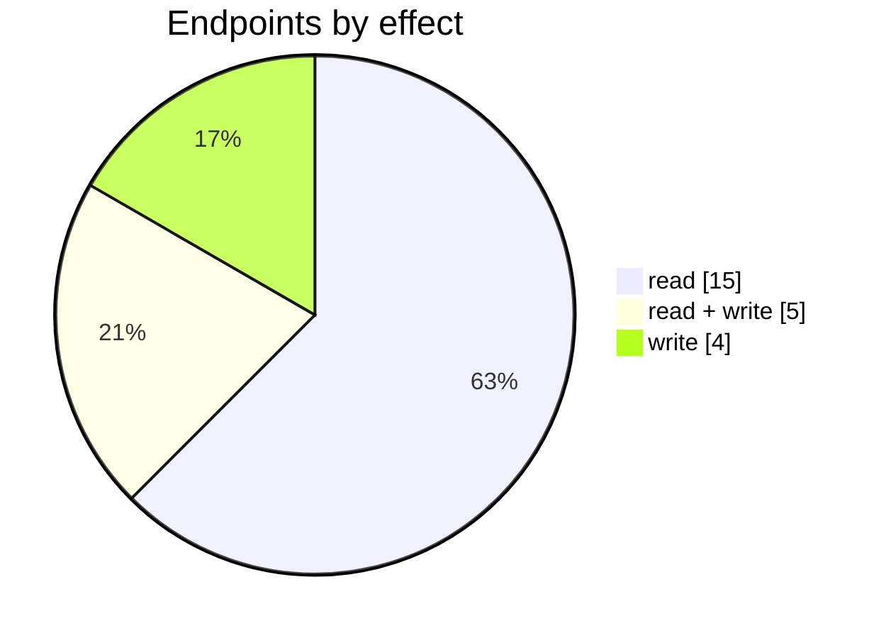
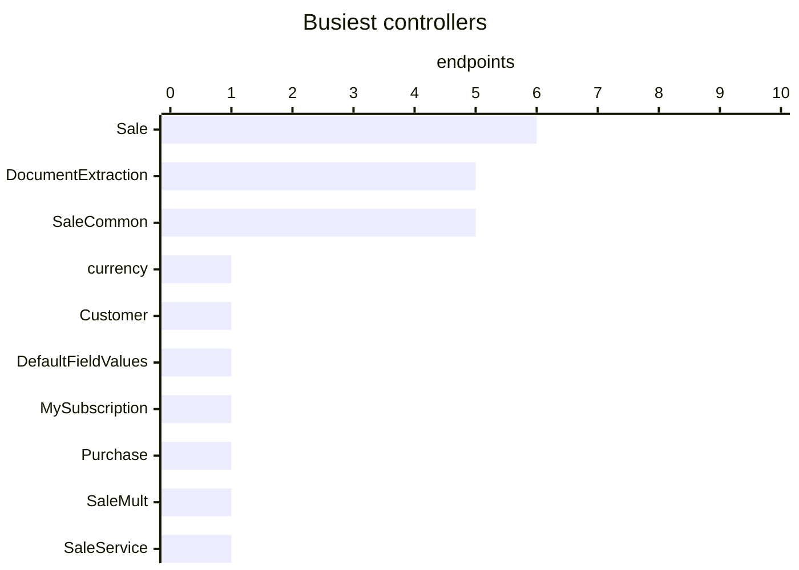
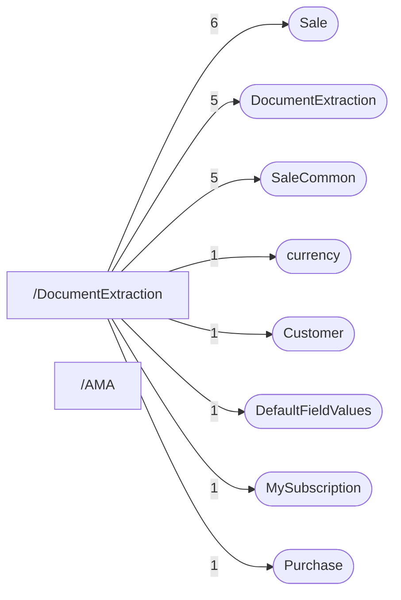

# AI

Ask AI (`/AMA`), document data extraction (upload a supplier document, get a purchase back) and generated product descriptions.

| 📄 Pages | 🧱 Models | 🔌 Endpoints | ✍️ Can write | 🌍 Public API |
|:-:|:-:|:-:|:-:|:-:|
| **2** | **7** + [shared](../00-shared/README.md) | **24** | 9 | **0** |

[📄 Pages (2)](#pages) · [🧱 Models (7)](#data-models) · [🔌 Endpoints (24)](#internal-endpoints) · [🖼️ UI](UI.md) · [🗄️ schema.sql](schema.sql)

Pages (left) and the controllers they call (right), busiest 2 pages and 8 controllers; numbers are endpoints.

## Integration endpoints this module calls

Filed under their integration; listed here because pages in this module call them.

| Integration | Endpoints |
|---|---|
| [avalara](../12-integrations/avalara/README.md) | `/api/Avalara_Index_vTaxCodeList/TaxExemptionReason` |

## How to rebuild it

| # | Build | How |
|:-:|---|---|
| 1 | 🗄️ Schema | 7 tables from [`schema.sql`](schema.sql); GUID ids, join on `*ID` |
| 2 | 🔌 Internal API | Each controller's verbs · [contract](../../docs/INTERNAL-API.md) · paged `{root, total}` · saves `{ID, HasErrors, Original, Updated}` |
| 3 | 🖥️ Screens | Server-rendered shell + page app, record from `#<guid>` · [page model](../../docs/ARCHITECTURE.md#what-a-page-is) · every control in [UI.md](UI.md) |

## Pages

| Route | Menu label | Title | Bundle | Endpoints (write) |
|---|---|---|---|---:|
| `/AMA` | Ask AI | Ask Me Anything ~ | `` | 0 (0) |
| `/DocumentExtraction` | Document data extraction | Document data extraction | `DocumentExtraction2024` | 22 (9) |

## Data models

ExtJS models the pages use; `v` prefix = view-model. Full DDL in [`schema.sql`](schema.sql).

| Model | Fields |
|---|---|
| `AvalaraSaleTaxCode` | Code:string, Name:string |
| `GiftCardGlobalSettings` | GiftCardProductID:string, IsGiftCardEnabled:bool, DefaultGiftCardExpirationPeriod:string, CanGiftCardExpire:bool, GiftCardSaleTaxID:string, GiftProductName:string, GiftProductCode:string, GiftCardRevenueAccount:string, GiftCardRevenueAccountName:string, CanGiftCardRefund:bool |
| `spTaskImportLogEntry` | ID:string, Date:date, DocumentName:string, Comment:string, UserName:string |
| `vCustomerParent` | CustomerID:string, Name:string |
| `vExtractedDocument` | DocumentName:string, Status:string, StatusDescription:string, DateCreated:date, EntityID:string |
| `vSaleGiftCards` | ID:string, TaskID:string, GiftCardCode:string, InitialBalance:float, CurrentBalance:float, Date:date, ExpirationDate:date, RefundID:string |
| `vShippingManifestAttachment` | BlobGUID:string, TrackNumber:string |

## Internal endpoints

Grouped by controller. Effect: 🟢 read · 🟠 read + write at the same URL · 🔴 write. `api` = JSON under `/api/`, `mvc` = controller action.

### currency

| URL | Kind | Methods | Effect | Params | Body keys | Reader root |
|---|---|---|---|---|---|---|
| `/api/currency` | api | REST(GET read; POST/PUT/DELETE on store.sync) | 🟢 read |  |  |  |

### Customer

| URL | Kind | Methods | Effect | Params | Body keys | Reader root |
|---|---|---|---|---|---|---|
| `/api/Customer_Index_ReferenceData` | api | REST(GET read; POST/PUT/DELETE on store.sync) | 🟢 read |  |  |  |

### DefaultFieldValues

| URL | Kind | Methods | Effect | Params | Body keys | Reader root |
|---|---|---|---|---|---|---|
| `/api/DefaultFieldValues` | api | GET POST | 🟠 read + write | entityType |  |  |

### DocumentExtraction

| URL | Kind | Methods | Effect | Params | Body keys | Reader root |
|---|---|---|---|---|---|---|
| `/DocumentExtraction/Upload` | mvc |  | 🔴 write |  |  |  |
| `/api/DocumentExtraction_BuildEntity` | api | POST | 🔴 write |  |  |  |
| `/api/DocumentExtraction_Index_LogEntries` | api | REST(GET read; POST/PUT/DELETE on store.sync) | 🟠 read + write |  |  | root |
| `/api/DocumentExtraction_Index_MapExtractedDocument` | api | GET | 🟢 read | entityID entityType |  |  |
| `/api/DocumentExtraction_Index_vExtractedDocument` | api |  | 🟢 read |  |  |  |

### MySubscription

| URL | Kind | Methods | Effect | Params | Body keys | Reader root |
|---|---|---|---|---|---|---|
| `/MySubscription/DetailsUpdate` | mvc | GET | 🔴 write |  |  |  |

### Purchase

| URL | Kind | Methods | Effect | Params | Body keys | Reader root |
|---|---|---|---|---|---|---|
| `/api/Purchase_DocumentExtraction` | api | POST PUT | 🔴 write |  |  |  |

### Sale

| URL | Kind | Methods | Effect | Params | Body keys | Reader root |
|---|---|---|---|---|---|---|
| `/api/Sale_Index_Coupon` | api | GET POST PUT | 🟠 read + write | taskID |  |  |
| `/api/Sale_Index_GiftCard` | api | GET POST | 🟢 read |  |  |  |
| `/api/Sale_Index_vCustomer` | api | REST(GET read; POST/PUT/DELETE on store.sync) | 🟠 read + write |  |  |  |
| `/api/Sale_Index_vCustomerParent` | api | REST(GET read; POST/PUT/DELETE on store.sync) | 🟢 read |  |  | root |
| `/api/Sale_Index_vSale_Customer` | api | REST(GET read; POST/PUT/DELETE on store.sync) | 🟢 read | CountrySpecificKey Name lang |  |  |
| `/api/Sale_Index_vShippingManifestAttachment` | api |  | 🟢 read |  |  |  |

### SaleCommon

| URL | Kind | Methods | Effect | Params | Body keys | Reader root |
|---|---|---|---|---|---|---|
| `/api/SaleCommon_GetAvailableLocations` | api | REST(GET read; POST/PUT/DELETE on store.sync) | 🟢 read | withBins |  |  |
| `/api/SaleCommon_RelatedTasks` | api | GET REST(GET read; POST/PUT/DELETE on store.sync) | 🟢 read | taskId |  | root |
| `/api/SaleCommon_TaxRules/purchase` | api | GET | 🟢 read |  |  |  |
| `/api/SaleCommon_TaxRules/sale` | api | REST(GET read; POST/PUT/DELETE on store.sync) | 🟢 read |  |  |  |
| `/api/SaleCommon_TaxRules/saleAll` | api | GET | 🟢 read |  |  |  |

### SaleMult

| URL | Kind | Methods | Effect | Params | Body keys | Reader root |
|---|---|---|---|---|---|---|
| `/api/SaleMult_Index_vShippingManifestAttachment` | api |  | 🟢 read |  |  |  |

### SaleService

| URL | Kind | Methods | Effect | Params | Body keys | Reader root |
|---|---|---|---|---|---|---|
| `/SaleService/CountrySpecific` | mvc |  | 🟢 read | Key |  |  |

### TenantAccessToFeatures

| URL | Kind | Methods | Effect | Params | Body keys | Reader root |
|---|---|---|---|---|---|---|
| `/api/TenantAccessToFeatures` | api | GET POST | 🟠 read + write |  |  |  |
