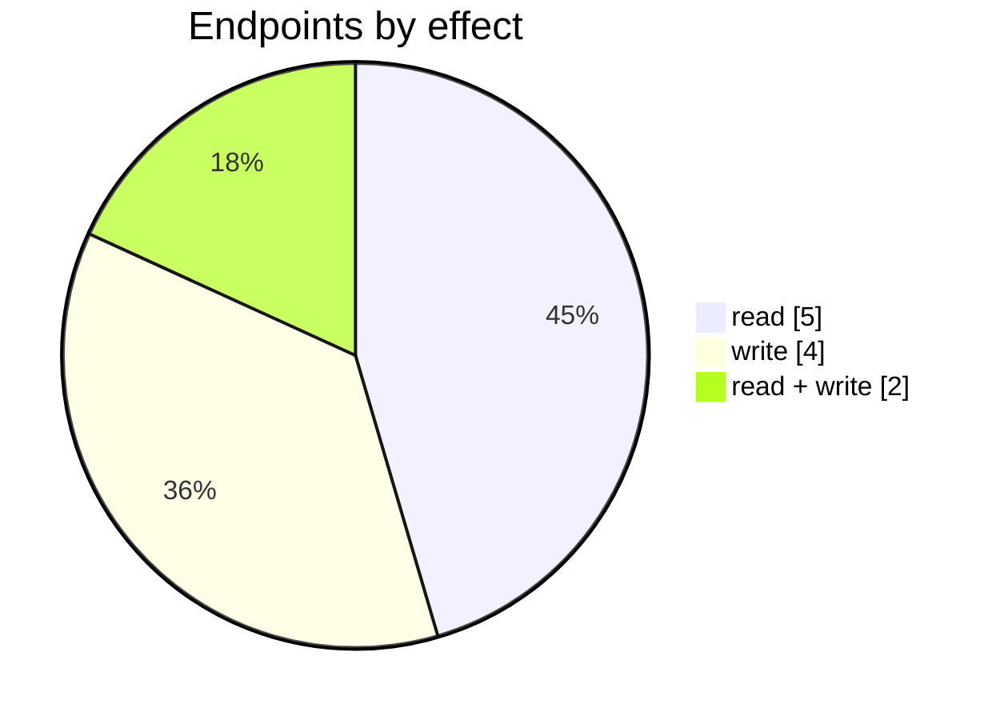
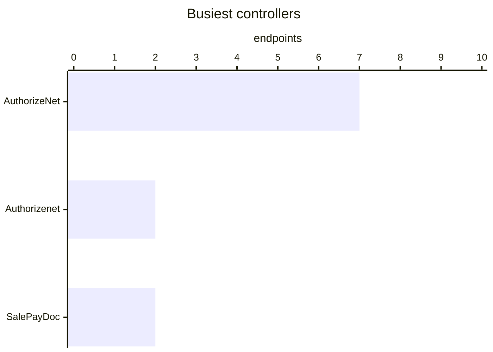

# AuthorizeNet

The AuthorizeNet connector: its settings page, mappings, logs and the endpoints behind them. Part of [Integrations](../README.md).

| 📄 Pages | 🧱 Models | 🔌 Endpoints | ✍️ Can write | 🌍 Public API |
|:-:|:-:|:-:|:-:|:-:|
| **1** | **2** + [shared](../../00-shared/README.md) | **11** | 6 | **0** |

[📄 Pages (1)](#pages) · [🧱 Models (2)](#data-models) · [🔌 Endpoints (11)](#internal-endpoints) · [🖼️ UI](UI.md) · [🗄️ schema.sql](schema.sql)

## How to rebuild it

| # | Build | How |
|:-:|---|---|
| 1 | 🗄️ Schema | 2 tables from [`schema.sql`](schema.sql); GUID ids, join on `*ID` |
| 2 | 🔌 Internal API | Each controller's verbs · [contract](../../../docs/INTERNAL-API.md) · paged `{root, total}` · saves `{ID, HasErrors, Original, Updated}` |
| 3 | 🖥️ Screens | Server-rendered shell + page app, record from `#<guid>` · [page model](../../../docs/ARCHITECTURE.md#what-a-page-is) · every control in [UI.md](UI.md) |

## Pages

| Route | Menu label | Title | Bundle | Endpoints (write) |
|---|---|---|---|---:|
| `/AuthorizeNet` |  | AuthorizeNet | `AuthorizeNet2019` | 4 (6) |

## Data models

ExtJS models the pages use; `v` prefix = view-model. Full DDL in [`schema.sql`](schema.sql).

| Model | Fields |
|---|---|
| `AuthorizeNetPaymentLogEntry` | Id:string, SaleTaskId:string, PaymentId:string, Amount:float, AccountCode:string, AccountName:string, Currency:string, SaleInvoiceNumber:string, StatusText:string, AuthorizeNetPaymentId:string, IsTestMode:boolean, InitTime:date, LastUpdateTime:date |
| `vAccount` | Code:string, DisplayName:string |

## Internal endpoints

Grouped by controller. Effect: 🟢 read · 🟠 read + write at the same URL · 🔴 write. `api` = JSON under `/api/`, `mvc` = controller action.

### AuthorizeNet

| URL | Kind | Methods | Effect | Params | Body keys | Reader root |
|---|---|---|---|---|---|---|
| `/AuthorizeNet/GetTokenForManageCustomer` | mvc | GET | 🟢 read | authorizeNetProfileId doc |  |  |
| `/AuthorizeNet/Pay` | mvc |  | 🔴 write | doc |  |  |
| `/AuthorizeNet/PrepareAuthorizeNetSession` | mvc | GET | 🔴 write | amount authorizeNetProfileId doc saveCustomer |  |  |
| `/api/AuthorizeNet_Index_Dashboard_Summary` | api | GET | 🟢 read |  |  |  |
| `/api/AuthorizeNet_Index_LogEntries` | api | REST(GET read; POST/PUT/DELETE on store.sync) | 🟠 read + write |  |  | root |
| `/api/AuthorizeNet_Index_vAccounts` | api | REST(GET read; POST/PUT/DELETE on store.sync) | 🟠 read + write |  |  |  |
| `/api/AuthorizeNet_PayDoc_Page` | api |  | 🟢 read | doc |  |  |

### Authorizenet

| URL | Kind | Methods | Effect | Params | Body keys | Reader root |
|---|---|---|---|---|---|---|
| `/Authorizenet/Disconnect` | mvc | POST | 🔴 write |  |  |  |
| `/Authorizenet/SaveSettings` | mvc | POST | 🔴 write |  |  |  |

### SalePayDoc

| URL | Kind | Methods | Effect | Params | Body keys | Reader root |
|---|---|---|---|---|---|---|
| `/SalePayDoc/GetCsv` | mvc | GET(navigate) | 🟢 read | doc |  |  |
| `/SalePayDoc/GetPdf` | mvc | GET(navigate) | 🟢 read | doc |  |  |
