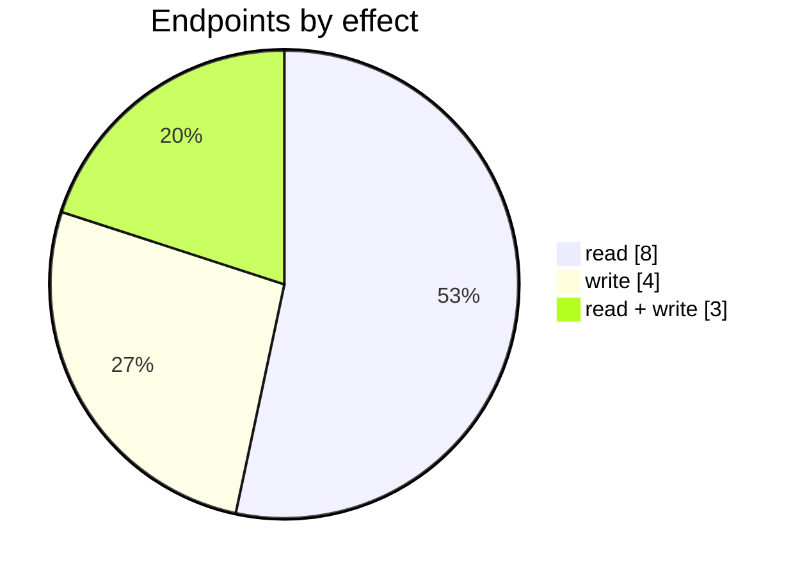

# Avalara

The Avalara connector: its settings page, mappings, logs and the endpoints behind them. Part of [Integrations](../README.md).

| 📄 Pages | 🧱 Models | 🔌 Endpoints | ✍️ Can write | 🌍 Public API |
|:-:|:-:|:-:|:-:|:-:|
| **1** | **8** + [shared](../../00-shared/README.md) | **15** | 7 | **0** |

[📄 Pages (1)](#pages) · [🧱 Models (8)](#data-models) · [🔌 Endpoints (15)](#internal-endpoints) · [🖼️ UI](UI.md) · [🗄️ schema.sql](schema.sql)

## How to rebuild it

| # | Build | How |
|:-:|---|---|
| 1 | 🗄️ Schema | 8 tables from [`schema.sql`](schema.sql); GUID ids, join on `*ID` |
| 2 | 🔌 Internal API | Each controller's verbs · [contract](../../../docs/INTERNAL-API.md) · paged `{root, total}` · saves `{ID, HasErrors, Original, Updated}` |
| 3 | 🖥️ Screens | Server-rendered shell + page app, record from `#<guid>` · [page model](../../../docs/ARCHITECTURE.md#what-a-page-is) · every control in [UI.md](UI.md) |

## Pages

| Route | Menu label | Title | Bundle | Endpoints (write) |
|---|---|---|---|---:|
| `/Avalara` |  | Avalara | `Avalara2019` | 12 (7) |

## Data models

ExtJS models the pages use; `v` prefix = view-model. Full DDL in [`schema.sql`](schema.sql).

| Model | Fields |
|---|---|
| `AvalaraCompany` | CompanyCode:string, Name:string |
| `AvalaraTaxCode` | Code:string, Name:string |
| `vAvalaraCustomerData` | Id:int, CustomerID:string, CustomerName:string, AvalaraCustomerID:int, AvalaraCustomerName:string, IsLinked:boolean, Selected:boolean |
| `vAvalaraCustomerLookup` | CustomerID:string, Name:string, IsDisplay:boolean |
| `vMailingList` | MailingListID:string, Name:string, Emails:string, ValidationText:string, ValidationState:string |
| `vProductTaxCode` | Type:string, ProductID:string, ProductCode:string, ProductName:string, AvalaraTaxCode:string, AvalaraTaxName:string |
| `vSyncEntry` | SaleTaskID:string, Type:string, DateSynchronised:date, DateCreated:date, Status:string, Error:string, SaleOrderNumber:string, InvoiceNumber:string, CreditNoteNumber:string, InvoiceDate:date, SaleOrderDate:date, CustomerID:string, CustomerName:string, ControllerName:string |
| `vTenantAddress` | AddressID:string, Line1:string, Line2:string, CitySuburb:string, StateProvince:string, ZipPostCode:string, Country:string, Type:string, DefaultForType:bool |

## Internal endpoints

Grouped by controller. Effect: 🟢 read · 🟠 read + write at the same URL · 🔴 write. `api` = JSON under `/api/`, `mvc` = controller action.

### Avalara

| URL | Kind | Methods | Effect | Params | Body keys | Reader root |
|---|---|---|---|---|---|---|
| `/Avalara/CheckAvalaraAddresses` | mvc | POST | 🟢 read |  |  |  |
| `/api/Avalara_Index_CustomerDataList` | api | REST(GET read; POST/PUT/DELETE on store.sync) | 🟢 read |  |  | root |
| `/api/Avalara_Index_CustomerDataList/ApplyLink` | api | POST | 🔴 write |  |  |  |
| `/api/Avalara_Index_CustomerDataList/AutoLinkByCustomerName` | api | POST | 🔴 write |  |  |  |
| `/api/Avalara_Index_CustomerDataList/Customers` | api | REST(GET read; POST/PUT/DELETE on store.sync) | 🟢 read |  |  |  |
| `/api/Avalara_Index_CustomerDataList/LoadFromAvalara` | api | POST | 🔴 write |  |  |  |
| `/api/Avalara_Index_LicenseKey` | api | POST | 🔴 write |  |  |  |
| `/api/Avalara_Index_vCompany` | api | REST(GET read; POST/PUT/DELETE on store.sync) | 🟢 read |  |  | root |
| `/api/Avalara_Index_vMailingList` | api | REST(GET read; POST/PUT/DELETE on store.sync) | 🟠 read + write |  |  | root |
| `/api/Avalara_Index_vProductsTaxCodeList` | api | POST REST(GET read; POST/PUT/DELETE on store.sync) | 🟢 read |  |  | root |
| `/api/Avalara_Index_vSyncEntries` | api | REST(GET read; POST/PUT/DELETE on store.sync) | 🟠 read + write |  |  | root |
| `/api/Avalara_Index_vTaxCodeList` | api | REST(GET read; POST/PUT/DELETE on store.sync) | 🟢 read |  |  | root |
| `/api/Avalara_Index_vTaxCodeList/TaxExemptionReason` | api | REST(GET read; POST/PUT/DELETE on store.sync) | 🟢 read |  |  |  |
| `/api/Avalara_Index_vTaxCodeList/hasintegration` | api | GET | 🟢 read |  |  |  |

### TenantAddress

| URL | Kind | Methods | Effect | Params | Body keys | Reader root |
|---|---|---|---|---|---|---|
| `/api/TenantAddress_Index_vTenantAddress` | api | REST(GET read; POST/PUT/DELETE on store.sync) | 🟠 read + write |  |  |  |
