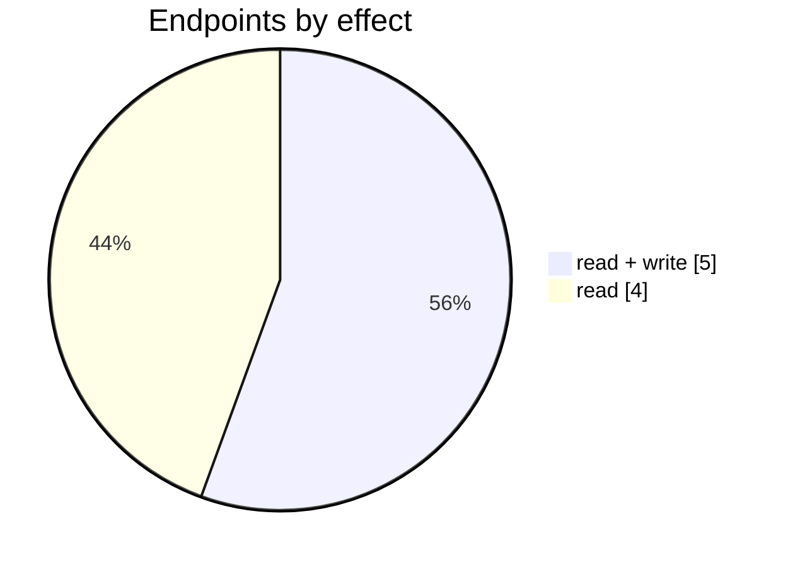

# Capsule

The Capsule connector: its settings page, mappings, logs and the endpoints behind them. Part of [Integrations](../README.md).

| 📄 Pages | 🧱 Models | 🔌 Endpoints | ✍️ Can write | 🌍 Public API |
|:-:|:-:|:-:|:-:|:-:|
| **1** | **7** + [shared](../../00-shared/README.md) | **9** | 5 | **0** |

[📄 Pages (1)](#pages) · [🧱 Models (7)](#data-models) · [🔌 Endpoints (9)](#internal-endpoints) · [🖼️ UI](UI.md) · [🗄️ schema.sql](schema.sql)

## How to rebuild it

| # | Build | How |
|:-:|---|---|
| 1 | 🗄️ Schema | 7 tables from [`schema.sql`](schema.sql); GUID ids, join on `*ID` |
| 2 | 🔌 Internal API | Each controller's verbs · [contract](../../../docs/INTERNAL-API.md) · paged `{root, total}` · saves `{ID, HasErrors, Original, Updated}` |
| 3 | 🖥️ Screens | Server-rendered shell + page app, record from `#<guid>` · [page model](../../../docs/ARCHITECTURE.md#what-a-page-is) · every control in [UI.md](UI.md) |

## Pages

| Route | Menu label | Title | Bundle | Endpoints (write) |
|---|---|---|---|---:|
| `/Capsule` |  | Capsule | `Capsule2019` | 9 (5) |

## Data models

ExtJS models the pages use; `v` prefix = view-model. Full DDL in [`schema.sql`](schema.sql).

| Model | Fields |
|---|---|
| `vAddressType` | AddressType:string |
| `vContact` | ID:string, ECSConfigID:string, ECSName:string, IsOrganization:bool, ContactType:string, Status:string, Tags:string |
| `vContactType` | ContactType:string, ContactTypeLocalized:string |
| `vEcsAddressTypesMapping` | ID:string, ECSConfigID:string, ECSAddressType:string, AddressType:string, SortOrder:string |
| `vEcsConfiguration` | ID:string, TenantID:string, ShopName:string, AccessToken:string, RefreshToken:string, PrimaryPriceTier:int, ConsolidationType:string, ConsolidationTimeText:string, ConsolidateToCustomerID:string, IsActive:bool, PickWhenOrderStatus:string, ShippingTaxed:bool, SyncStockLevel:bool, ExportShippingInformation:bool, AutoInvoicingMode:string, AutoFulfilmentMode:string, ECSspecificParameter1:bool, ECSspecificParameter9:string, ECSspecificParameter8:string, ECSspecificParameter6:bool, ECSspecificParameter10:string, CustomerName:string, ECSTokenType:string, RevenueAccount:string, MoneySettlementBankAcc… |
| `vEcsContactTagMapping` | ID:string, ECSConfigID:string, ECSTag:string, ContactType:string, SortOrder:string |
| `vTaxRules` | RuleID:string, Description:string |

## Internal endpoints

Grouped by controller. Effect: 🟢 read · 🟠 read + write at the same URL · 🔴 write. `api` = JSON under `/api/`, `mvc` = controller action.

### Capsule

| URL | Kind | Methods | Effect | Params | Body keys | Reader root |
|---|---|---|---|---|---|---|
| `/api/Capsule_Index_ContactsDashboard_Summary` | api | GET | 🟢 read |  |  |  |
| `/api/Capsule_Index_PurchaseTaxRules` | api | REST(GET read; POST/PUT/DELETE on store.sync) | 🟢 read |  |  |  |
| `/api/Capsule_Index_SaleTaxRules` | api | REST(GET read; POST/PUT/DELETE on store.sync) | 🟢 read |  |  |  |
| `/api/Capsule_Index_vAddressType` | api | REST(GET read; POST/PUT/DELETE on store.sync) | 🟠 read + write |  |  |  |
| `/api/Capsule_Index_vContactType` | api | REST(GET read; POST/PUT/DELETE on store.sync) | 🟢 read |  |  |  |
| `/api/Capsule_Index_vEcsAddressTypeMapping` | api | REST(GET read; POST/PUT/DELETE on store.sync) | 🟠 read + write | ConfigID configID update |  |  |
| `/api/Capsule_Index_vEcsConfiguration` | api | REST(GET read; POST/PUT/DELETE on store.sync) | 🟠 read + write |  |  |  |
| `/api/Capsule_Index_vEcsContact` | api | REST(GET read; POST/PUT/DELETE on store.sync) | 🟠 read + write | ConfigID search |  | root |
| `/api/Capsule_Index_vEcsContactTagMapping` | api | REST(GET read; POST/PUT/DELETE on store.sync) | 🟠 read + write | ConfigID configID update |  |  |
