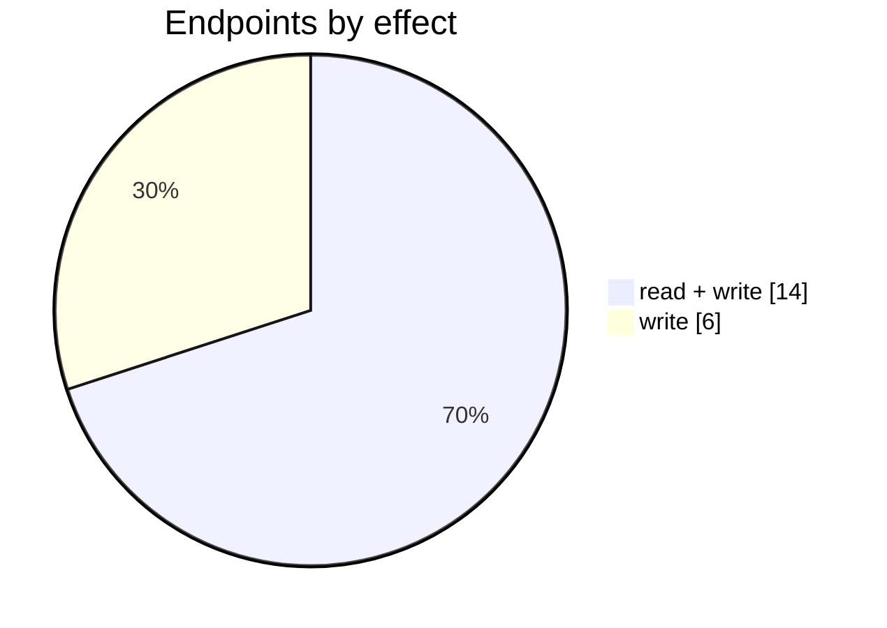

# Cin7 Core Payments

The Cin7 Core Payments connector: its settings page, mappings, logs and the endpoints behind them. Part of [Integrations](../README.md).

| 📄 Pages | 🧱 Models | 🔌 Endpoints | ✍️ Can write | 🌍 Public API |
|:-:|:-:|:-:|:-:|:-:|
| **1** | **9** + [shared](../../00-shared/README.md) | **20** | 20 | **0** |

[📄 Pages (1)](#pages) · [🧱 Models (9)](#data-models) · [🔌 Endpoints (20)](#internal-endpoints) · [🖼️ UI](UI.md) · [🗄️ schema.sql](schema.sql)

## How to rebuild it

| # | Build | How |
|:-:|---|---|
| 1 | 🗄️ Schema | 9 tables from [`schema.sql`](schema.sql); GUID ids, join on `*ID` |
| 2 | 🔌 Internal API | Each controller's verbs · [contract](../../../docs/INTERNAL-API.md) · paged `{root, total}` · saves `{ID, HasErrors, Original, Updated}` |
| 3 | 🖥️ Screens | Server-rendered shell + page app, record from `#<guid>` · [page model](../../../docs/ARCHITECTURE.md#what-a-page-is) · every control in [UI.md](UI.md) |

## Pages

| Route | Menu label | Title | Bundle | Endpoints (write) |
|---|---|---|---|---:|
| `/PaymentGateway` |  | Cin7 Core Payments | `PaymentGateway2019 PaymentGatewayCOMMONREFUND2019` | 20 (20) |

## Data models

ExtJS models the pages use; `v` prefix = view-model. Full DDL in [`schema.sql`](schema.sql).

| Model | Fields |
|---|---|
| `vCin7PayTransaction` | PaymentIntent:string, Created:date, Amount:float, Currency:string |
| `vDearPaymentGatewayNotificationsLogs` | NotificationExecutionLogID:string, ExecutionDate:date, Recipients:string, Subject:string, CustomerBody:string, MerchantBody:string, Status:string, ErrorMessage:string |
| `vDispute` | DisputeID:string, DearPaymentGatewayTransactionID:string, CustomerName:string, Email:string, Currency:string, Amount:float, FeeAmount:float, ConvertedAmount:float, ConvertedAmountToAdditionalChargeExceptFee:float, State:string, Reason:string, DisputeDate:date, DisputeDueDate:date, TransactionDate:date, DocumentName:string, BillingAddressLine1:string, BillingAddressLine2:string, Error:string |
| `vDisputeItem` | DisputeID:string, DisputeItemID:string, DisputeItemDate:date, Actor:string, Details:string, Error:string |
| `vEmailNotification` | EmailNotificationSettingsID:string, IsActive:bool, Code:string, EmailTemplate:string, EmailSubject:string, ConditionParameterValue:string, Error:string |
| `vInternalNotification` | NotificationSettingsID:string, IsActive:bool, Code:string, Error:string |
| `vPayout` | PayoutID:string, PayoutPlanedDate:date, PayoutDate:date, State:string, PayoutAmount:float, MoneyTaskID:string, PurchaseTaskID:string, Note:string, Error:string |
| `vPayoutItem` | PayoutItemID:string, PayoutID:string, TransactionDate:date, DocumentName:string, CustomerName:string, Amount:float, Error:string |
| `vRefundReasons` | Code:string, Name:string |

## Internal endpoints

Grouped by controller. Effect: 🟢 read · 🟠 read + write at the same URL · 🔴 write. `api` = JSON under `/api/`, `mvc` = controller action.

### Cin7Pay

| URL | Kind | Methods | Effect | Params | Body keys | Reader root |
|---|---|---|---|---|---|---|
| `/api/Cin7Pay_Index_Cin7PayRefundProcessing` | api | POST | 🔴 write |  |  |  |
| `/api/Cin7Pay_Index_vCin7PayTransactions` | api | REST(GET read; POST/PUT/DELETE on store.sync) | 🟠 read + write |  |  | root |

### PaymentGateway

| URL | Kind | Methods | Effect | Params | Body keys | Reader root |
|---|---|---|---|---|---|---|
| `/api/PaymentGateway_Index_ChartOfAccounts` | api | REST(GET read; POST/PUT/DELETE on store.sync) | 🟠 read + write |  |  |  |
| `/api/PaymentGateway_Index_ChartOfAccountsNoP` | api | REST(GET read; POST/PUT/DELETE on store.sync) | 🟠 read + write |  |  |  |
| `/api/PaymentGateway_Index_GenerateAgreement` | api | POST PUT | 🔴 write | isSandBox |  |  |
| `/api/PaymentGateway_Index_PaymentGatewayExternalAccount` | api | DELETE | 🔴 write | id |  |  |
| `/api/PaymentGateway_Index_PaymentGatewayFiles` | api | POST | 🔴 write |  |  |  |
| `/api/PaymentGateway_Index_PaymentGatewayPerson` | api | DELETE | 🔴 write | id |  |  |
| `/api/PaymentGateway_Index_PaymentGatewayRefundProcessing` | api | GET POST | 🟠 read + write | transactionID |  |  |
| `/api/PaymentGateway_Index_PaymentGatewaySetup` | api | DELETE GET POST | 🟠 read + write | checkSigning |  |  |
| `/api/PaymentGateway_Index_PaymentGatewaySetupActivation` | api | POST | 🔴 write | IsActive |  |  |
| `/api/PaymentGateway_Index_vDearPaymentGatewayDisputeItems` | api | REST(GET read; POST/PUT/DELETE on store.sync) | 🟠 read + write |  |  | root |
| `/api/PaymentGateway_Index_vDearPaymentGatewayDisputes` | api | GET PUT REST(GET read; POST/PUT/DELETE on store.sync) | 🟠 read + write | DisputeID action disputeID |  | root |
| `/api/PaymentGateway_Index_vDearPaymentGatewayEmailNotificationSettings` | api | PUT REST(GET read; POST/PUT/DELETE on store.sync) | 🟠 read + write | Code State |  | root |
| `/api/PaymentGateway_Index_vDearPaymentGatewayInternalNotificationSettings` | api | PUT REST(GET read; POST/PUT/DELETE on store.sync) | 🟠 read + write | Code State |  | root |
| `/api/PaymentGateway_Index_vDearPaymentGatewayNotificationsLogsController` | api | REST(GET read; POST/PUT/DELETE on store.sync) | 🟠 read + write |  |  | root |
| `/api/PaymentGateway_Index_vDearPaymentGatewayPayoutItems` | api | REST(GET read; POST/PUT/DELETE on store.sync) | 🟠 read + write |  |  | root |
| `/api/PaymentGateway_Index_vDearPaymentGatewayPayouts` | api | REST(GET read; POST/PUT/DELETE on store.sync) | 🟠 read + write |  |  | root |
| `/api/PaymentGateway_Index_vDearPaymentGatewayRefunds` | api | REST(GET read; POST/PUT/DELETE on store.sync) | 🟠 read + write |  |  | root |
| `/api/PaymentGateway_Index_vDearPaymentGatewayTransactions` | api | REST(GET read; POST/PUT/DELETE on store.sync) | 🟠 read + write |  |  | root |
