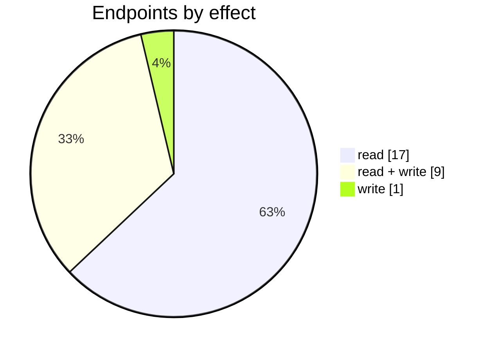

# Etsy

The Etsy connector: its settings page, mappings, logs and the endpoints behind them. Part of [Integrations](../README.md).

| 📄 Pages | 🧱 Models | 🔌 Endpoints | ✍️ Can write | 🌍 Public API |
|:-:|:-:|:-:|:-:|:-:|
| **1** | **27** + [shared](../../00-shared/README.md) | **27** | 10 | **0** |

[📄 Pages (1)](#pages) · [🧱 Models (27)](#data-models) · [🔌 Endpoints (27)](#internal-endpoints) · [🖼️ UI](UI.md) · [🗄️ schema.sql](schema.sql)

## How to rebuild it

| # | Build | How |
|:-:|---|---|
| 1 | 🗄️ Schema | 27 tables from [`schema.sql`](schema.sql); GUID ids, join on `*ID` |
| 2 | 🔌 Internal API | Each controller's verbs · [contract](../../../docs/INTERNAL-API.md) · paged `{root, total}` · saves `{ID, HasErrors, Original, Updated}` |
| 3 | 🖥️ Screens | Server-rendered shell + page app, record from `#<guid>` · [page model](../../../docs/ARCHITECTURE.md#what-a-page-is) · every control in [UI.md](UI.md) |

## Pages

| Route | Menu label | Title | Bundle | Endpoints (write) |
|---|---|---|---|---:|
| `/Etsy` |  | Etsy | `Etsy2019` | 29 (12) |

## Data models

ExtJS models the pages use; `v` prefix = view-model. Full DDL in [`schema.sql`](schema.sql).

| Model | Fields |
|---|---|
| `ConsolidationStore` | type:string, description:string |
| `CtlgFamily` | FamilyID:string, SKU:string, Name:string, Category:string, Brand:string, SKUCount:float, Option1Name:string, Option2Name:string, Option3Name:string, Option1Values:string, Option2Values:string, Option3Values:string, ImageID:string, ShortDescription:string, Tags:string |
| `CtlgProduct` | ProductID:string, ProductCode:string, Name:string, Available:float, OnHand:float, ImageID:string, IsStockProduct:bool |
| `ECommerceShop` | ConfigID:string, ShopName:string |
| `EtsyPublishingFailed` | ProductID:string, ProfileName:string, SKU:string, Name:string, Result:string, ImageID:string, ProductType:string |
| `EtsyPublishingNotListed` | ProductID:string, SKU:string, Type:string, ProductType:string, Name:string, Category:string, Brand:string, Price:float, Quantity:float, Status:string, LProfile:string, ItemID:string, Selected:bool, ImageID:string, FamilyID:string, ValidationText:string, ValidationState:string |
| `IdNameModel` | id:string, name:string |
| `TopicStore` | type:string, description:string |
| `vAccount` | Code:string, DisplayName:string |
| `vECSOrderLog` | LogID:string, ConfigID:string, Date:date, DownloadDate:date, ProcessDate:date, OrderNumber:string, SaleTaskID:string, Status:string, Type:string, SaleOrderNumber:string, RefundID:string, OrderID:string, IsNewSale:bool |
| `vECSPendingOrdersNew` | OrderLineID:string, OrderNumber:string, DateCreated:date, Name:string, Quantity:float, Total:float, CustomerName:string, Error:string, ValidationText:string, ValidationState:string |
| `vEcsCatalogItemNew` | SIMID:string, ProductID:string, FamilyID:string, EntityType:string, LinkedSKU:string, LinkedName:string, SKU:string, Name:string, Status:string, ImageID:string, SyncStockLevel:bool, Price:float, Category:string, Option1:string, Option2:string, Option3:string, IsStockProduct:bool, IgnoreProductUpdation:bool, Quantity:float |
| `vEcsConfiguration` | ID:string, TenantID:string, ShopName:string, AccessToken:string, RefreshToken:string, PrimaryPriceTier:int, ConsolidationType:string, ConsolidationTimeText:string, ConsolidateToCustomerID:string, IsActive:bool, PickWhenOrderStatus:string, ShippingTaxed:bool, SyncStockLevel:bool, ExportShippingInformation:bool, AutoInvoicingMode:string, AutoFulfilmentMode:string, ECSspecificParameter1:bool, ECSspecificParameter9:string, ECSspecificParameter8:string, ECSspecificParameter6:bool, ECSspecificParameter10:string, CustomerName:string, ECSTokenType:string, RevenueAccount:string, MoneySettlementBankAcc… |
| `vEcsOperationLog` | ID:string, ConfigID:string, Date:date, Description:string, Category:string, Processed:bool, Type:int, UserName:string, ConfigName:string, ConfigType:string, Disabled:bool |
| `vEcsOverviewCustomersList` | CustomerID:string, Name:string, OrderCount:int, PaidTotalAmount:decimal, ConfigID:string |
| `vEcsOverviewSalesList` | SaleOrderDate:date, SaleOrderNumber:string, CustomerName:string, Status:string, PaidTotalAmount:decimal, InvoicingStatus:string, OrderStatus:string, FulFilmentStatus:string, PaymentStatus:string, TaskID:string, TT:int, ConfigID:string |
| `vEcsPaymentProcessorMapping` | ID:string, ConfigID:string, PaymentProcessorID:string, PaymentProcessorName:string, LedgerAccount:string, AccountName:string, SortOrder:string |
| `vEcsProductVariation` | SIMID:string, SKU:string, Name:string, Category:string, Option1:string, Option2:string, Option3:string, Status:string, CustomField1:string, CustomField2:string, CustomField3:string, CustomField4:string, CustomField5:string, CustomField6:string, CustomField7:string, CustomField8:string, CustomField9:string, CustomField10:string, Price:float, SIMFamilyID:string, ProductID:string, LinkedName:string, LinkedSKU:string, ImageID:string, ValidationText:string, MaxRows:int |
| `vEcsTaxMapping` | ID:string, ECSConfigID:string, ECSTaxType:string, ECSTaxID:string, Description:string, Value:string, TaxRuleName:string, SortOrder:int |
| `vEtsyLanguage` | Code:string, description:string |
| `vListingProfile` | id:string, Name:string, ShippingProfileID:string, ShippingProfileName:string, ReadinessStateId:auto |
| `vLocation` | LocationID:string, Description:string |
| `vProductVariation` | ProductID:string, FamilyID:string, ProductCode:string, ImageID:string, Name:string, Option1:string, Option2:string, Option3:string |
| `vReadinessState` | Id:auto, Title:string, ReadinessState:string, DisplayTitle:string |
| `vShippingTemplate` | Id:string, Title:string |
| `vTax` | RuleID:string, Description:string |
| `vTime` | Value:string, Name:string |

## Internal endpoints

Grouped by controller. Effect: 🟢 read · 🟠 read + write at the same URL · 🔴 write. `api` = JSON under `/api/`, `mvc` = controller action.

### Etsy

| URL | Kind | Methods | Effect | Params | Body keys | Reader root |
|---|---|---|---|---|---|---|
| `/Etsy/ChangeMappingAndSyncStock` | mvc | POST | 🔴 write | ConfigID IgnoreProductUpdation ProductID SIMProductID SyncStockLevel |  |  |
| `/api/Etsy_Index_CheckFamily` | api | GET PUT | 🟠 read + write |  |  |  |
| `/api/Etsy_Index_CheckProduct` | api | GET PUT | 🟠 read + write | ConfigID |  |  |
| `/api/Etsy_Index_Dashboard_Summary` | api | GET | 🟢 read |  |  |  |
| `/api/Etsy_Index_Family` | api | REST(GET read; POST/PUT/DELETE on store.sync) | 🟢 read | ConfigID CurrentFamilyID lang |  |  |
| `/api/Etsy_Index_Product` | api | REST(GET read; POST/PUT/DELETE on store.sync) | 🟢 read | ConfigID IsStockProduct Name lang |  |  |
| `/api/Etsy_Index_PublishingFailed` | api | REST(GET read; POST/PUT/DELETE on store.sync) | 🟢 read | ConfigID lang search |  | root |
| `/api/Etsy_Index_PublishingNotListed` | api | PUT REST(GET read; POST/PUT/DELETE on store.sync) | 🟠 read + write | ConfigID lang search |  | root |
| `/api/Etsy_Index_PublishingProfiles` | api | PUT REST(GET read; POST/PUT/DELETE on store.sync) | 🟠 read + write | ConfigID | IsSupply Name NonTaxable ReadinessStateId ShippingProfileID ShippingProfileName TaxonomyCategoryName TaxonomyID When Who | root |
| `/api/Etsy_Index_vAccounts` | api | REST(GET read; POST/PUT/DELETE on store.sync) | 🟢 read |  |  |  |
| `/api/Etsy_Index_vCustomer` | api | REST(GET read; POST/PUT/DELETE on store.sync) | 🟢 read |  |  |  |
| `/api/Etsy_Index_vEcsConfiguration` | api | REST(GET read; POST/PUT/DELETE on store.sync) | 🟠 read + write |  |  |  |
| `/api/Etsy_Index_vEcsLogs` | api | DELETE REST(GET read; POST/PUT/DELETE on store.sync) | 🟠 read + write | ConfigID search |  | root |
| `/api/Etsy_Index_vEcsPaymentProcessorMapping` | api | REST(GET read; POST/PUT/DELETE on store.sync) | 🟠 read + write | ConfigID Update |  |  |
| `/api/Etsy_Index_vEcsProductList` | api | REST(GET read; POST/PUT/DELETE on store.sync) | 🟢 read | ConfigID lang mode search status |  | root |
| `/api/Etsy_Index_vEcsTaxMapping` | api | REST(GET read; POST/PUT/DELETE on store.sync) | 🟠 read + write | ConfigID |  |  |
| `/api/Etsy_Index_vEcsVariationList` | api | REST(GET read; POST/PUT/DELETE on store.sync) | 🟢 read | ConfigID SIMFamilyID ScanFamilyID |  | root |
| `/api/Etsy_Index_vEcsVariationManual` | api | REST(GET read; POST/PUT/DELETE on store.sync) | 🟢 read | ConfigID FamilyID SIMFamilyID additionalSKUs search |  | root |
| `/api/Etsy_Index_vEtsyOverviewCustomersList` | api | REST(GET read; POST/PUT/DELETE on store.sync) | 🟢 read | ConfigID search |  | root |
| `/api/Etsy_Index_vEtsyOverviewSalesList` | api | REST(GET read; POST/PUT/DELETE on store.sync) | 🟢 read | ConfigID search |  | root |
| `/api/Etsy_Index_vEtsyPendingOrders` | api | REST(GET read; POST/PUT/DELETE on store.sync) | 🟢 read | ConfigID search |  | root |
| `/api/Etsy_Index_vLocation` | api | REST(GET read; POST/PUT/DELETE on store.sync) | 🟢 read |  |  |  |
| `/api/Etsy_Index_vOperationLogs` | api | REST(GET read; POST/PUT/DELETE on store.sync) | 🟠 read + write | ConfigID search |  | root |
| `/api/Etsy_Index_vReferenceDataForPublishing` | api | GET | 🟢 read | ConfigID |  |  |
| `/api/Etsy_Index_vRevenueAccounts` | api | REST(GET read; POST/PUT/DELETE on store.sync) | 🟢 read |  |  |  |
| `/api/Etsy_Index_vSalesPriceTiers` | api | REST(GET read; POST/PUT/DELETE on store.sync) | 🟢 read |  |  |  |
| `/api/Etsy_Index_vTaxRules` | api | REST(GET read; POST/PUT/DELETE on store.sync) | 🟢 read |  |  |  |
