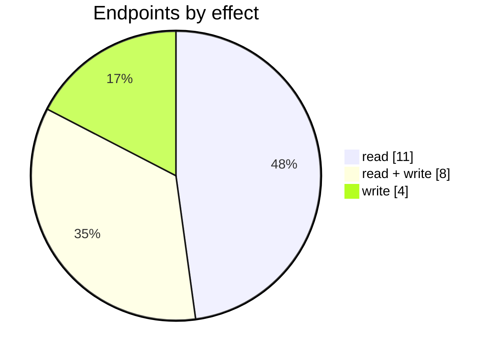

# Fulfillment by Amazon

The Fulfillment by Amazon connector: its settings page, mappings, logs and the endpoints behind them. Part of [Integrations](../README.md).

| 📄 Pages | 🧱 Models | 🔌 Endpoints | ✍️ Can write | 🌍 Public API |
|:-:|:-:|:-:|:-:|:-:|
| **1** | **25** + [shared](../../00-shared/README.md) | **23** | 12 | **0** |

[📄 Pages (1)](#pages) · [🧱 Models (25)](#data-models) · [🔌 Endpoints (23)](#internal-endpoints) · [🖼️ UI](UI.md) · [🗄️ schema.sql](schema.sql)

## How to rebuild it

| # | Build | How |
|:-:|---|---|
| 1 | 🗄️ Schema | 25 tables from [`schema.sql`](schema.sql); GUID ids, join on `*ID` |
| 2 | 🔌 Internal API | Each controller's verbs · [contract](../../../docs/INTERNAL-API.md) · paged `{root, total}` · saves `{ID, HasErrors, Original, Updated}` |
| 3 | 🖥️ Screens | Server-rendered shell + page app, record from `#<guid>` · [page model](../../../docs/ARCHITECTURE.md#what-a-page-is) · every control in [UI.md](UI.md) |

## Pages

| Route | Menu label | Title | Bundle | Endpoints (write) |
|---|---|---|---|---:|
| `/FBA` |  | Fulfillment by Amazon | `FBA2019` | 17 (12) |

## Data models

ExtJS models the pages use; `v` prefix = view-model. Full DDL in [`schema.sql`](schema.sql).

| Model | Fields |
|---|---|
| `AmazonConf` | ID:string, ShopName:string, Region:string, Country:string, DisplayName:string |
| `Carrier` | Key:string, Value:string |
| `ChannelMapping` | ChannelName:string, ConfigID:string, FulfillmentBoxSetting:string, LogisticsProviderSetting:string |
| `FulfillmentBoxOption` | Name:string, Description:string |
| `ImportItemsError` | Line:int, BoxNumber:int, SKU:string, ProductName:string, UnitsPerBox:int, BoxWeight:float, BoxWidth:float, BoxHeight:float, BoxDepth:float, ValidationState:string, ValidationText:string |
| `LogisticsProviderOption` | Name:string, Description:string |
| `NewStatusStore` | type:string, description:string |
| `vEcsConfiguration` | ID:string, TenantID:string, ShopName:string, AccessToken:string, RefreshToken:string, PrimaryPriceTier:int, ConsolidationType:string, ConsolidationTimeText:string, ConsolidateToCustomerID:string, IsActive:bool, PickWhenOrderStatus:string, ShippingTaxed:bool, SyncStockLevel:bool, ExportShippingInformation:bool, AutoInvoicingMode:string, AutoFulfilmentMode:string, ECSspecificParameter1:bool, ECSspecificParameter9:string, ECSspecificParameter8:string, ECSspecificParameter6:bool, ECSspecificParameter10:string, CustomerName:string, ECSTokenType:string, RevenueAccount:string, MoneySettlementBankAcc… |
| `vEcsOperationLog` | ID:string, ConfigID:string, Date:date, Description:string, Category:string, Processed:bool, Type:int, UserName:string, ConfigName:string, ConfigType:string, Disabled:bool |
| `vEcsOverviewFulfilmentCustomersList` | CustomerID:string, CustomerName:string, OrderCount:int, ConfigID:string |
| `vEcsOverviewOrdersList` | Date:date, SaleOrderNumber:string, CustomerName:string, Status:string, FulfillmentOrderID:string, SaleTaskID:string, ConfigID:string |
| `vFFProduct` | ID:string, ConfigID:string, FFProductID:string, SKU:string, FFSKU:string, Name:string, Price:float, QuantityFulfillable:float, QuantityWarehouse:float, QuantityUnsellable:float, QuantityReserved:float, QuantityInbound:float, Quantity:float, ProductID:string, MappedSKU:string, MappedName:string, ImageID:string, AdditionalField1:string, AdditionalField2:string, AdditionalField3:string, AdditionalField4:string, AdditionalField5:string, AdditionalField6:string, AdditionalField7:string, AdditionalField8:string, AdditionalField9:string, AdditionalField10:string, IsLinktoAnotherLocation:bool, IsElig… |
| `vFulfillmentInboundShipment` | InboundShipmentID:string, ConfigID:string, Currency:string, CarrierName:string, ShippingMethod:string, TrackingNumber:string, ShipmentPacking:string, PaperType:string, PageType:string, ShipmentDate:date, FromBox:int, ToBox:int, GeneratePaperType:string, TransferOrderID:string, HasPrintedLabels:bool, TransferOrderNumber:string, OrderDate:date, ShipmentID:string, ShipmentStatus:string, LabelPrepType:string, BoxContentsSource:string, ShipmentName:string, DestinationFulfillmentCenterId:string, AreCasesRequired:bool, ConfirmedNeedByDate:date, AddressName:string, AddressLine1:string, AddressLine2:s… |
| `vFulfillmentInboundShipmentBoxContent` | ID:string, InboundShipmentID:string, BoxNumber:int, ProductID:string, SKU:string, ProductName:string, ProductPrice:float, ProductTotalPrice:float, UnitsPerBox:int, QuantityInCase:int, NumberOfBoxes:int, BoxWidth:float, BoxHeight:float, BoxDepth:float, BoxWeight:float, ASIN:string, TransferOrderID:string, TransferOrderNumber:string, ShipmentDate:date, ValidationText:string, ValidationState:string |
| `vFulfillmentInboundShipmentEstimate` | CalculationID:string, ConfigID:string, InboundShipmentID:string, Carrier:string, NumberOfBoxes:int, ShipmentWeight:float, ShipmentCosts:float, FreightReadyDate:date, FreightClass:string, DeclaredValue:float, NumberOfPallets:int, PickUpDate:date, Status:string, CalculationDate:date, ValidationText:string, ValidationState:string |
| `vFulfillmentInboundShipmentItem` | LineID:string, InboundShipmentID:string, ConfigID:string, ASIN:string, HasPrintedLabels:bool, LocationID:string, LocationName:string, ProductCode:string, ProductName:string, ProductPrice:float, ProductTotalPrice:float, ProductID:string, QuantityInCase:int, QuantityReceived:int, QuantityShipped:int, SKU:string, ShipmentDate:date, ShipmentStatus:string, TransferOrderID:string, TransferOrderNumber:string, Condition:string, ReleaseDate:date, ValidationText:string, ValidationState:string |
| `vFulfillmentInboundShipmentList` | InboundShipmentID:string, ConfigID:string, Currency:string, TransferOrderID:string, TransferOrderNumber:string, HasPrintedLabels:bool, HasBillOfLading:bool, HasPalletLabels:bool, HasMultipleShipments:bool, CarrierName:string, ShippingMethod:string, ShipmentID:string, ShipmentStatus:string, TotalUnits:int, AmountPerUnit:float, TotalAmount:float, ShipmentDate:date, SellerCentralLink:string, LocationName:string, ValidationText:string, ValidationState:string |
| `vFulfillmentInboundShipmentPallet` | ID:string, ConfigID:string, InboundShipmentID:string, NumberOfPallets:int, PalletWeight:float, PalletDepth:float, PalletWidth:float, PalletHeight:float, TransferOrderID:string, TransferOrderNumber:string, ShipmentDate:date, IsStackable:bool, ValidationText:string, ValidationState:string |
| `vFulfillmentInboundShipmentWrapper` | ID:string, HasErrors:bool |
| `vInboundShipmentBoxLabes` | FromBox:int, ToBox:int, TotalOfBoxes:int, PaperType:string, ValidationText:string, ValidationState:string |
| `vInboundShipmentCharges` | ShippingCarrier:string, NumberOfBoxes:int, ShipmentWeight:float, BillableWeight:float, EstimatedShipmentCost:float, FreightReadyDate:date, FreightClass:string, DeclaredValue:float, ContactPerson:string, ValidationText:string, ValidationState:string |
| `vInboundShipmentPrintLabes` | NumberOfBoxes:int, PaperType:string, PaperSize:string, ShipmentDate:date, ValidationText:string, ValidationState:string |
| `vLogRecord` | ID:string, LogDate:string, FulfillmentOrderId:string, FFOrderID:string, ChangesText:string, ChangedBy:string |
| `vShortLocation` | LocationID:string, Description:string |
| `vTime` | Value:string, Name:string |

## Internal endpoints

Grouped by controller. Effect: 🟢 read · 🟠 read + write at the same URL · 🔴 write. `api` = JSON under `/api/`, `mvc` = controller action.

### FBA

| URL | Kind | Methods | Effect | Params | Body keys | Reader root |
|---|---|---|---|---|---|---|
| `/FBA/ChangeMapping` | mvc | POST | 🔴 write | ConfigID ProductID SIMProductID |  |  |
| `/FBA/DownloadLabels` | mvc | POST | 🟢 read | ConfigID InboundShipmentID |  |  |
| `/FBA/GenerateBoxLabels` | mvc | POST | 🔴 write | ConfigID InboundShipmentID IsPallet fromBox isPartnered numberOfBoxes pageSize pageType shipmentDate toBox |  |  |
| `/FBA/ImportBoxContent` | mvc | POST | 🔴 write | InboundShipmentId |  |  |
| `/FBA/QueueStockSync` | mvc | POST | 🔴 write | ConfigID |  |  |
| `/api/FBA_Index_Carriers` | api | REST(GET read; POST/PUT/DELETE on store.sync) | 🟢 read | region |  |  |
| `/api/FBA_Index_CheckProduct` | api | GET PUT | 🟠 read + write | ConfigID |  |  |
| `/api/FBA_Index_Dashboard_Summary` | api | GET | 🟢 read |  |  |  |
| `/api/FBA_Index_FulfillmentBoxOptions` | api | REST(GET read; POST/PUT/DELETE on store.sync) | 🟠 read + write |  |  |  |
| `/api/FBA_Index_LogisticsProviderOptions` | api | REST(GET read; POST/PUT/DELETE on store.sync) | 🟠 read + write |  |  |  |
| `/api/FBA_Index_McfChannelMapping` | api | GET REST(GET read; POST/PUT/DELETE on store.sync) | 🟠 read + write | ConfigID ConfigIds |  |  |
| `/api/FBA_Index_vAmazonConfiguration` | api | REST(GET read; POST/PUT/DELETE on store.sync) | 🟢 read |  |  |  |
| `/api/FBA_Index_vAmazonOverviewCustomersList` | api | REST(GET read; POST/PUT/DELETE on store.sync) | 🟢 read | ConfigID search |  | root |
| `/api/FBA_Index_vAmazonOverviewOrdersList` | api | REST(GET read; POST/PUT/DELETE on store.sync) | 🟢 read | ConfigID search |  | root |
| `/api/FBA_Index_vChooseLocation` | api | REST(GET read; POST/PUT/DELETE on store.sync) | 🟢 read |  |  |  |
| `/api/FBA_Index_vEcsConfiguration` | api | REST(GET read; POST/PUT/DELETE on store.sync) | 🟠 read + write |  |  |  |
| `/api/FBA_Index_vFFProductList` | api | REST(GET read; POST/PUT/DELETE on store.sync) | 🟠 read + write |  |  | root |
| `/api/FBA_Index_vFulfillmentInboundShipment` | api | DELETE PUT REST(GET read; POST/PUT/DELETE on store.sync) | 🟠 read + write | ConfigID InboundShipmentID action dateFrom dateTo search status | HasErrors ID Original Updated | root |
| `/api/FBA_Index_vFulfillmentOutboundShipmentEstimate` | api | POST | 🟢 read |  | Address BoxNumber ConfigId Items |  |
| `/api/FBA_Index_vLog` | api | REST(GET read; POST/PUT/DELETE on store.sync) | 🟢 read | ConfigID search |  | root |
| `/api/FBA_Index_vOperLog` | api | REST(GET read; POST/PUT/DELETE on store.sync) | 🟠 read + write | ConfigID search |  | root |
| `/api/FBA_Index_vProductList` | api | REST(GET read; POST/PUT/DELETE on store.sync) | 🟢 read | ConfigID lang search |  |  |
| `/api/FBA_Index_vSalesPriceTiers` | api | REST(GET read; POST/PUT/DELETE on store.sync) | 🟢 read |  |  |  |
