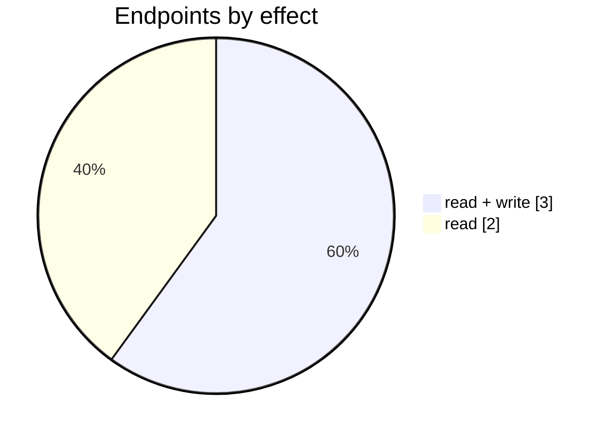

# Google Workspaces

The Google Workspaces connector: its settings page, mappings, logs and the endpoints behind them. Part of [Integrations](../README.md).

| 📄 Pages | 🧱 Models | 🔌 Endpoints | ✍️ Can write | 🌍 Public API |
|:-:|:-:|:-:|:-:|:-:|
| **1** | **3** + [shared](../../00-shared/README.md) | **5** | 3 | **0** |

[📄 Pages (1)](#pages) · [🧱 Models (3)](#data-models) · [🔌 Endpoints (5)](#internal-endpoints) · [🖼️ UI](UI.md) · [🗄️ schema.sql](schema.sql)

## How to rebuild it

| # | Build | How |
|:-:|---|---|
| 1 | 🗄️ Schema | 3 tables from [`schema.sql`](schema.sql); GUID ids, join on `*ID` |
| 2 | 🔌 Internal API | Each controller's verbs · [contract](../../../docs/INTERNAL-API.md) · paged `{root, total}` · saves `{ID, HasErrors, Original, Updated}` |
| 3 | 🖥️ Screens | Server-rendered shell + page app, record from `#<guid>` · [page model](../../../docs/ARCHITECTURE.md#what-a-page-is) · every control in [UI.md](UI.md) |

## Pages

| Route | Menu label | Title | Bundle | Endpoints (write) |
|---|---|---|---|---:|
| `/GSuites` |  | Google Workspaces | `GSuites2019` | 3 (3) |

## Data models

ExtJS models the pages use; `v` prefix = view-model. Full DDL in [`schema.sql`](schema.sql).

| Model | Fields |
|---|---|
| `ContactInfo` | ContactID:string, ContactTypeName:string, ContactType:string, ContactName:string, IsActive:bool |
| `vGSuiteConfig` | ConfigID:string, HasSyncContacts:bool, HasExportData:bool, GD_DefaultDirID_Printing:string, GD_DefaultDirPath_Printing:string, GD_DefaultDirID_Reporting:string, GD_DefaultDirPath_Reporting:string, NeedsToReconnect:bool, ConnectedGoogleEmail:string, RequiresFolderReselection:bool |
| `vGSuiteLog` | LogID:string, Action:string, Message:string, LogDate:date |

## Internal endpoints

Grouped by controller. Effect: 🟢 read · 🟠 read + write at the same URL · 🔴 write. `api` = JSON under `/api/`, `mvc` = controller action.

### GSuites

| URL | Kind | Methods | Effect | Params | Body keys | Reader root |
|---|---|---|---|---|---|---|
| `/api/GSuites_Index_Config` | api | GET REST(GET read; POST/PUT/DELETE on store.sync) | 🟠 read + write |  |  | root |
| `/api/GSuites_Index_Contacts` | api | GET REST(GET read; POST/PUT/DELETE on store.sync) | 🟠 read + write |  |  | root |
| `/api/GSuites_Index_Directory` | api |  | 🟢 read |  |  |  |
| `/api/GSuites_Index_Files` | api |  | 🟢 read |  |  |  |
| `/api/GSuites_Index_Logs` | api | REST(GET read; POST/PUT/DELETE on store.sync) | 🟠 read + write |  |  | root |
