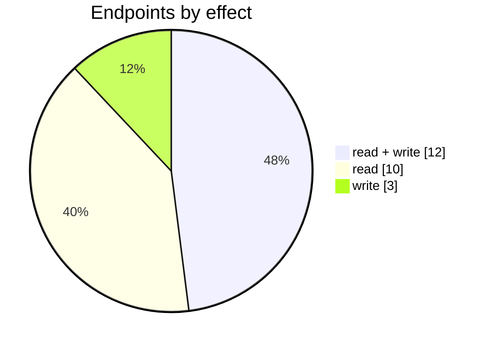

# HubSpot

The HubSpot connector: its settings page, mappings, logs and the endpoints behind them. Part of [Integrations](../README.md).

| 📄 Pages | 🧱 Models | 🔌 Endpoints | ✍️ Can write | 🌍 Public API |
|:-:|:-:|:-:|:-:|:-:|
| **1** | **19** + [shared](../../00-shared/README.md) | **25** | 15 | **0** |

[📄 Pages (1)](#pages) · [🧱 Models (19)](#data-models) · [🔌 Endpoints (25)](#internal-endpoints) · [🖼️ UI](UI.md) · [🗄️ schema.sql](schema.sql)

## How to rebuild it

| # | Build | How |
|:-:|---|---|
| 1 | 🗄️ Schema | 19 tables from [`schema.sql`](schema.sql); GUID ids, join on `*ID` |
| 2 | 🔌 Internal API | Each controller's verbs · [contract](../../../docs/INTERNAL-API.md) · paged `{root, total}` · saves `{ID, HasErrors, Original, Updated}` |
| 3 | 🖥️ Screens | Server-rendered shell + page app, record from `#<guid>` · [page model](../../../docs/ARCHITECTURE.md#what-a-page-is) · every control in [UI.md](UI.md) |

## Pages

| Route | Menu label | Title | Bundle | Endpoints (write) |
|---|---|---|---|---:|
| `/HubSpot` |  | HubSpot | `HubSpot2019` | 24 (15) |

## Data models

ExtJS models the pages use; `v` prefix = view-model. Full DDL in [`schema.sql`](schema.sql).

| Model | Fields |
|---|---|
| `CurrencyAndPortalIdWrapper` | PortalId:string |
| `HubSpotStage` | HubSpotStageID:string, HubSpotStageName:string |
| `StatusMappingModel` | ID:string, HubSpotID:string, HubSpotPipeLineID:string, HubSpotPipeLineName:string, HubSpotStageID:string, HubSpotStageName:string, DearStatus:string, SortOrder:string |
| `ValueNameDescriptionModel` | Value:string, Name:string, Description:string, Type:string |
| `ValueNameModel` | Value:string, Name:string |
| `vContactType` | ContactType:string, ContactTypeLocalized:string |
| `vCurrency` | Currency:string, DisplayCurrency:string |
| `vEcsOverviewCustomersList` | CustomerID:string, Name:string, OrderCount:int, PaidTotalAmount:decimal, ConfigID:string |
| `vEcsOverviewSalesList` | SaleOrderDate:date, SaleOrderNumber:string, CustomerName:string, Status:string, PaidTotalAmount:decimal, InvoicingStatus:string, OrderStatus:string, FulFilmentStatus:string, PaymentStatus:string, TaskID:string, TT:int, ConfigID:string |
| `vExportSale` | TaskID:string, OrderNo:string, OrderDate:date, Status:string, TotalAmount:float, Currency:string, Customer:string |
| `vHubSpot` | HubSpotID:string, IsActive:bool, PriceTier:string, PriceTierCurrency:string, DefaultLocation:string, AutoSync:bool, AutoSync_StartDateStr:string, AutoSync_StartTime:string, AutoSync_Frequency:string, AutoSync_ErrorAlertType:string, AutoSync_MailListID:string, ProductSyncType:string, ProductExport_DescriptionType:string, ProductExport_TermValue:int, ProductExport_TermPeriod:string, ProductImport_Type:string, ProductImport_Category:string, ProductImport_MappingByUniqueName:bool, ProductImport_AutoCreate:bool, CustomerSyncType:string, CustomerExport_AddressType:string, CustomerExport_AllowCustom… |
| `vHubSpotContact` | ID:string, ContactName:string, CompanyName:string, IsOrganization:bool |
| `vHubspotFieldsMapping` | ID:string, ECSConfigID:string, DearFieldModel:string, DearFieldName:string, ECSFieldName:string |
| `vImportSale` | DealID:string, DealCurrency:string, HubSpotDealId:string, HubSpotDealName:string, HubSpotDealDate:date, HubSpotTotal:float, HubSpotDealStage:string, Error:string, ValidationText:string, ValidationState:string |
| `vLog` | LogID:string, Action:string, Message:string, AdditionalInfo:string, LogDate:date, Error:string, LogType:string, SyncID:string, AffectedEntitiesCount:int, ValidationText:string, ValidationState:string |
| `vMailingList` | MailingListID:string, Name:string, Emails:string, ValidationText:string, ValidationState:string |
| `vProductCatalogModel` | ID:string, HubSpotCatalogID:string, ProductID:string, ProductCode:string, Name:string, Type:string, CategoryName:string, Status:string, HubSpotName:string, HubSpotObjectID:string, HubSpotPrice:string, PriceTier1:decimal, PriceTier2:decimal, PriceTier3:decimal, PriceTier4:decimal, PriceTier5:decimal, PriceTier6:decimal, PriceTier7:decimal, PriceTier8:decimal, PriceTier9:decimal, PriceTier10:decimal, ValidationState:string, ValidationText:string |
| `vProductToExportModel` | ProductID:string, ProductCode:string, Name:string, Type:string, CategoryName:string, Status:string, PriceTier:int, PriceTier1:decimal, PriceTier2:decimal, PriceTier3:decimal, PriceTier4:decimal, PriceTier5:decimal, PriceTier6:decimal, PriceTier7:decimal, PriceTier8:decimal, PriceTier9:decimal, PriceTier10:decimal |
| `vTaxRules` | RuleID:string, Description:string |

## Internal endpoints

Grouped by controller. Effect: 🟢 read · 🟠 read + write at the same URL · 🔴 write. `api` = JSON under `/api/`, `mvc` = controller action.

### HubSpot

| URL | Kind | Methods | Effect | Params | Body keys | Reader root |
|---|---|---|---|---|---|---|
| `/HubSpot/Reconnect` | mvc | GET(navigate) | 🔴 write |  |  |  |
| `/api/HubSpot_Index/CatalogViewList` | api | REST(GET read; POST/PUT/DELETE on store.sync) | 🟠 read + write | Category HubSpotID Type listStatus search |  | root |
| `/api/HubSpot_Index/CreateProperty` | api | POST | 🔴 write | DisplayName Entity |  |  |
| `/api/HubSpot_Index/HsObjectProperties` | api | REST(GET read; POST/PUT/DELETE on store.sync) | 🟢 read |  |  |  |
| `/api/HubSpot_Index/HubSpotReferenceData` | api | REST(GET read; POST/PUT/DELETE on store.sync) | 🟢 read |  |  |  |
| `/api/HubSpot_Index/Pipelines` | api | GET | 🟢 read | HubSpotID |  |  |
| `/api/HubSpot_Index/vCustomers` | api | REST(GET read; POST/PUT/DELETE on store.sync) | 🟠 read + write | ConfigID ListingStatus Status search |  | root |
| `/api/HubSpot_Index/vHubSpot` | api | GET REST(GET read; POST/PUT/DELETE on store.sync) | 🟠 read + write |  |  |  |
| `/api/HubSpot_Index/vHubSpotContacts` | api | REST(GET read; POST/PUT/DELETE on store.sync) | 🟠 read + write | ConfigID search |  | root |
| `/api/HubSpot_Index/vHubSpotFieldsMapping` | api | REST(GET read; POST/PUT/DELETE on store.sync) | 🟠 read + write | hubSpotID |  |  |
| `/api/HubSpot_Index/vHubSpotPipelineStageMapping` | api | REST(GET read; POST/PUT/DELETE on store.sync) | 🟠 read + write | hubSpotID hubSpotPipelineID |  |  |
| `/api/HubSpot_Index/vImportSales` | api | REST(GET read; POST/PUT/DELETE on store.sync) | 🟠 read + write | ConfigID search |  | root |
| `/api/HubSpot_Index_Dashboard_Summary` | api | GET | 🟢 read |  |  |  |
| `/api/HubSpot_Index_DearProduct` | api | REST(GET read; POST/PUT/DELETE on store.sync) | 🟢 read |  |  |  |
| `/api/HubSpot_Index_Disconnect` | api | DELETE | 🔴 write | hubSpotID |  |  |
| `/api/HubSpot_Index_SaleTaxRules` | api | REST(GET read; POST/PUT/DELETE on store.sync) | 🟢 read |  |  |  |
| `/api/HubSpot_Index_vCatalog` | api | GET POST | 🟠 read + write | CatalogID Currency HubSpotID Operation PriceTier ProductID SKU |  |  |
| `/api/HubSpot_Index_vCurrency` | api | REST(GET read; POST/PUT/DELETE on store.sync) | 🟢 read |  |  |  |
| `/api/HubSpot_Index_vExportSales` | api | REST(GET read; POST/PUT/DELETE on store.sync) | 🟠 read + write | ConfigID dateFrom search |  | root |
| `/api/HubSpot_Index_vHubSpotOverviewCustomersList` | api | REST(GET read; POST/PUT/DELETE on store.sync) | 🟢 read | ConfigID search |  | root |
| `/api/HubSpot_Index_vHubSpotOverviewSalesList` | api | REST(GET read; POST/PUT/DELETE on store.sync) | 🟢 read | ConfigID search |  | root |
| `/api/HubSpot_Index_vLog` | api | REST(GET read; POST/PUT/DELETE on store.sync) | 🟠 read + write | ConfigID search |  | root |
| `/api/HubSpot_Index_vMailingList` | api | REST(GET read; POST/PUT/DELETE on store.sync) | 🟠 read + write |  |  | root |
| `/api/HubSpot_Index_vProductToExport` | api | REST(GET read; POST/PUT/DELETE on store.sync) | 🟠 read + write | Category HubSpotID Type listStatus search |  | root |
| `/api/HubSpot_Index_vSalesPriceTiers` | api | REST(GET read; POST/PUT/DELETE on store.sync) | 🟢 read |  |  |  |
