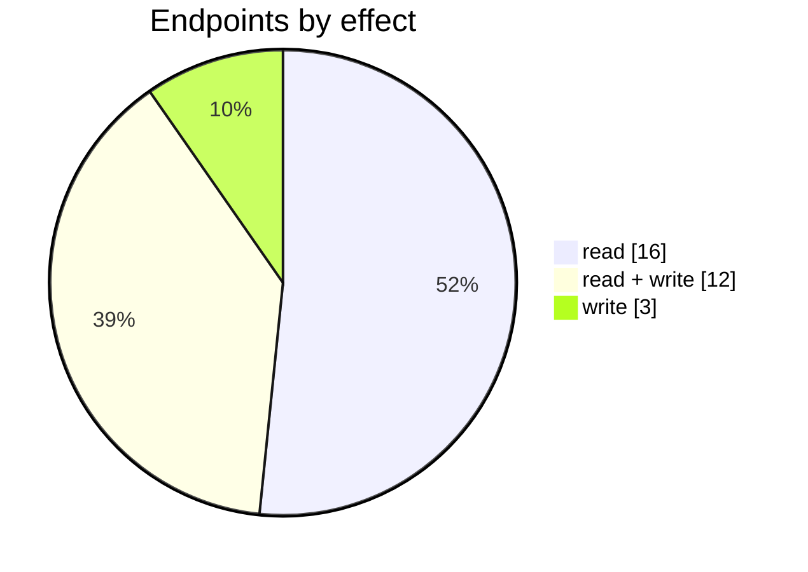
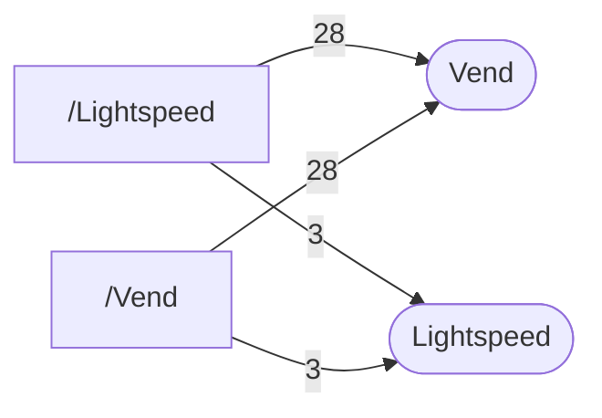

# Lightspeed

The Lightspeed connector: its settings page, mappings, logs and the endpoints behind them. Part of [Integrations](../README.md).

| 📄 Pages | 🧱 Models | 🔌 Endpoints | ✍️ Can write | 🌍 Public API |
|:-:|:-:|:-:|:-:|:-:|
| **2** | **22** + [shared](../../00-shared/README.md) | **31** | 15 | **0** |

[📄 Pages (2)](#pages) · [🧱 Models (22)](#data-models) · [🔌 Endpoints (31)](#internal-endpoints) · [🖼️ UI](UI.md) · [🗄️ schema.sql](schema.sql)

Pages (left) and the controllers they call (right), busiest 2 pages and 2 controllers; numbers are endpoints.

## How to rebuild it

| # | Build | How |
|:-:|---|---|
| 1 | 🗄️ Schema | 22 tables from [`schema.sql`](schema.sql); GUID ids, join on `*ID` |
| 2 | 🔌 Internal API | Each controller's verbs · [contract](../../../docs/INTERNAL-API.md) · paged `{root, total}` · saves `{ID, HasErrors, Original, Updated}` |
| 3 | 🖥️ Screens | Server-rendered shell + page app, record from `#<guid>` · [page model](../../../docs/ARCHITECTURE.md#what-a-page-is) · every control in [UI.md](UI.md) |

## Pages

| Route | Menu label | Title | Bundle | Endpoints (write) |
|---|---|---|---|---:|
| `/Lightspeed` |  | Lightspeed | `Vend2019` | 31 (17) |
| `/Vend` |  | Lightspeed | `Vend2019` | 31 (17) |

## Data models

ExtJS models the pages use; `v` prefix = view-model. Full DDL in [`schema.sql`](schema.sql).

| Model | Fields |
|---|---|
| `ConsolidationStore` | type:string, description:string |
| `ECommerceShop` | ConfigID:string, ShopName:string |
| `EcsProductDetails` | ProductID:string, SyncStockLevel:bool, UseBufferInventory:bool, BufferInventory:int, SyncBufferInventory:int, SyncQuantity:float |
| `TopicStore` | type:string, description:string |
| `vAccount` | Code:string, DisplayName:string |
| `vECSOrderLog` | LogID:string, ConfigID:string, Date:date, DownloadDate:date, ProcessDate:date, OrderNumber:string, SaleTaskID:string, Status:string, Type:string, SaleOrderNumber:string, RefundID:string, OrderID:string, IsNewSale:bool |
| `vECSPaymentsToExport` | TaskID:string, OrderID:string, OrderNumber:string, TaskID:string, InvoiceNumber:string, Error:string |
| `vECSPendingOrdersNew` | OrderLineID:string, OrderNumber:string, DateCreated:date, Name:string, Quantity:float, Total:float, CustomerName:string, Error:string, ValidationText:string, ValidationState:string |
| `vECSPurchases` | LogID:string, ConfigID:string, ECSPurchaseID:string, ECSPurchaseNumber:string, ECSStatus:string, DearPurchaseID:string, CreatedDate:date, ReceivedDate:date, Location:string, DearStatus:string, DearOrderNumber:string |
| `vECSStockAdjustments` | LogID:string, ConfigID:string, ECSStockAdjustmentID:string, ECSStockAdjustmentNumber:string, ECSStatus:string, DearStockAdjustmentID:string, CreatedDate:date, CompletedDate:date, DearStatus:string, DearNumber:string |
| `vECSStockTransfers` | LogID:string, ConfigID:string, ECSStockTransferID:string, ECSStockTransferNumber:string, ECSStatus:string, DearStockTransferID:string, FromLocation:string, ToLocation:string, CreatedDate:date, ReceivedDate:date, DearStatus:string, DearNumber:string |
| `vEcsBulkListing` | ProductID:string, ProductCode:string, Name:string, Status:string, Category:string, ProductType:string, Price:float, Quantity:float, UseBufferInventory:bool, BufferInventory:int, SyncBufferInventory:int, SyncQuantity:float |
| `vEcsConfiguration` | ID:string, TenantID:string, ShopName:string, AccessToken:string, RefreshToken:string, PrimaryPriceTier:int, ConsolidationType:string, ConsolidationTimeText:string, ConsolidateToCustomerID:string, IsActive:bool, PickWhenOrderStatus:string, ShippingTaxed:bool, SyncStockLevel:bool, ExportShippingInformation:bool, AutoInvoicingMode:string, AutoFulfilmentMode:string, ECSspecificParameter1:bool, ECSspecificParameter9:string, ECSspecificParameter8:string, ECSspecificParameter6:bool, ECSspecificParameter10:string, CustomerName:string, ECSTokenType:string, RevenueAccount:string, MoneySettlementBankAcc… |
| `vEcsLocationMapping` | ID:string, ECSConfigID:string, ECSLocationName:string, ECSLocationID:string, LocationID:string, LocationName:string |
| `vEcsOperationLog` | ID:string, ConfigID:string, Date:date, Description:string, Category:string, Processed:bool, Type:int, UserName:string, ConfigName:string, ConfigType:string, Disabled:bool |
| `vEcsOverviewCustomersList` | CustomerID:string, Name:string, OrderCount:int, PaidTotalAmount:decimal, ConfigID:string |
| `vEcsOverviewSalesList` | SaleOrderDate:date, SaleOrderNumber:string, CustomerName:string, Status:string, PaidTotalAmount:decimal, InvoicingStatus:string, OrderStatus:string, FulFilmentStatus:string, PaymentStatus:string, TaskID:string, TT:int, ConfigID:string |
| `vEcsPaymentProcessorMapping` | ID:string, ConfigID:string, PaymentProcessorID:string, PaymentProcessorName:string, LedgerAccount:string, AccountName:string, SortOrder:string |
| `vEcsTaxMapping` | ID:string, ECSConfigID:string, ECSTaxType:string, ECSTaxID:string, Description:string, Value:string, TaxRuleName:string, SortOrder:int |
| `vLocation` | LocationID:string, Description:string |
| `vTax` | RuleID:string, Description:string |
| `vTime` | Value:string, Name:string |

## Internal endpoints

Grouped by controller. Effect: 🟢 read · 🟠 read + write at the same URL · 🔴 write. `api` = JSON under `/api/`, `mvc` = controller action.

### Lightspeed

| URL | Kind | Methods | Effect | Params | Body keys | Reader root |
|---|---|---|---|---|---|---|
| `/Lightspeed/ListOrUpdateProduct` | mvc | POST | 🔴 write | ConfigID ProductID SyncStockLevel bufferInventory createAsActive useBufferInventory |  |  |
| `/Lightspeed/RemoveProduct` | mvc | POST | 🔴 write | ConfigID ProductID |  |  |
| `/Lightspeed/SaveEcsProductLocally` | mvc | POST | 🔴 write | bufferInventory configID productID syncStockLevel useBufferInventory |  |  |

### Vend

| URL | Kind | Methods | Effect | Params | Body keys | Reader root |
|---|---|---|---|---|---|---|
| `/api/Vend_Index_Dashboard_Summary` | api | GET | 🟢 read |  |  |  |
| `/api/Vend_Index_EcsBulkList` | api | DELETE REST(GET read; POST/PUT/DELETE on store.sync) | 🟠 read + write | Category ConfigID Family Tag brandID lang listStatus listedInConfigID search |  | root |
| `/api/Vend_Index_Family` | api | REST(GET read; POST/PUT/DELETE on store.sync) | 🟢 read |  |  |  |
| `/api/Vend_Index_Tags` | api | REST(GET read; POST/PUT/DELETE on store.sync) | 🟢 read |  |  |  |
| `/api/Vend_Index_vAccounts` | api | REST(GET read; POST/PUT/DELETE on store.sync) | 🟢 read |  |  |  |
| `/api/Vend_Index_vCategory` | api | REST(GET read; POST/PUT/DELETE on store.sync) | 🟢 read |  |  |  |
| `/api/Vend_Index_vCustomer` | api | REST(GET read; POST/PUT/DELETE on store.sync) | 🟢 read |  |  |  |
| `/api/Vend_Index_vECSPaymentsToExport` | api | REST(GET read; POST/PUT/DELETE on store.sync) | 🟠 read + write | ConfigID search |  | root |
| `/api/Vend_Index_vEcsConfiguration` | api | REST(GET read; POST/PUT/DELETE on store.sync) | 🟠 read + write |  |  |  |
| `/api/Vend_Index_vEcsLocationMapping` | api | REST(GET read; POST/PUT/DELETE on store.sync) | 🟠 read + write | ConfigID Update |  |  |
| `/api/Vend_Index_vEcsLogs` | api | DELETE REST(GET read; POST/PUT/DELETE on store.sync) | 🟠 read + write | ConfigID search |  | root |
| `/api/Vend_Index_vEcsPaymentProcessorMapping` | api | REST(GET read; POST/PUT/DELETE on store.sync) | 🟠 read + write | ConfigID Update |  |  |
| `/api/Vend_Index_vEcsProduct` | api | REST(GET read; POST/PUT/DELETE on store.sync) | 🟢 read | ConfigID ProductID |  |  |
| `/api/Vend_Index_vEcsProductList` | api | REST(GET read; POST/PUT/DELETE on store.sync) | 🟠 read + write | ConfigID lang search |  | root |
| `/api/Vend_Index_vEcsPurchaseLogs` | api | DELETE REST(GET read; POST/PUT/DELETE on store.sync) | 🟠 read + write | ConfigID search |  | root |
| `/api/Vend_Index_vEcsStockAdjustmentLogs` | api | DELETE REST(GET read; POST/PUT/DELETE on store.sync) | 🟠 read + write | ConfigID search |  | root |
| `/api/Vend_Index_vEcsStockTransferLogs` | api | DELETE REST(GET read; POST/PUT/DELETE on store.sync) | 🟠 read + write | ConfigID search |  | root |
| `/api/Vend_Index_vEcsTaxMapping` | api | REST(GET read; POST/PUT/DELETE on store.sync) | 🟠 read + write | ConfigID Update |  |  |
| `/api/Vend_Index_vLiabilityAccounts` | api | REST(GET read; POST/PUT/DELETE on store.sync) | 🟢 read |  |  |  |
| `/api/Vend_Index_vLocation` | api | REST(GET read; POST/PUT/DELETE on store.sync) | 🟢 read |  |  |  |
| `/api/Vend_Index_vOperationLogs` | api | REST(GET read; POST/PUT/DELETE on store.sync) | 🟠 read + write | ConfigID search |  | root |
| `/api/Vend_Index_vRevenueAccounts` | api | REST(GET read; POST/PUT/DELETE on store.sync) | 🟢 read |  |  |  |
| `/api/Vend_Index_vSalesPriceTiers` | api | REST(GET read; POST/PUT/DELETE on store.sync) | 🟢 read |  |  |  |
| `/api/Vend_Index_vSupplier` | api | REST(GET read; POST/PUT/DELETE on store.sync) | 🟢 read |  |  |  |
| `/api/Vend_Index_vTaxRules` | api | REST(GET read; POST/PUT/DELETE on store.sync) | 🟢 read |  |  |  |
| `/api/Vend_Index_vVendOverviewCustomersList` | api | REST(GET read; POST/PUT/DELETE on store.sync) | 🟢 read | ConfigID search |  | root |
| `/api/Vend_Index_vVendOverviewSalesList` | api | REST(GET read; POST/PUT/DELETE on store.sync) | 🟢 read | ConfigID search |  | root |
| `/api/Vend_Index_vVendPendingOrders` | api | REST(GET read; POST/PUT/DELETE on store.sync) | 🟢 read | ConfigID search |  | root |
