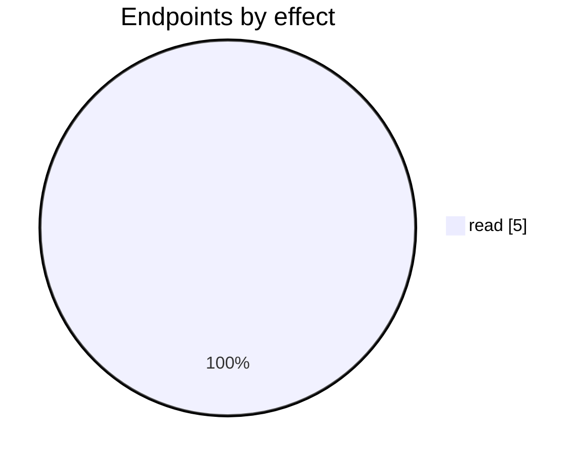

# Lokad

The Lokad connector: its settings page, mappings, logs and the endpoints behind them. Part of [Integrations](../README.md).

| 📄 Pages | 🧱 Models | 🔌 Endpoints | ✍️ Can write | 🌍 Public API |
|:-:|:-:|:-:|:-:|:-:|
| **1** | **0** + [shared](../../00-shared/README.md) | **5** | 0 | **0** |

[📄 Pages (1)](#pages) · [🔌 Endpoints (5)](#internal-endpoints) · [🖼️ UI](UI.md)

## How to rebuild it

| # | Build | How |
|:-:|---|---|
| 1 | 🔌 Internal API | Each controller's verbs · [contract](../../../docs/INTERNAL-API.md) · paged `{root, total}` · saves `{ID, HasErrors, Original, Updated}` |
| 2 | 🖥️ Screens | Server-rendered shell + page app, record from `#<guid>` · [page model](../../../docs/ARCHITECTURE.md#what-a-page-is) · every control in [UI.md](UI.md) |

## Pages

| Route | Menu label | Title | Bundle | Endpoints (write) |
|---|---|---|---|---:|
| `/Lokad` |  | Lokad | `Lokad2019` | 5 (0) |

## Internal endpoints

Grouped by controller. Effect: 🟢 read · 🟠 read + write at the same URL · 🔴 write. `api` = JSON under `/api/`, `mvc` = controller action.

### Lokad

| URL | Kind | Methods | Effect | Params | Body keys | Reader root |
|---|---|---|---|---|---|---|
| `/api/Lokad_Index_vSalesPriceTiers` | api | REST(GET read; POST/PUT/DELETE on store.sync) | 🟢 read |  |  |  |

### QuickLinks

| URL | Kind | Methods | Effect | Params | Body keys | Reader root |
|---|---|---|---|---|---|---|
| `/api/QuickLinks_Index_Tooltips/customer` | api | GET | 🟢 read | customerId |  |  |
| `/api/QuickLinks_Index_Tooltips/product` | api | GET | 🟢 read | currentPage customerId locationId productId |  |  |
| `/api/QuickLinks_Index_Tooltips/sections` | api | GET | 🟢 read |  |  |  |
| `/api/QuickLinks_Index_Tooltips/supplier` | api | GET | 🟢 read | supplierId |  |  |
