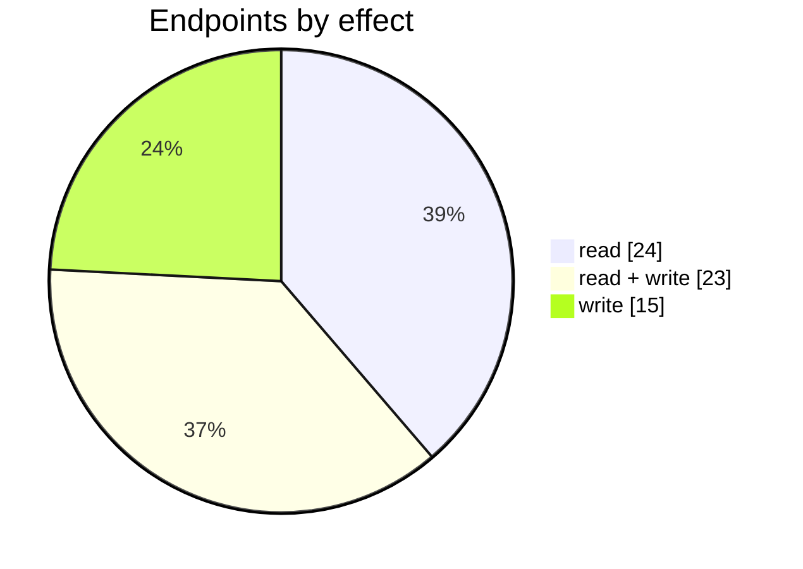
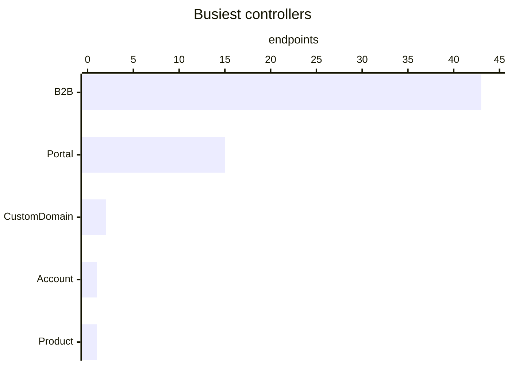

# Portal

The Portal connector: its settings page, mappings, logs and the endpoints behind them. Part of [Integrations](../README.md).

| 📄 Pages | 🧱 Models | 🔌 Endpoints | ✍️ Can write | 🌍 Public API |
|:-:|:-:|:-:|:-:|:-:|
| **1** | **30** + [shared](../../00-shared/README.md) | **62** | 38 | **0** |

[📄 Pages (1)](#pages) · [🧱 Models (30)](#data-models) · [🔌 Endpoints (62)](#internal-endpoints) · [🖼️ UI](UI.md) · [🗄️ schema.sql](schema.sql)

## How to rebuild it

| # | Build | How |
|:-:|---|---|
| 1 | 🗄️ Schema | 30 tables from [`schema.sql`](schema.sql); GUID ids, join on `*ID` |
| 2 | 🔌 Internal API | Each controller's verbs · [contract](../../../docs/INTERNAL-API.md) · paged `{root, total}` · saves `{ID, HasErrors, Original, Updated}` |
| 3 | 🖥️ Screens | Server-rendered shell + page app, record from `#<guid>` · [page model](../../../docs/ARCHITECTURE.md#what-a-page-is) · every control in [UI.md](UI.md) |

## Pages

| Route | Menu label | Title | Bundle | Endpoints (write) |
|---|---|---|---|---:|
| `/Portal` |  | Portal | `Portal2019` | 48 (41) |

## Data models

ExtJS models the pages use; `v` prefix = view-model. Full DDL in [`schema.sql`](schema.sql).

| Model | Fields |
|---|---|
| `B2B_SearchProduct` | Id:string, Code:string, Name:string, Type:string |
| `vAbandonedCart` | CartID:string, DateTime:date, CustomerContactEmail:string, CustomerID:string, CustomerContactName:string, CartTotal:float, CartTotalCurrency:string, Quantity:float |
| `vAbandonedCartProduct` | ProductID:string, CartID:string, ProductName:string, ProductCode:string, Quantity:float, PriceValue:float, PriceCurrency:string, AvailableQuantity:float, Status:string |
| `vAccount` | Code:string, DisplayName:string |
| `vAddress` | AddressID:string, Line1:string, Line2:string |
| `vBulkListingProduct` | ProductID:string, ProductCode:string, Name:string, Status:string, Category:string, Price:float, OrderedQuantity:float, MinimumToOrder:int, MaximumToOrder:int, Quantity:float, MenuItems:string, IsBackorderEnabled:bool |
| `vContact` | ID:string, ECSConfigID:string, ECSName:string, IsOrganization:bool, ContactType:string, Status:string, Tags:string |
| `vCustomerInvite` | ID:string, CustomerID:string, CustomerName:string, ContactPerson:string, Email:string, Status:string, Role:string, InviteSendDate:date, InviteAccepted:bool, Selected:bool, SaleRepAccessType:int |
| `vInvoiceTemplate` | TemplateID:string, Name:string |
| `vLocation` | LocationID:string, Description:string |
| `vNameValue` | Name:string, Value:string |
| `vNavbarItem` | ID:string, WebPortalID:string, NavbarType:string, Item:string, ItemId:string, ItemName:string, DisplayName:string, ItemType:string, LineOrder:int |
| `vOverviewAbandonedCarts` | ID:string, DateTime:date, ContactName:string, Quantity:float, CartTotal:float |
| `vOverviewCustomers` | CustomerID:string, CustomerName:string, Sales:int, Amount:float |
| `vOverviewSales` | ID:string, Date:date, Number:string, CustomerName:string, CustomerID:string, Amount:float, Status:string, TaskType:string |
| `vPaymentMethod` | Value:string, Name:string |
| `vPortalEmailTemplate` | WebPortalID:string, Name:string, Content:string, Description:string, Subject:string |
| `vPortalPage` | WebPortalPageID:string, WebPortalID:string, Name:string, LineOrder:string, Content:string, IsActive:string, Type:string |
| `vPortalPriceList` | WebPortalID:string, Name:string, ID:string, LineOrder:int |
| `vPriceListBrand` | ID:string, WebPortalPriceListID:string, BrandID:string, Name:string |
| `vPriceListCategory` | ID:string, WebPortalPriceListID:string, CategoryID:string, Name:string |
| `vPriceListTag` | ID:string, WebPortalPriceListID:string, Tag:string |
| `vProductAttributeRow` | ID:string, DisplayName:string, SetID:string, ColumnNumber:string, AttributeSetName:string, ColumnName:string, ColumnType:string, ColumnValues:string, AttributeName:string |
| `vShippingMethod` | ID:string, Name:string |
| `vShippingService` | ID:string, Name:string |
| `vSortingOption` | WebPortalID:string, ID:string, Name:string, B2BName:string, IsDefault:bool |
| `vWebPortal` | WebPortalID:string, Name:string, Type:string, Domain:string, Description:string, IsActive:bool, HorizontalNavbarDataType:string, DefaultCustomer:string, AllowBackorder:bool, ShowAdditionalAttributes:bool, ShowOutOfStockItems:bool, ShowMinimumOrderQuantityForProducts:bool, ShowMaximumOrderQuantityForProducts:bool, FacebookURL:string, GooglePlusURL:string, TwitterURL:string, InstagramURL:string, YouTubeURL:string, LinkedInURL:string, TenantContactID:string, TenantAddressID:string, LocationID:string, ShowImagesInShoppingCart:bool, SalesRepresentative:string, GoogleAnalyticsTrackerID:string, Goog… |
| `vWebPortalPageElements` | Id:string, WebPortalId:string, Name:string, LineOrder:int, IsRemovable:bool, IsVisible:bool, SectionType:string, Location:string, HideNavigationMenu:bool |
| `vWebPortalPageElementsDetails` | Id:string, WebPortalPageElementId:string, DetailsType:string, LineOrder:int, LinkType:string, ContentType:string, LinkItem:string, LinkMessage:string, LinkUrl:string, Text:string, FileName:string, FileHtml:string, IsFamily:string |
| `vWebPortalSale` | TaskId:string, OrderDate:date, Customer:string, SaleOrderNumber:string, Status:string, PaymentStatus:string, InvoiceAmount:float, Reference:string |

## Internal endpoints

Grouped by controller. Effect: 🟢 read · 🟠 read + write at the same URL · 🔴 write. `api` = JSON under `/api/`, `mvc` = controller action.

### Account

| URL | Kind | Methods | Effect | Params | Body keys | Reader root |
|---|---|---|---|---|---|---|
| `/Account/LoginRMA` | mvc |  | 🔴 write |  |  |  |

### B2B

| URL | Kind | Methods | Effect | Params | Body keys | Reader root |
|---|---|---|---|---|---|---|
| `/api/B2B_BulkList` | api | REST(GET read; POST/PUT/DELETE on store.sync) | 🟠 read + write | brand category configId family search tag |  | root |
| `/api/B2B_Index_AbandonedCarts` | api | REST(GET read; POST/PUT/DELETE on store.sync) | 🟢 read | fromDate search toDate webPortalId |  | root |
| `/api/B2B_Index_B2BPriceListTemplates` | api | REST(GET read; POST/PUT/DELETE on store.sync) | 🟠 read + write | WebPortalID |  |  |
| `/api/B2B_Index_ChangePortalDomain` | api | POST | 🔴 write | domainName webPortalID |  |  |
| `/api/B2B_Index_ChartOfAccounts` | api | REST(GET read; POST/PUT/DELETE on store.sync) | 🟠 read + write |  |  |  |
| `/api/B2B_Index_EcsBulkList` | api | REST(GET read; POST/PUT/DELETE on store.sync) | 🟠 read + write |  |  | root |
| `/api/B2B_Index_Family` | api | REST(GET read; POST/PUT/DELETE on store.sync) | 🟢 read |  |  |  |
| `/api/B2B_Index_InvoiceTemplates` | api | REST(GET read; POST/PUT/DELETE on store.sync) | 🟠 read + write |  |  |  |
| `/api/B2B_Index_Product` | api | REST(GET read; POST/PUT/DELETE on store.sync) | 🟢 read |  |  |  |
| `/api/B2B_Index_TenantPriceTierNames` | api | REST(GET read; POST/PUT/DELETE on store.sync) | 🟢 read |  |  |  |
| `/api/B2B_Index_vAddress` | api | REST(GET read; POST/PUT/DELETE on store.sync) | 🟠 read + write |  |  |  |
| `/api/B2B_Index_vAttributeSetRow` | api | REST(GET read; POST/PUT/DELETE on store.sync) | 🟠 read + write |  |  | Original |
| `/api/B2B_Index_vBrands` | api | REST(GET read; POST/PUT/DELETE on store.sync) | 🟢 read |  |  | Original |
| `/api/B2B_Index_vCategories` | api | REST(GET read; POST/PUT/DELETE on store.sync) | 🟢 read |  |  | Original |
| `/api/B2B_Index_vContacts` | api | REST(GET read; POST/PUT/DELETE on store.sync) | 🟠 read + write |  |  |  |
| `/api/B2B_Index_vCustomMenu` | api | GET POST | 🟠 read + write |  | Conditions Items WebPortalID |  |
| `/api/B2B_Index_vEmailTemplates` | api | REST(GET read; POST/PUT/DELETE on store.sync) | 🟠 read + write | WebPortalID |  |  |
| `/api/B2B_Index_vInvitations` | api | POST PUT REST(GET read; POST/PUT/DELETE on store.sync) | 🟠 read + write | search statusFilter webPortalId |  | root |
| `/api/B2B_Index_vInvitations/AccessType/Set` | api | POST | 🔴 write |  |  |  |
| `/api/B2B_Index_vLocation` | api | REST(GET read; POST/PUT/DELETE on store.sync) | 🟠 read + write |  |  |  |
| `/api/B2B_Index_vNavbarItems` | api | POST REST(GET read; POST/PUT/DELETE on store.sync) | 🟠 read + write | WebPortalID itemType navbar | List WebPortalID |  |
| `/api/B2B_Index_vPageElements` | api | REST(GET read; POST/PUT/DELETE on store.sync) | 🟠 read + write | WebPortalID |  |  |
| `/api/B2B_Index_vPageElementsDetails` | api | REST(GET read; POST/PUT/DELETE on store.sync) | 🟠 read + write | WebPortalID |  |  |
| `/api/B2B_Index_vPages` | api | REST(GET read; POST/PUT/DELETE on store.sync) | 🟠 read + write | WebPortalID |  |  |
| `/api/B2B_Index_vPaymentMethods` | api | POST REST(GET read; POST/PUT/DELETE on store.sync) | 🟠 read + write | WebPortalID | List WebPortalID |  |
| `/api/B2B_Index_vPaymentMethods/Types` | api | REST(GET read; POST/PUT/DELETE on store.sync) | 🟠 read + write |  |  |  |
| `/api/B2B_Index_vPriceList` | api | PUT REST(GET read; POST/PUT/DELETE on store.sync) | 🟠 read + write | WebPortalID | List WebPortalID |  |
| `/api/B2B_Index_vProductFamilies` | api | REST(GET read; POST/PUT/DELETE on store.sync) | 🟢 read |  |  | Original |
| `/api/B2B_Index_vProducts` | api | REST(GET read; POST/PUT/DELETE on store.sync) | 🟢 read |  |  | Original |
| `/api/B2B_Index_vRmaReturnLocation` | api | REST(GET read; POST/PUT/DELETE on store.sync) | 🟠 read + write |  |  |  |
| `/api/B2B_Index_vSaleRepInvitation` | api | POST | 🔴 write | accessType email name webPortalID |  |  |
| `/api/B2B_Index_vShippingMethods` | api | POST REST(GET read; POST/PUT/DELETE on store.sync) | 🟠 read + write | WebPortalID | List WebPortalID |  |
| `/api/B2B_Index_vShippingServices` | api | REST(GET read; POST/PUT/DELETE on store.sync) | 🟢 read |  |  |  |
| `/api/B2B_Index_vSortingOptionTypes` | api | REST(GET read; POST/PUT/DELETE on store.sync) | 🟢 read |  |  |  |
| `/api/B2B_Index_vSortingOptions` | api | POST REST(GET read; POST/PUT/DELETE on store.sync) | 🟠 read + write | WebPortalID | List WebPortalID |  |
| `/api/B2B_Index_vTags` | api | REST(GET read; POST/PUT/DELETE on store.sync) | 🟢 read |  |  |  |
| `/api/B2B_Index_vTenantCarriers` | api | GET | 🟢 read |  |  |  |
| `/api/B2B_Index_vWebPortal` | api | REST(GET read; POST/PUT/DELETE on store.sync) | 🟠 read + write |  |  |  |
| `/api/B2B_Overview_AbandonedCarts` | api | REST(GET read; POST/PUT/DELETE on store.sync) | 🟢 read | lang webPortalId |  | root |
| `/api/B2B_Overview_Customers` | api | REST(GET read; POST/PUT/DELETE on store.sync) | 🟢 read | lang webPortalId |  | root |
| `/api/B2B_Overview_SaleSummary` | api | POST | 🟢 read |  |  |  |
| `/api/B2B_Overview_Sales` | api | REST(GET read; POST/PUT/DELETE on store.sync) | 🟢 read | webPortalId |  | root |
| `/api/B2B_Sales` | api | REST(GET read; POST/PUT/DELETE on store.sync) | 🟢 read | filter search webPortalId |  | root |

### CustomDomain

| URL | Kind | Methods | Effect | Params | Body keys | Reader root |
|---|---|---|---|---|---|---|
| `/api/CustomDomain` | api | GET | 🟢 read | webPortalId |  |  |
| `/api/CustomDomain/status` | api | GET | 🟢 read | webPortalId |  |  |

### Portal

| URL | Kind | Methods | Effect | Params | Body keys | Reader root |
|---|---|---|---|---|---|---|
| `/Portal/AddDomain` | mvc | POST | 🔴 write |  |  |  |
| `/Portal/AuthorisePost` | mvc | POST | 🔴 write |  |  |  |
| `/Portal/BulkChangeProductBackorderState` | mvc |  | 🔴 write |  |  |  |
| `/Portal/BulkListDelist` | mvc |  | 🔴 write |  |  |  |
| `/Portal/BulkListRecalculateQuantities` | mvc |  | 🔴 write |  |  |  |
| `/Portal/ChangeProductBackorderState` | mvc | POST | 🔴 write |  | IsEnabled ProductID WebPortalID |  |
| `/Portal/CustomMenuPreview` | mvc | POST | 🟢 read |  | Colors Conditions CustomMenuFirstLevelBgColor CustomMenuFirstLevelHoverBgColor CustomMenuFirstLevelTextColor CustomMenuSecondLevelBgColor CustomMenuSecondLevel… |  |
| `/Portal/DownloadCartImage` | mvc |  | 🟢 read | id |  |  |
| `/Portal/DownloadLogo` | mvc |  | 🟢 read | id |  |  |
| `/Portal/DownloadNoImage` | mvc |  | 🟢 read | id |  |  |
| `/Portal/RemoveCustomDomain` | mvc | DELETE | 🔴 write | id |  |  |
| `/Portal/ResetCartImage` | mvc | DELETE | 🔴 write | id |  |  |
| `/Portal/UploadCartImage` | mvc | POST | 🔴 write |  |  |  |
| `/Portal/UploadLogo` | mvc | POST | 🔴 write |  |  |  |
| `/Portal/UploadPageItemsImages` | mvc | POST | 🔴 write |  |  |  |

### Product

| URL | Kind | Methods | Effect | Params | Body keys | Reader root |
|---|---|---|---|---|---|---|
| `/api/Product_Index_Tags` | api | REST(GET read; POST/PUT/DELETE on store.sync) | 🟢 read |  |  |  |
