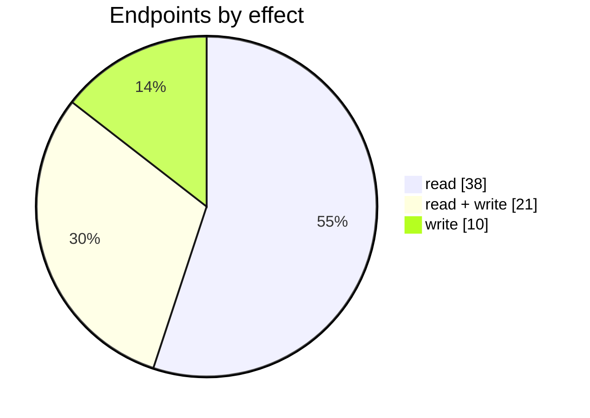
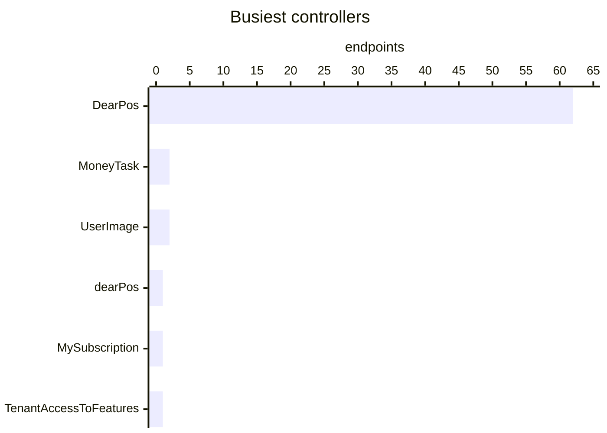

# POS

The POS connector: its settings page, mappings, logs and the endpoints behind them. Part of [Integrations](../README.md).

| 📄 Pages | 🧱 Models | 🔌 Endpoints | ✍️ Can write | 🌍 Public API |
|:-:|:-:|:-:|:-:|:-:|
| **1** | **43** + [shared](../../00-shared/README.md) | **69** | 31 | **0** |

[📄 Pages (1)](#pages) · [🧱 Models (43)](#data-models) · [🔌 Endpoints (69)](#internal-endpoints) · [🖼️ UI](UI.md) · [🗄️ schema.sql](schema.sql)

## How to rebuild it

| # | Build | How |
|:-:|---|---|
| 1 | 🗄️ Schema | 43 tables from [`schema.sql`](schema.sql); GUID ids, join on `*ID` |
| 2 | 🔌 Internal API | Each controller's verbs · [contract](../../../docs/INTERNAL-API.md) · paged `{root, total}` · saves `{ID, HasErrors, Original, Updated}` |
| 3 | 🖥️ Screens | Server-rendered shell + page app, record from `#<guid>` · [page model](../../../docs/ARCHITECTURE.md#what-a-page-is) · every control in [UI.md](UI.md) |

## Pages

| Route | Menu label | Title | Bundle | Endpoints (write) |
|---|---|---|---|---:|
| `/DearPos` |  | POS | `Pos2019` | 57 (34) |

## Data models

ExtJS models the pages use; `v` prefix = view-model. Full DDL in [`schema.sql`](schema.sql).

| Model | Fields |
|---|---|
| `AspnetRole` | RoleId:string, RoleName:string |
| `CashManagementReason` | ID:string, ReasonName:string |
| `Category2` | Category:string |
| `ConsolidationStore` | type:string, description:string |
| `ECommerceShop` | ConfigID:string, ShopName:string |
| `EcsProductDetails` | ProductID:string, SyncStockLevel:bool, UseBufferInventory:bool, BufferInventory:int, SyncBufferInventory:int, SyncQuantity:float |
| `OutletSelector` | PosOutletID:string, OutletName:string |
| `ReferenceDataModel` | ID:int, TimeZone:string, TenantTaxCalculationMethod:string |
| `RegisterCountModel` | RegisterCount:int |
| `TopicStore` | type:string, description:string |
| `vAccount` | Code:string, DisplayName:string |
| `vAspnetUserRoles` | UserId:string, UserName:string, Name:string |
| `vBanknoteDenomination` | BanknoteID:string, Code:string, Nominal:float |
| `vCCLP` | CustomerID:string, Name:string, LoyaltyPoints:float, StoreCredits:float, SendReceiptViaEmail:bool |
| `vECSOrderLog` | LogID:string, ConfigID:string, Date:date, DownloadDate:date, ProcessDate:date, OrderNumber:string, SaleTaskID:string, Status:string, Type:string, SaleOrderNumber:string, RefundID:string, OrderID:string, IsNewSale:bool |
| `vECSPaymentsToExport` | TaskID:string, OrderID:string, OrderNumber:string, TaskID:string, InvoiceNumber:string, Error:string |
| `vECSPendingOrdersNew` | OrderLineID:string, OrderNumber:string, DateCreated:date, Name:string, Quantity:float, Total:float, CustomerName:string, Error:string, ValidationText:string, ValidationState:string |
| `vECSPurchases` | LogID:string, ConfigID:string, ECSPurchaseID:string, ECSPurchaseNumber:string, ECSStatus:string, DearPurchaseID:string, CreatedDate:date, ReceivedDate:date, Location:string, DearStatus:string, DearOrderNumber:string |
| `vECSStockAdjustments` | LogID:string, ConfigID:string, ECSStockAdjustmentID:string, ECSStockAdjustmentNumber:string, ECSStatus:string, DearStockAdjustmentID:string, CreatedDate:date, CompletedDate:date, DearStatus:string, DearNumber:string |
| `vECSStockTransfers` | LogID:string, ConfigID:string, ECSStockTransferID:string, ECSStockTransferNumber:string, ECSStatus:string, DearStockTransferID:string, FromLocation:string, ToLocation:string, CreatedDate:date, ReceivedDate:date, DearStatus:string, DearNumber:string |
| `vEcsBulkListing` | ProductID:string, ProductCode:string, Name:string, Status:string, Category:string, ProductType:string, Price:float, Quantity:float, UseBufferInventory:bool, BufferInventory:int, SyncBufferInventory:int, SyncQuantity:float |
| `vEcsConfiguration` | ID:string, TenantID:string, ShopName:string, AccessToken:string, RefreshToken:string, PrimaryPriceTier:int, ConsolidationType:string, ConsolidationTimeText:string, ConsolidateToCustomerID:string, IsActive:bool, PickWhenOrderStatus:string, ShippingTaxed:bool, SyncStockLevel:bool, ExportShippingInformation:bool, AutoInvoicingMode:string, AutoFulfilmentMode:string, ECSspecificParameter1:bool, ECSspecificParameter9:string, ECSspecificParameter8:string, ECSspecificParameter6:bool, ECSspecificParameter10:string, CustomerName:string, ECSTokenType:string, RevenueAccount:string, MoneySettlementBankAcc… |
| `vEcsOverviewCustomersList` | CustomerID:string, Name:string, OrderCount:int, PaidTotalAmount:decimal, ConfigID:string |
| `vEcsOverviewSalesList` | SaleOrderDate:date, SaleOrderNumber:string, CustomerName:string, Status:string, PaidTotalAmount:decimal, InvoicingStatus:string, OrderStatus:string, FulFilmentStatus:string, PaymentStatus:string, TaskID:string, TT:int, ConfigID:string |
| `vLocation` | LocationID:string, Description:string |
| `vNameCodeModel` | Code:string, Name:string |
| `vPaymentMethod` | Value:string, Name:string |
| `vPaymentMethodSurcharge` | SurchargeID:string, PaymentMethodID:string, ConfigID:string |
| `vPosOutlets` | PosOutletID:string, LocationID:string, OutletName:string, TimeZone:string, DefaultTaxRule:string, LocationName:string, DefaultTaxRuleName:string, CountRegistry:int, EcsPaymentProcessorID:string, LedgerAccount:string, ReceiptID:string, PrintNotes:bool, PrintDiscounts:bool, Active:bool, SquareIntegrationID:string, PaymentSenseURL:string, PaymentSenseAPIKey:string, SurchargeTaxRule:string, PaymentSenseAPIKey:string, TyroMerchantID:string, TriPOSAccountID:string, TriPOSAcceptorID:string, TriPOSAccountToken:string, CustomizedCustomerDisplayUI:bool, CustomerDisplayLogo:string, CustomerDisplayBackgr… |
| `vPosProductEx` | ProductID:string, Name:string, SKU:string, Category:string, OutletSKU:string, ConfigID:string, PosOutletID:string, ValidationText:string, ValidationState:string |
| `vPosQuickKey` | QuickKeyID:string, Name:string, ContentQuery:string |
| `vProductionCalendar` | CalendarID:string, Year:int, WeekStart:int, ValidationState:string, ValidationText:string |
| `vProductionCalendarDay` | DayID:string, CalendarID:string, DayOfWeek:int, IsWeekend:boolean, StartTime:int, EndTime:int, StartTimeStr:string, EndTimeStr:string, BreakStartTime:int, BreakEndTime:int, BreakStartTimeStr:string, BreakEndTimeStr:string, SortOrder:int, ValidationState:string, ValidationText:string |
| `vProductionCalendarSpecialDay` | DayID:string, CalendarID:string, Date:date, IsWeekend:boolean, IsHoliday:boolean, StartTime:int, EndTime:int, StartTimeStr:string, EndTimeStr:string, BreakStartTime:int, BreakEndTime:int, BreakStartTimeStr:string, BreakEndTimeStr:string, Comment:string, ValidationState:string, ValidationText:string |
| `vReceiptTemplate` | TemplateID:string, Name:string |
| `vRegistries` | ConfigID:string, RegistryID:string, RegistryCode:string, LocationID:string, LocationName:string, EcsPaymentProcessorID:string, LedgerAccount:string, ReceiptID:string, TillDiscrepancyMapping:string, CashFloatMapping:string, PettyCashMapping:string, CashInOutMapping:string, RegistryPrefix:string, RegistrySuffix:string, Active:bool, QuickKeyID:string, UseTyro:bool, TyroTerminalID:string, UseTriPOS:bool, TriPOSLaneID:string, CatalogTilesSize:string, CatalogTilesVisibility:string, ShowProductAvailability:bool, LinklyUserName:string, LinklyPassword:string, WindcaveStation:string |
| `vReportTemplate` | TemplateID:string, Name:string |
| `vSquareIntegration` | ID:string, ShopName:string |
| `vSurcharge` | PaymentMethod:string, Type:string, FlatAmount:float, Rate:float, MaxAmount:float |
| `vTax` | RuleID:string, Description:string |
| `vTime` | Value:string, Name:string |
| `vTimezone` | name:string, displayName:string |
| `vUserImage` | UserId:string, ImageID:string, ContentType:string, FileName:string, Uri:string, isDefault:bool, IsImage:bool |

## Internal endpoints

Grouped by controller. Effect: 🟢 read · 🟠 read + write at the same URL · 🔴 write. `api` = JSON under `/api/`, `mvc` = controller action.

### DearPos

| URL | Kind | Methods | Effect | Params | Body keys | Reader root |
|---|---|---|---|---|---|---|
| `/DearPos/CustomerImport` | mvc | GET(navigate) | 🔴 write | applicationID ref |  |  |
| `/DearPos/DeleteQuickKeyImage` | mvc | DELETE | 🔴 write | quickKeyID |  |  |
| `/DearPos/DownloadQuickKeyImage` | mvc |  | 🟢 read |  |  |  |
| `/DearPos/GetImage` | mvc | POST | 🟢 read | imageID |  |  |
| `/DearPos/ListOrUpdateProduct` | mvc | POST | 🔴 write | ConfigID Loyalty ProductID SyncStockLevel |  |  |
| `/DearPos/OutletLevelSKUImport` | mvc | GET(navigate) | 🔴 write | applicationID ref |  |  |
| `/DearPos/RemoveProduct` | mvc | POST | 🔴 write | ConfigID ProductID |  |  |
| `/DearPos/ToggleAccess` | mvc | POST | 🔴 write | UserId permission value |  |  |
| `/DearPos/UploadLogoImage` | mvc | POST | 🔴 write |  |  |  |
| `/api/DearPos_Index_AspnetRole` | api | REST(GET read; POST/PUT/DELETE on store.sync) | 🟢 read | ConfigID |  |  |
| `/api/DearPos_Index_CashManagementReasons` | api | REST(GET read; POST/PUT/DELETE on store.sync) | 🟠 read + write | configID |  | root |
| `/api/DearPos_Index_Dashboard` | api | GET | 🟢 read |  |  |  |
| `/api/DearPos_Index_Dashboard_Settings` | api | GET | 🟢 read |  |  |  |
| `/api/DearPos_Index_Dashboard_Summary` | api | GET | 🟢 read |  |  |  |
| `/api/DearPos_Index_EcsBulkList` | api | REST(GET read; POST/PUT/DELETE on store.sync) | 🟠 read + write | Category ConfigID Family Tag brandID lang listStatus listedInConfigID search |  | root |
| `/api/DearPos_Index_EcsBulkUnList` | api | POST | 🔴 write |  | CountToList |  |
| `/api/DearPos_Index_Family` | api | REST(GET read; POST/PUT/DELETE on store.sync) | 🟢 read |  |  |  |
| `/api/DearPos_Index_PosRoundingDenomination` | api | REST(GET read; POST/PUT/DELETE on store.sync) | 🟢 read |  |  |  |
| `/api/DearPos_Index_PosRoundingRules` | api | REST(GET read; POST/PUT/DELETE on store.sync) | 🟢 read |  |  |  |
| `/api/DearPos_Index_ReferenceData` | api | REST(GET read; POST/PUT/DELETE on store.sync) | 🟢 read |  |  |  |
| `/api/DearPos_Index_Tags` | api | REST(GET read; POST/PUT/DELETE on store.sync) | 🟢 read |  |  |  |
| `/api/DearPos_Index_vAccounts` | api | REST(GET read; POST/PUT/DELETE on store.sync) | 🟢 read |  |  |  |
| `/api/DearPos_Index_vBanknoteDenominations` | api | REST(GET read; POST/PUT/DELETE on store.sync) | 🟠 read + write |  |  | root |
| `/api/DearPos_Index_vBrands` | api | REST(GET read; POST/PUT/DELETE on store.sync) | 🟢 read |  |  |  |
| `/api/DearPos_Index_vCCLP` | api | REST(GET read; POST/PUT/DELETE on store.sync) | 🟢 read | ConfigID search |  | root |
| `/api/DearPos_Index_vCashFloatAccounts` | api | REST(GET read; POST/PUT/DELETE on store.sync) | 🟢 read |  |  |  |
| `/api/DearPos_Index_vCategory` | api | REST(GET read; POST/PUT/DELETE on store.sync) | 🟢 read |  |  |  |
| `/api/DearPos_Index_vCategory2` | api | REST(GET read; POST/PUT/DELETE on store.sync) | 🟢 read |  |  |  |
| `/api/DearPos_Index_vCustomer` | api | REST(GET read; POST/PUT/DELETE on store.sync) | 🟢 read |  |  |  |
| `/api/DearPos_Index_vDearPosOverviewCustomersList` | api | REST(GET read; POST/PUT/DELETE on store.sync) | 🟢 read | ConfigID search |  | root |
| `/api/DearPos_Index_vDearPosOverviewSalesList` | api | REST(GET read; POST/PUT/DELETE on store.sync) | 🟢 read | ConfigID search |  | root |
| `/api/DearPos_Index_vDearPosPendingOrders` | api | REST(GET read; POST/PUT/DELETE on store.sync) | 🟢 read | configId search |  | root |
| `/api/DearPos_Index_vECSPaymentsToExport` | api | REST(GET read; POST/PUT/DELETE on store.sync) | 🟠 read + write | ConfigID search |  | root |
| `/api/DearPos_Index_vEcsConfiguration` | api | REST(GET read; POST/PUT/DELETE on store.sync) | 🟠 read + write |  |  |  |
| `/api/DearPos_Index_vEcsLogs` | api | DELETE REST(GET read; POST/PUT/DELETE on store.sync) | 🟠 read + write | ConfigID search |  | root |
| `/api/DearPos_Index_vEcsProduct` | api | REST(GET read; POST/PUT/DELETE on store.sync) | 🟢 read | ConfigID ProductID |  |  |
| `/api/DearPos_Index_vEcsProductList` | api | REST(GET read; POST/PUT/DELETE on store.sync) | 🟠 read + write | ConfigID lang search |  | root |
| `/api/DearPos_Index_vEcsPurchaseLogs` | api | REST(GET read; POST/PUT/DELETE on store.sync) | 🟠 read + write | ConfigID search |  | root |
| `/api/DearPos_Index_vEcsStockAdjustmentLogs` | api | REST(GET read; POST/PUT/DELETE on store.sync) | 🟠 read + write | ConfigID search |  | root |
| `/api/DearPos_Index_vEcsStockTransferLogs` | api | REST(GET read; POST/PUT/DELETE on store.sync) | 🟠 read + write |  |  | root |
| `/api/DearPos_Index_vExpenseAccounts` | api | REST(GET read; POST/PUT/DELETE on store.sync) | 🟢 read |  |  |  |
| `/api/DearPos_Index_vLocation` | api | REST(GET read; POST/PUT/DELETE on store.sync) | 🟢 read |  |  |  |
| `/api/DearPos_Index_vPaymentMethods` | api | REST(GET read; POST/PUT/DELETE on store.sync) | 🟠 read + write | ConfigID PosOutletID |  |  |
| `/api/DearPos_Index_vPettyCashAccounts` | api | REST(GET read; POST/PUT/DELETE on store.sync) | 🟢 read |  |  |  |
| `/api/DearPos_Index_vPosOutlets` | api | DELETE PUT REST(GET read; POST/PUT/DELETE on store.sync) | 🟠 read + write | ConfigID id isNew | Active CustomerDisplayBackground CustomizedCustomerDisplayUI PaymentSenseAPIKey PaymentSenseURL PrintDiscounts SquareIntegrationID TriPOSAcceptorID TriPOSAccou… |  |
| `/api/DearPos_Index_vPosOutletsSelect` | api | REST(GET read; POST/PUT/DELETE on store.sync) | 🟢 read | ConfigID |  |  |
| `/api/DearPos_Index_vPosProduct` | api | REST(GET read; POST/PUT/DELETE on store.sync) | 🟠 read + write | ConfigID HasOutletSKU Name PosOutletID lang search |  | root |
| `/api/DearPos_Index_vPosQuickKey` | api | DELETE PUT REST(GET read; POST/PUT/DELETE on store.sync) | 🟠 read + write | id |  |  |
| `/api/DearPos_Index_vPosRegisterCount` | api | REST(GET read; POST/PUT/DELETE on store.sync) | 🟠 read + write | ConfigID |  |  |
| `/api/DearPos_Index_vReceiptTemplates` | api | REST(GET read; POST/PUT/DELETE on store.sync) | 🟢 read |  |  |  |
| `/api/DearPos_Index_vRegistries` | api | DELETE PUT REST(GET read; POST/PUT/DELETE on store.sync) | 🟠 read + write | ConfigID OutletId id | Active CashInOutMapping CatalogTilesSize CatalogTilesVisibility LinklyPassword LinklyUserName PettyCashMapping QuickKeyID RegistryPrefix RegistrySuffix ShowPro… |  |
| `/api/DearPos_Index_vReportTemplates` | api | REST(GET read; POST/PUT/DELETE on store.sync) | 🟢 read | type |  |  |
| `/api/DearPos_Index_vRevenueAccounts` | api | REST(GET read; POST/PUT/DELETE on store.sync) | 🟢 read |  |  |  |
| `/api/DearPos_Index_vSalesPriceTiers` | api | REST(GET read; POST/PUT/DELETE on store.sync) | 🟢 read |  |  |  |
| `/api/DearPos_Index_vSquareConfigs` | api | REST(GET read; POST/PUT/DELETE on store.sync) | 🟢 read |  |  |  |
| `/api/DearPos_Index_vSupplier` | api | REST(GET read; POST/PUT/DELETE on store.sync) | 🟢 read |  |  |  |
| `/api/DearPos_Index_vSurcharge` | api | POST REST(GET read; POST/PUT/DELETE on store.sync) | 🟠 read + write | configID limit start | ConfigID IsActive Name RefundSurcharge Type Value | root |
| `/api/DearPos_Index_vTaxRules` | api | REST(GET read; POST/PUT/DELETE on store.sync) | 🟢 read |  |  |  |
| `/api/DearPos_Index_vTillDiscrepancyAccounts` | api | REST(GET read; POST/PUT/DELETE on store.sync) | 🟢 read |  |  |  |
| `/api/DearPos_Index_vTimezone` | api | REST(GET read; POST/PUT/DELETE on store.sync) | 🟢 read |  |  |  |
| `/api/DearPos_Index_vUserManagement` | api | POST PUT REST(GET read; POST/PUT/DELETE on store.sync) | 🟠 read + write | ConfigID id | ConfigID Name PosOutletIDs RoleId UserName | root |
| `/api/DearPos_Index_vZeroTax` | api | REST(GET read; POST/PUT/DELETE on store.sync) | 🟠 read + write |  |  |  |

### dearPos

| URL | Kind | Methods | Effect | Params | Body keys | Reader root |
|---|---|---|---|---|---|---|
| `/api/dearPos_Index_vUserImage` | api | REST(GET read; POST/PUT/DELETE on store.sync) | 🟠 read + write | UserID |  |  |

### MoneyTask

| URL | Kind | Methods | Effect | Params | Body keys | Reader root |
|---|---|---|---|---|---|---|
| `/MoneyTask/Receive` | mvc |  | 🟢 read |  |  |  |
| `/MoneyTask/Spend` | mvc |  | 🟢 read |  |  |  |

### MySubscription

| URL | Kind | Methods | Effect | Params | Body keys | Reader root |
|---|---|---|---|---|---|---|
| `/MySubscription/DetailsUpdate` | mvc | GET | 🔴 write |  |  |  |

### TenantAccessToFeatures

| URL | Kind | Methods | Effect | Params | Body keys | Reader root |
|---|---|---|---|---|---|---|
| `/api/TenantAccessToFeatures` | api | GET POST | 🟠 read + write |  |  |  |

### UserImage

| URL | Kind | Methods | Effect | Params | Body keys | Reader root |
|---|---|---|---|---|---|---|
| `/UserImage/DownloadImage` | mvc |  | 🟢 read | id |  |  |
| `/UserImage/Upload` | mvc | POST | 🔴 write |  |  |  |
