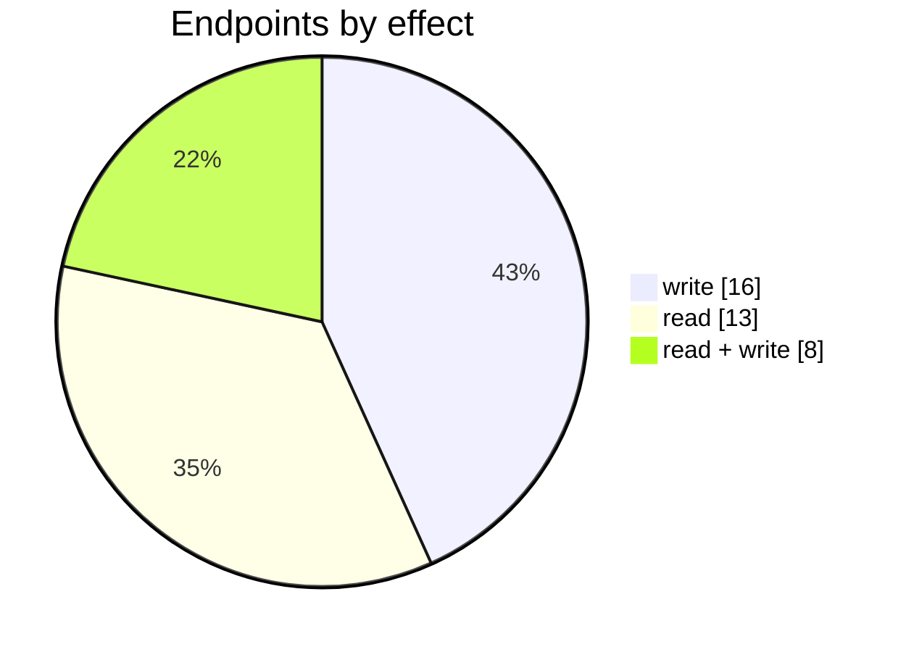
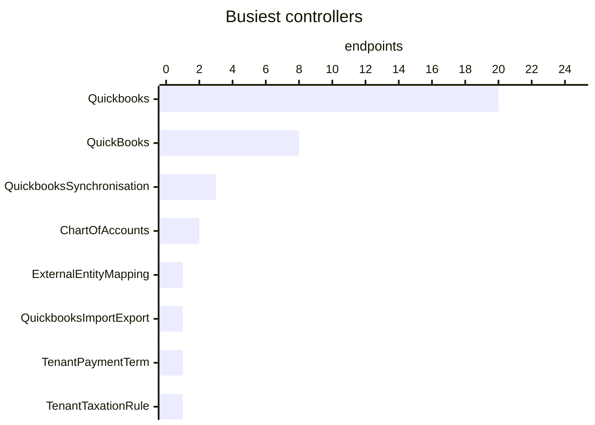

# QuickBooks

The QuickBooks connector: its settings page, mappings, logs and the endpoints behind them. Part of [Integrations](../README.md).

| 📄 Pages | 🧱 Models | 🔌 Endpoints | ✍️ Can write | 🌍 Public API |
|:-:|:-:|:-:|:-:|:-:|
| **1** | **11** + [shared](../../00-shared/README.md) | **37** | 24 | **0** |

[📄 Pages (1)](#pages) · [🧱 Models (11)](#data-models) · [🔌 Endpoints (37)](#internal-endpoints) · [🖼️ UI](UI.md) · [🗄️ schema.sql](schema.sql)

## How to rebuild it

| # | Build | How |
|:-:|---|---|
| 1 | 🗄️ Schema | 11 tables from [`schema.sql`](schema.sql); GUID ids, join on `*ID` |
| 2 | 🔌 Internal API | Each controller's verbs · [contract](../../../docs/INTERNAL-API.md) · paged `{root, total}` · saves `{ID, HasErrors, Original, Updated}` |
| 3 | 🖥️ Screens | Server-rendered shell + page app, record from `#<guid>` · [page model](../../../docs/ARCHITECTURE.md#what-a-page-is) · every control in [UI.md](UI.md) |

## Pages

| Route | Menu label | Title | Bundle | Endpoints (write) |
|---|---|---|---|---:|
| `/Quickbooks` |  | QuickBooks | `Quickbooks2019` | 14 (17) |

## Data models

ExtJS models the pages use; `v` prefix = view-model. Full DDL in [`schema.sql`](schema.sql).

| Model | Fields |
|---|---|
| `ExternalEntityMapping` | ID:string, ExternalCode:string, ExternalName:string, EntityCode:string, EntityType:string |
| `ExternalEntityMappingTaxRule` | ID:string, ExternalCode:string, ExternalName:string, EntityCode:string, EntityType:string, TaxRuleIsActive:bool, TaxRuleIsPurchase:bool, TaxRuleIsSale:bool, TaxRulePercent:float, TaxRuleName:string |
| `InventoryProductsCountInfo` | Count:int |
| `JournalsSearchResultModel` | QBOID:string, Date:date, DocNumber:string, Selected:boolean |
| `QuickbooksAccounts` | Code:string, DisplayName:string, Class:string, Type:string, SystemAccount:string, IsFirst:bool |
| `QuickbooksPaymentTerm` | Id:string, Name:string |
| `QuickbooksTaxationRule` | TaxType:string, Name:string, EffectiveRate:float, IsPurchaseTaxRule:bool, IsSaleTaxRule:bool |
| `vConsolidateCustomers` | value:string, name:string |
| `vConsolidationChannelTypesStore` | EntryID:string, SaleChannel:string, InvoiceSyncType:string, COGSSyncType:string |
| `vLocation` | LocationID:string, Description:string |
| `vMailingList` | MailingListID:string, Name:string, Emails:string, ValidationText:string, ValidationState:string |

## Internal endpoints

Grouped by controller. Effect: 🟢 read · 🟠 read + write at the same URL · 🔴 write. `api` = JSON under `/api/`, `mvc` = controller action.

### ChartOfAccounts

| URL | Kind | Methods | Effect | Params | Body keys | Reader root |
|---|---|---|---|---|---|---|
| `/api/ChartOfAccounts_Index_vChartOfAccounts` | api | POST PUT REST(GET read; POST/PUT/DELETE on store.sync) | 🟠 read + write | includeXeroAccountsIfPossible returnActiveOnly |  |  |
| `/api/ChartOfAccounts_Index_vChartOfAccountsType` | api | POST | 🟢 read |  |  |  |

### ExternalEntityMapping

| URL | Kind | Methods | Effect | Params | Body keys | Reader root |
|---|---|---|---|---|---|---|
| `/api/ExternalEntityMapping_Index_vExternalEntityMapping` | api | REST(GET read; POST/PUT/DELETE on store.sync) | 🟠 read + write | returnActiveOnly showDetails type |  |  |

### QuickBooks

| URL | Kind | Methods | Effect | Params | Body keys | Reader root |
|---|---|---|---|---|---|---|
| `/QuickBooks/ConnectWizardFinish` | mvc | POST | 🔴 write |  |  |  |
| `/api/QuickBooks_CheckOverpayments` | api | POST | 🟢 read |  |  |  |
| `/api/QuickBooks_ImportOB` | api | POST | 🔴 write |  |  |  |
| `/api/QuickBooks_ImportSoH` | api | POST | 🔴 write |  |  |  |
| `/api/QuickBooks_Index_Integration` | api | POST | 🔴 write |  |  |  |
| `/api/QuickBooks_ReplaceProduct` | api | POST | 🔴 write |  |  |  |
| `/api/QuickBooks_StartOnboardingImport` | api | POST | 🔴 write |  |  |  |
| `/api/QuickBooks_StartSync` | api | POST | 🔴 write |  |  |  |

### Quickbooks

| URL | Kind | Methods | Effect | Params | Body keys | Reader root |
|---|---|---|---|---|---|---|
| `/Quickbooks/ConnectWizard` | mvc | GET(navigate) | 🔴 write | isSandbox |  |  |
| `/Quickbooks/ConsolidatedTransactionDetails` | mvc |  | 🟢 read |  |  |  |
| `/Quickbooks/ExportCOGS` | mvc | POST | 🟢 read | From To |  |  |
| `/Quickbooks/ExportHistoricalData` | mvc | POST | 🟢 read |  |  |  |
| `/Quickbooks/GenerateSaleChannelList` | mvc | POST(read) | 🔴 write | consolidationChannelTypeJsonStr requestedSaleChannelMode |  |  |
| `/Quickbooks/GetCustomersSuppliersCount` | mvc | GET | 🟢 read |  |  |  |
| `/Quickbooks/QuickbooksChartOfAccounts` | mvc | REST(GET read; POST/PUT/DELETE on store.sync) | 🟢 read |  |  |  |
| `/Quickbooks/QuickbooksInventoryProductsCount` | mvc | REST(GET read; POST/PUT/DELETE on store.sync) | 🟢 read |  |  |  |
| `/Quickbooks/QuickbooksPaymentTerms` | mvc | REST(GET read; POST/PUT/DELETE on store.sync) | 🔴 write |  |  |  |
| `/Quickbooks/QuickbooksTaxRules` | mvc | REST(GET read; POST/PUT/DELETE on store.sync) | 🟢 read |  |  |  |
| `/Quickbooks/SetQuickbooksSyncModeDirectionBothWays` | mvc | POST | 🔴 write |  |  |  |
| `/Quickbooks/StartConnection` | mvc |  | 🔴 write | type |  |  |
| `/Quickbooks/VoidCOGS` | mvc | POST | 🔴 write | From To |  |  |
| `/api/Quickbooks_Customer` | api | REST(GET read; POST/PUT/DELETE on store.sync) | 🟠 read + write |  |  | root |
| `/api/Quickbooks_HasConsolidatedTranscations` | api | GET | 🟢 read |  |  |  |
| `/api/Quickbooks_Index_ConsolidatedTranscations` | api | REST(GET read; POST/PUT/DELETE on store.sync) | 🟢 read |  |  | root |
| `/api/Quickbooks_Index_JournalsReconciliation` | api | GET POST | 🟠 read + write | fromDate toDate |  |  |
| `/api/Quickbooks_Index_vMailingList` | api | REST(GET read; POST/PUT/DELETE on store.sync) | 🟠 read + write |  |  | root |
| `/api/Quickbooks_Location` | api | REST(GET read; POST/PUT/DELETE on store.sync) | 🟢 read |  |  |  |
| `/api/Quickbooks_StartSync` | api | POST | 🔴 write |  |  |  |

### QuickbooksImportExport

| URL | Kind | Methods | Effect | Params | Body keys | Reader root |
|---|---|---|---|---|---|---|
| `/QuickbooksImportExport/Quickbooks` | mvc | GET(navigate) | 🔴 write |  |  |  |

### QuickbooksSynchronisation

| URL | Kind | Methods | Effect | Params | Body keys | Reader root |
|---|---|---|---|---|---|---|
| `/QuickbooksSynchronisation/GetLastSyncDate` | mvc | GET | 🟢 read |  |  |  |
| `/api/QuickbooksSynchronisation_History` | api | REST(GET read; POST/PUT/DELETE on store.sync) | 🟠 read + write | entity search status |  | root |
| `/api/QuickbooksSynchronisation_History/BulkStatusUpdate` | api | POST | 🔴 write |  |  |  |

### TenantPaymentTerm

| URL | Kind | Methods | Effect | Params | Body keys | Reader root |
|---|---|---|---|---|---|---|
| `/api/TenantPaymentTerm_Index_vTenantPaymentTerm` | api | DELETE REST(GET read; POST/PUT/DELETE on store.sync) | 🟠 read + write | id |  |  |

### TenantTaxationRule

| URL | Kind | Methods | Effect | Params | Body keys | Reader root |
|---|---|---|---|---|---|---|
| `/api/TenantTaxationRule_Index_vTenantTaxationRule` | api | POST PUT REST(GET read; POST/PUT/DELETE on store.sync) | 🟠 read + write |  |  |  |
