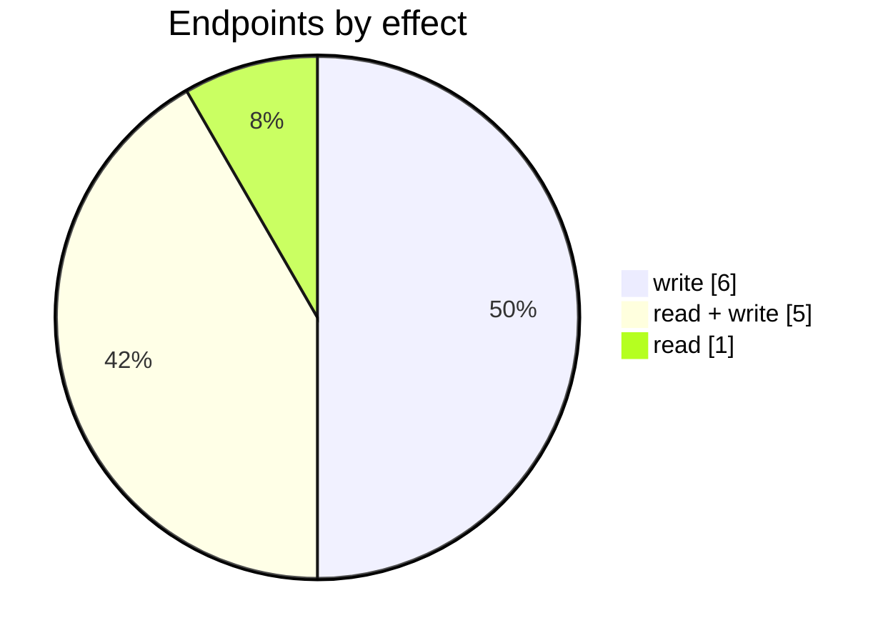

# RMA Portal

The RMA Portal connector: its settings page, mappings, logs and the endpoints behind them. Part of [Integrations](../README.md).

| 📄 Pages | 🧱 Models | 🔌 Endpoints | ✍️ Can write | 🌍 Public API |
|:-:|:-:|:-:|:-:|:-:|
| **1** | **6** + [shared](../../00-shared/README.md) | **12** | 11 | **0** |

[📄 Pages (1)](#pages) · [🧱 Models (6)](#data-models) · [🔌 Endpoints (12)](#internal-endpoints) · [🖼️ UI](UI.md) · [🗄️ schema.sql](schema.sql)

## How to rebuild it

| # | Build | How |
|:-:|---|---|
| 1 | 🗄️ Schema | 6 tables from [`schema.sql`](schema.sql); GUID ids, join on `*ID` |
| 2 | 🔌 Internal API | Each controller's verbs · [contract](../../../docs/INTERNAL-API.md) · paged `{root, total}` · saves `{ID, HasErrors, Original, Updated}` |
| 3 | 🖥️ Screens | Server-rendered shell + page app, record from `#<guid>` · [page model](../../../docs/ARCHITECTURE.md#what-a-page-is) · every control in [UI.md](UI.md) |

## Pages

| Route | Menu label | Title | Bundle | Endpoints (write) |
|---|---|---|---|---:|
| `/RmaPortal` |  | RMA Portal | `RmaPortal2019` | 12 (15) |

## Data models

ExtJS models the pages use; `v` prefix = view-model. Full DDL in [`schema.sql`](schema.sql).

| Model | Fields |
|---|---|
| `vAddress` | AddressID:string, Line1:string, Line2:string |
| `vAppearance` | WebPortalID:string, Name:string, ButtonsBackgroundColor:string, ButtonsColor:string, ContactsTextColor:string, ContentColor:string, ContentLinkColor:string, FooterBackgroundColor:string, FooterLinkColor:string, FooterTextColor:string, HeaderBackgroundColor:string, NavigationTextColor:string, NavigationTextHoverColor:string, PageBackgroundColor:string, PreFooterBackgroundColor:string, PreFooterTextColor:string, PreHeaderBackgroundColor:string, SloganBackgroundColor:string, Status:string |
| `vContact` | ID:string, ECSConfigID:string, ECSName:string, IsOrganization:bool, ContactType:string, Status:string, Tags:string |
| `vPortalEmailTemplate` | WebPortalID:string, Name:string, Content:string, Description:string, Subject:string |
| `vPortalPage` | WebPortalPageID:string, WebPortalID:string, Name:string, LineOrder:string, Content:string, IsActive:string, Type:string |
| `vWebPortal` | WebPortalID:string, Name:string, Type:string, Domain:string, Description:string, IsActive:bool, HorizontalNavbarDataType:string, DefaultCustomer:string, AllowBackorder:bool, ShowAdditionalAttributes:bool, ShowOutOfStockItems:bool, ShowMinimumOrderQuantityForProducts:bool, ShowMaximumOrderQuantityForProducts:bool, FacebookURL:string, GooglePlusURL:string, TwitterURL:string, InstagramURL:string, YouTubeURL:string, LinkedInURL:string, TenantContactID:string, TenantAddressID:string, LocationID:string, ShowImagesInShoppingCart:bool, SalesRepresentative:string, GoogleAnalyticsTrackerID:string, Goog… |

## Internal endpoints

Grouped by controller. Effect: 🟢 read · 🟠 read + write at the same URL · 🔴 write. `api` = JSON under `/api/`, `mvc` = controller action.

### RmaPortal

| URL | Kind | Methods | Effect | Params | Body keys | Reader root |
|---|---|---|---|---|---|---|
| `/RmaPortal/AddDomain` | mvc | POST | 🔴 write |  |  |  |
| `/RmaPortal/AuthorisePost` | mvc | POST | 🔴 write |  |  |  |
| `/RmaPortal/RemoveCustomDomain` | mvc | DELETE | 🔴 write | id |  |  |
| `/api/RmaPortal_Index_B2BPortalAppearance` | api | REST(GET read; POST/PUT/DELETE on store.sync) | 🟢 read |  |  |  |
| `/api/RmaPortal_Index_ChangePortalDomain` | api | POST | 🔴 write | domainName webPortalID |  |  |
| `/api/RmaPortal_Index_vAddress` | api | REST(GET read; POST/PUT/DELETE on store.sync) | 🟠 read + write |  |  |  |
| `/api/RmaPortal_Index_vContacts` | api | REST(GET read; POST/PUT/DELETE on store.sync) | 🟠 read + write |  |  |  |
| `/api/RmaPortal_Index_vEmailTemplates` | api | REST(GET read; POST/PUT/DELETE on store.sync) | 🟠 read + write | WebPortalID |  |  |
| `/api/RmaPortal_Index_vNavbarItems` | api | POST | 🔴 write |  | List WebPortalID |  |
| `/api/RmaPortal_Index_vPages` | api | REST(GET read; POST/PUT/DELETE on store.sync) | 🟠 read + write | WebPortalID |  |  |
| `/api/RmaPortal_Index_vSortingOptions` | api | POST | 🔴 write |  | List WebPortalID |  |
| `/api/RmaPortal_Index_vWebPortal` | api | REST(GET read; POST/PUT/DELETE on store.sync) | 🟠 read + write |  |  |  |
