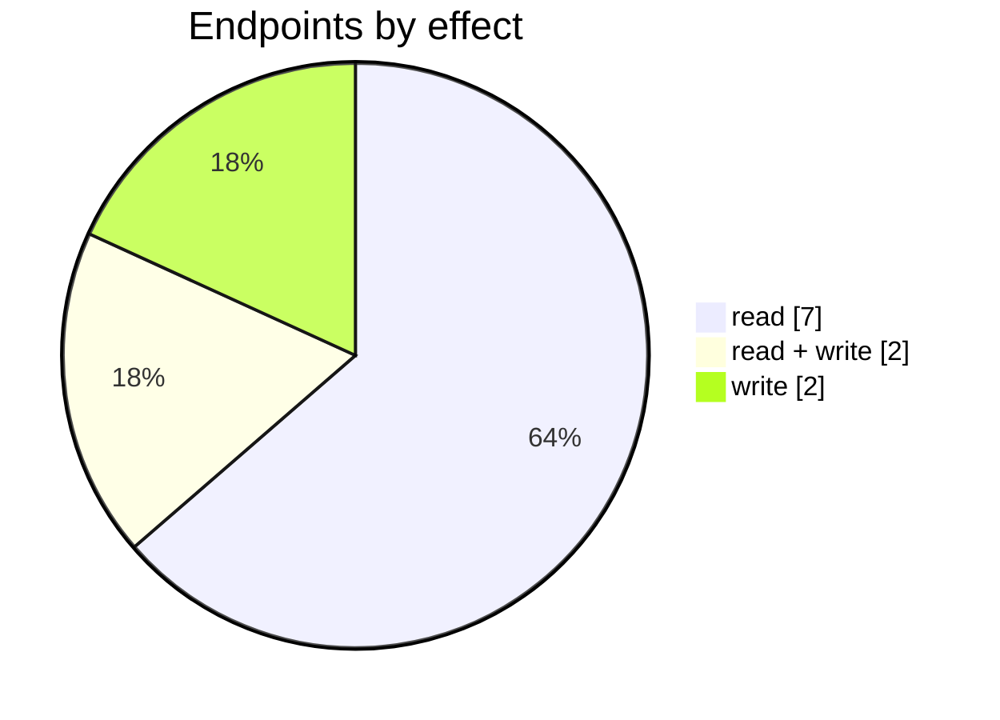
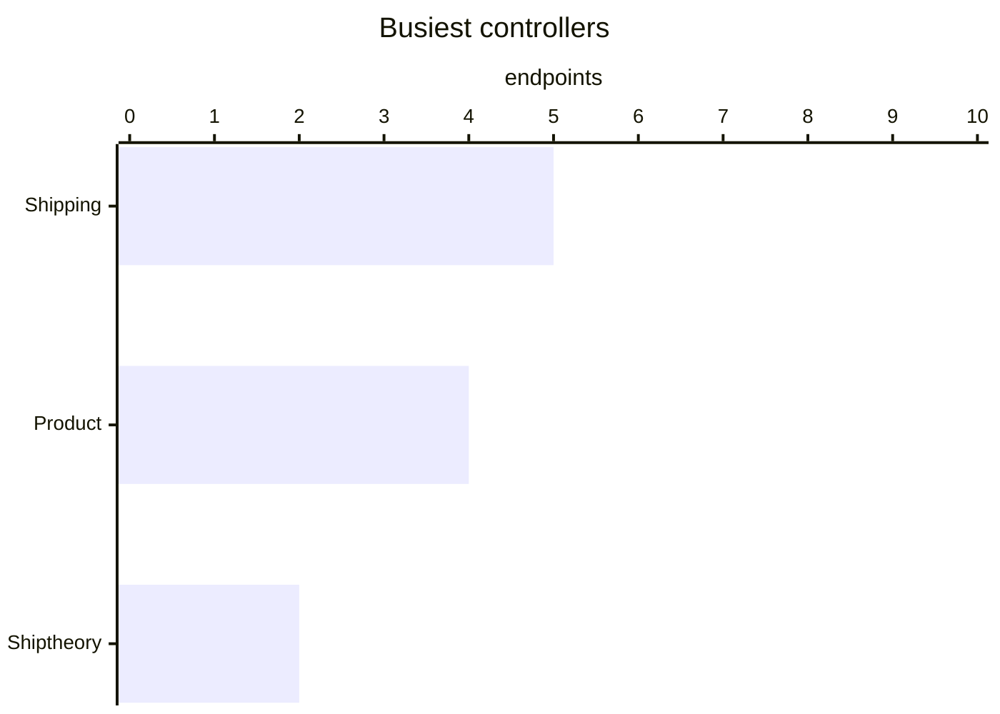

# Shiptheory

The Shiptheory connector: its settings page, mappings, logs and the endpoints behind them. Part of [Integrations](../README.md).

| 📄 Pages | 🧱 Models | 🔌 Endpoints | ✍️ Can write | 🌍 Public API |
|:-:|:-:|:-:|:-:|:-:|
| **1** | **12** + [shared](../../00-shared/README.md) | **11** | 4 | **0** |

[📄 Pages (1)](#pages) · [🧱 Models (12)](#data-models) · [🔌 Endpoints (11)](#internal-endpoints) · [🖼️ UI](UI.md) · [🗄️ schema.sql](schema.sql)

## How to rebuild it

| # | Build | How |
|:-:|---|---|
| 1 | 🗄️ Schema | 12 tables from [`schema.sql`](schema.sql); GUID ids, join on `*ID` |
| 2 | 🔌 Internal API | Each controller's verbs · [contract](../../../docs/INTERNAL-API.md) · paged `{root, total}` · saves `{ID, HasErrors, Original, Updated}` |
| 3 | 🖥️ Screens | Server-rendered shell + page app, record from `#<guid>` · [page model](../../../docs/ARCHITECTURE.md#what-a-page-is) · every control in [UI.md](UI.md) |

## Pages

| Route | Menu label | Title | Bundle | Endpoints (write) |
|---|---|---|---|---:|
| `/Shiptheory` |  | Shiptheory | `Shiptheory2019` | 10 (4) |

## Data models

ExtJS models the pages use; `v` prefix = view-model. Full DDL in [`schema.sql`](schema.sql).

| Model | Fields |
|---|---|
| `ExceptionsList` | Line:int, SupplierName:string, SupplierNameError:string, SupplierReference:string, SupplierReferenceError:string, InvoiceDate:string, InvoiceDateError:string, Amount:string, AmountError:string, CurrencyConversionRate:string, CurrencyConversionRateError:string, ValidationText:string, ValidationState:string |
| `vBulkListingProduct` | ProductID:string, ProductCode:string, Name:string, Status:string, Category:string, Price:float, OrderedQuantity:float, MinimumToOrder:int, MaximumToOrder:int, Quantity:float, MenuItems:string, IsBackorderEnabled:bool |
| `vCarrierList` | value:string, name:string |
| `vCarrierServiceList` | FakeID:string, CarrierCode:string, ServiceCode:string, Highlighted:bool, DisplayName:string, CarrierServiceCode:string, Domestic:bool, International:bool |
| `vCurrency` | Currency:string, DisplayCurrency:string |
| `vExportFilter` | ParameterName:string, Condition:string, Value:string, Join:string, ValidationText:string, ValidationState:string |
| `vExportFilterItem` | Value:string, Name:string |
| `vExportFilterItemGroupped` | Value:string, Name:string, Group:string, IsFirst:bool |
| `vMailingList` | MailingListID:string, Name:string, Emails:string, ValidationText:string, ValidationState:string |
| `vSSExportLog` | ScheduledPeriod:date, OrderNumber:string, FulfillmentNumber:string, InvoiceNumber:string, OrderID:string, FulfillmenID:string, InvoiceID:string, CustomerName:string, ShipByDate:date, Status:string, Comments:string, StatusDate:date |
| `vScheduledExport` | periodBeg:date, periodEnd:date |
| `vShipServConf` | ID:string, ModuleType:string |

## Internal endpoints

Grouped by controller. Effect: 🟢 read · 🟠 read + write at the same URL · 🔴 write. `api` = JSON under `/api/`, `mvc` = controller action.

### Product

| URL | Kind | Methods | Effect | Params | Body keys | Reader root |
|---|---|---|---|---|---|---|
| `/Product/ExportCommodityDetails` | mvc | GET(navigate) | 🟢 read |  |  |  |
| `/Product/ImportProductCommodityDetails` | mvc | GET(navigate) | 🔴 write | module ref |  |  |
| `/Product/ImportProductCommodityDetailsJson` | mvc | POST | 🔴 write |  |  |  |
| `/api/Product_ImportCommodityDetails_Exceptions` | api | REST(GET read; POST/PUT/DELETE on store.sync) | 🟠 read + write |  |  |  |

### Shipping

| URL | Kind | Methods | Effect | Params | Body keys | Reader root |
|---|---|---|---|---|---|---|
| `/api/Shipping_Index_Family` | api | REST(GET read; POST/PUT/DELETE on store.sync) | 🟢 read |  |  |  |
| `/api/Shipping_Index_vBrands` | api | REST(GET read; POST/PUT/DELETE on store.sync) | 🟢 read |  |  |  |
| `/api/Shipping_Index_vCategories` | api | REST(GET read; POST/PUT/DELETE on store.sync) | 🟢 read |  |  |  |
| `/api/Shipping_Index_vTags` | api | REST(GET read; POST/PUT/DELETE on store.sync) | 🟢 read |  |  |  |
| `/api/Shipping_ProductCatalogueList` | api | POST REST(GET read; POST/PUT/DELETE on store.sync) | 🟢 read | brand category family search tag |  | root |

### Shiptheory

| URL | Kind | Methods | Effect | Params | Body keys | Reader root |
|---|---|---|---|---|---|---|
| `/api/Shiptheory_Index_vMailingList` | api | REST(GET read; POST/PUT/DELETE on store.sync) | 🟢 read |  |  |  |
| `/api/Shiptheory_Index_vShipServConf` | api | PUT REST(GET read; POST/PUT/DELETE on store.sync) | 🟠 read + write |  |  |  |
