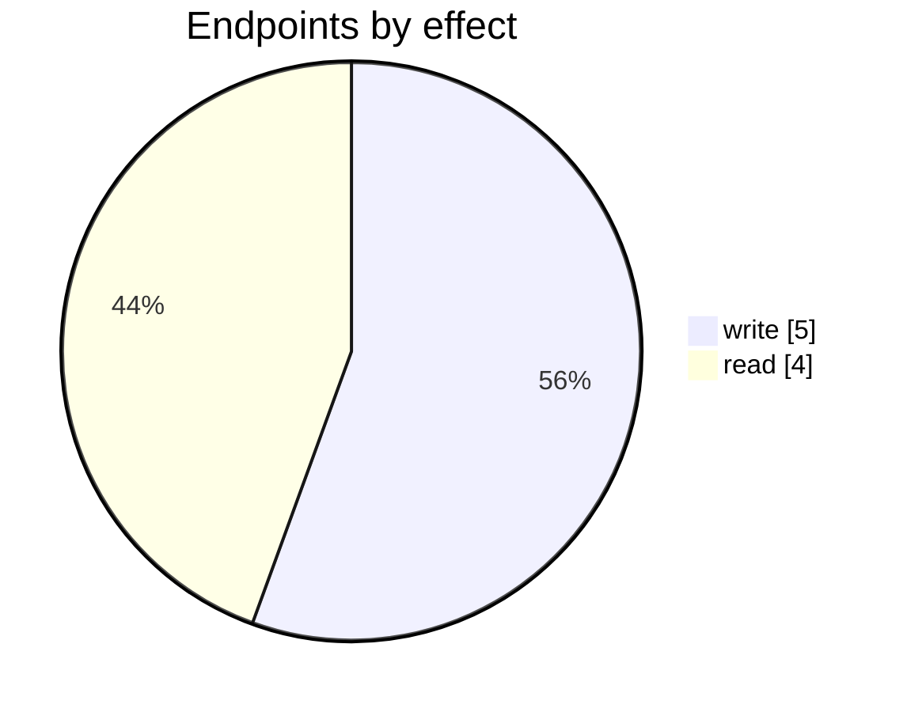
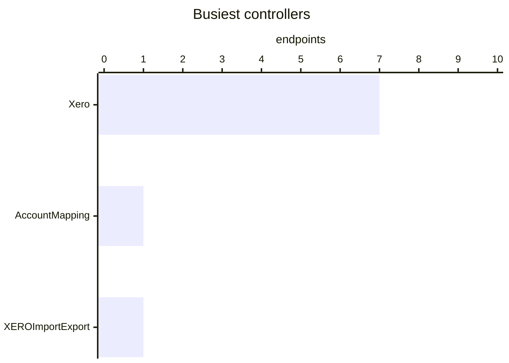

# Xero

The Xero connector: its settings page, mappings, logs and the endpoints behind them. Part of [Integrations](../README.md).

| 📄 Pages | 🧱 Models | 🔌 Endpoints | ✍️ Can write | 🌍 Public API |
|:-:|:-:|:-:|:-:|:-:|
| **1** | **5** + [shared](../../00-shared/README.md) | **9** | 5 | **0** |

[📄 Pages (1)](#pages) · [🧱 Models (5)](#data-models) · [🔌 Endpoints (9)](#internal-endpoints) · [🖼️ UI](UI.md) · [🗄️ schema.sql](schema.sql)

## How to rebuild it

| # | Build | How |
|:-:|---|---|
| 1 | 🗄️ Schema | 5 tables from [`schema.sql`](schema.sql); GUID ids, join on `*ID` |
| 2 | 🔌 Internal API | Each controller's verbs · [contract](../../../docs/INTERNAL-API.md) · paged `{root, total}` · saves `{ID, HasErrors, Original, Updated}` |
| 3 | 🖥️ Screens | Server-rendered shell + page app, record from `#<guid>` · [page model](../../../docs/ARCHITECTURE.md#what-a-page-is) · every control in [UI.md](UI.md) |

## Pages

| Route | Menu label | Title | Bundle | Endpoints (write) |
|---|---|---|---|---:|
| `/Xero` |  | Xero | `Xero2019` | 5 (6) |

## Data models

ExtJS models the pages use; `v` prefix = view-model. Full DDL in [`schema.sql`](schema.sql).

| Model | Fields |
|---|---|
| `AccountsMapping` | InventoryControlAccount:string, CostOfGoodsSoldAccount:string, DefaultRevenueAccount:string, TaxLiabilityAccount:string, PurchasePrepayment:string, SalePrepayment:string, InventoryAccrualAccount:string, StockInTransitAccount:string, InventoryDiscrepancyAccount:string, GiftCardAccount:string, WipAccount:string, TransferInTransitAccount:string, CurrentYearProfitsAccount:string, UnrealisedCurrencyGainAccount:string, RealisedCurrencyGainAccount:string, PaymentClearingAccount:string |
| `ExternalEntityMapping` | ID:string, ExternalCode:string, ExternalName:string, EntityCode:string, EntityType:string |
| `ExternalEntityMappingTaxRule` | ID:string, ExternalCode:string, ExternalName:string, EntityCode:string, EntityType:string, TaxRuleIsActive:bool, TaxRuleIsPurchase:bool, TaxRuleIsSale:bool, TaxRulePercent:float, TaxRuleName:string |
| `XeroAccounts` | Code:string, DisplayName:string, Class:string, Type:string, SystemAccount:string, EnablePaymentsToAccount:bool, IsFirst:bool |
| `XeroTaxationRule` | TaxType:string, Name:string, EffectiveRate:float, IsPurchaseTaxRule:bool, IsSaleTaxRule:bool |

## Internal endpoints

Grouped by controller. Effect: 🟢 read · 🟠 read + write at the same URL · 🔴 write. `api` = JSON under `/api/`, `mvc` = controller action.

### AccountMapping

| URL | Kind | Methods | Effect | Params | Body keys | Reader root |
|---|---|---|---|---|---|---|
| `/api/AccountMapping_Index_vAccountMapping` | api | REST(GET read; POST/PUT/DELETE on store.sync) | 🟢 read |  |  |  |

### Xero

| URL | Kind | Methods | Effect | Params | Body keys | Reader root |
|---|---|---|---|---|---|---|
| `/Xero/ConnectWizardFinish` | mvc | POST | 🔴 write |  |  |  |
| `/Xero/CreateXeroAccount` | mvc | POST | 🔴 write |  |  |  |
| `/Xero/GetCustomersSuppliersCount` | mvc | GET | 🟢 read |  |  |  |
| `/Xero/XeroChartOfAccounts` | mvc | REST(GET read; POST/PUT/DELETE on store.sync) | 🟢 read |  |  |  |
| `/Xero/XeroTaxRules` | mvc | REST(GET read; POST/PUT/DELETE on store.sync) | 🟢 read |  |  |  |
| `/api/Xero_StartOnboardingImport` | api | POST | 🔴 write |  |  |  |
| `/api/Xero_StartSync` | api | POST | 🔴 write |  |  |  |

### XEROImportExport

| URL | Kind | Methods | Effect | Params | Body keys | Reader root |
|---|---|---|---|---|---|---|
| `/XEROImportExport/WizardConnectToXero` | mvc | GET(navigate) | 🔴 write |  |  |  |
