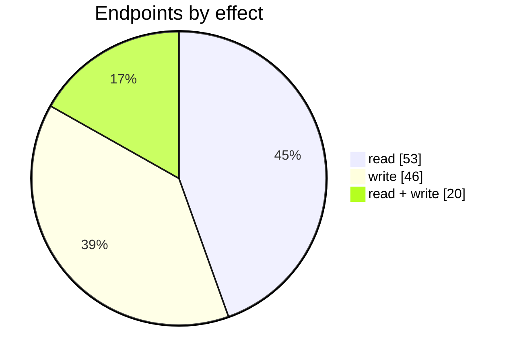
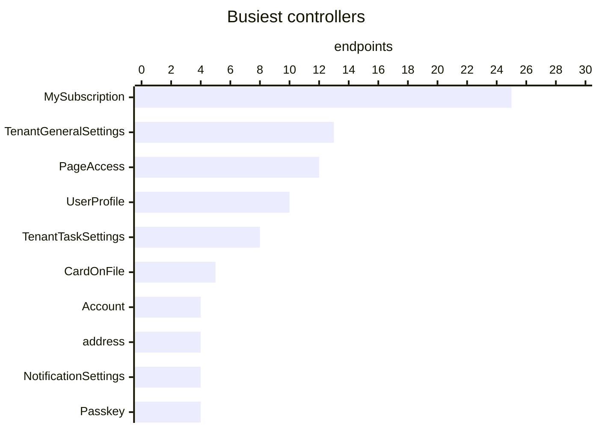
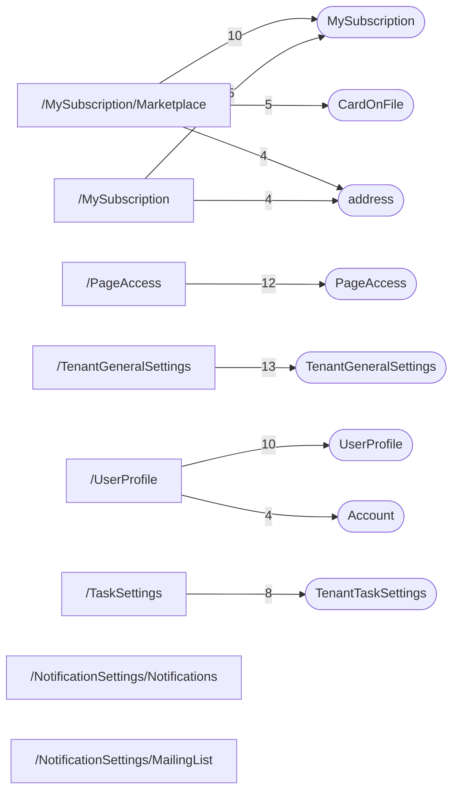

# Settings

Tenant-wide settings: general settings, users and roles (page access), document and email templates, notifications and automations, reminders, task settings, scheduled reports, user profile and subscription.

| 📄 Pages | 🧱 Models | 🔌 Endpoints | ✍️ Can write | 🌍 Public API |
|:-:|:-:|:-:|:-:|:-:|
| **13** | **41** + [shared](../00-shared/README.md) | **119** | 66 | **14** |

[📄 Pages (13)](#pages) · [🧱 Models (41)](#data-models) · [🔌 Endpoints (119)](#internal-endpoints) · [🌍 Public API (14)](#public-api-externalapiv2) · [🖼️ UI](UI.md) · [🗄️ schema.sql](schema.sql)

Pages (left) and the controllers they call (right), busiest 8 pages and 8 controllers; numbers are endpoints.

## How to rebuild it

| # | Build | How |
|:-:|---|---|
| 1 | 🗄️ Schema | 41 tables from [`schema.sql`](schema.sql); GUID ids, join on `*ID` |
| 2 | 🔌 Internal API | Each controller's verbs · [contract](../../docs/INTERNAL-API.md) · paged `{root, total}` · saves `{ID, HasErrors, Original, Updated}` |
| 3 | 🖥️ Screens | Server-rendered shell + page app, record from `#<guid>` · [page model](../../docs/ARCHITECTURE.md#what-a-page-is) · every control in [UI.md](UI.md) |
| 4 | 🌍 Public API | 14 ops under `/ExternalApi/v2`, header auth · [contract](../../docs/PUBLIC-API.md) |

## Pages

| Route | Menu label | Title | Bundle | Endpoints (write) |
|---|---|---|---|---:|
| `/AutomatedWorkflow` | Automated workflows | Workflow | `AutomatedWorkflow2019` | 1 (2) |
| `/MySubscription` | My subscription | My subscription | `MySubscription2019` | 16 (14) |
| `/MySubscription/Marketplace` | Marketplace | Subscription configuration | `MySubscriptionUpdateSubscriptionn2023` | 20 (9) |
| `/NotificationSettings` | Automation | Automation | `NotificationSettings2019` | 1 (2) |
| `/NotificationSettings/MailingList` | Mailing list | Mailing list | `NotificationSettingsMailingList2019` | 6 (3) |
| `/NotificationSettings/Notifications` | Notification settings | Notification settings | `NotificationSettingsNotifications2019` | 8 (3) |
| `/PageAccess` | Users and roles | Users & Roles | `PageAccess2019` | 14 (10) |
| `/Settings` | Reference books | Settings | `Settings2019` | 2 (2) |
| `/TaskSettings` | Task settings | Task settings | `TaskSettings2019` | 11 (5) |
| `/Template` | Document and email templates | Manage report templates | `Template2019` | 3 (4) |
| `/TenantGeneralSettings` | General settings | General Settings | `GeneralSettings2019` | 14 (3) |
| `/TenantReminders` | Reminders | Reminders | `TenantReminders2019` | 1 (1) |
| `/UserProfile` | User profile | User profile | `UserProfile2019 PasskeyUserProfile2019` | 14 (16) |

## Data models

ExtJS models the pages use; `v` prefix = view-model. Full DDL in [`schema.sql`](schema.sql).

| Model | Fields |
|---|---|
| `CalendarSettingsWrapper` | FirstDayOfWeek:string, WeekendDays:string |
| `CatColor` | Color:string, BackgroundColor:string |
| `MeasurementUnit` | UoMAbbr:string, UoMName:string, IsFirst:bool, MeasurementSystem:string |
| `RoundingRule` | Code:string, Name:string |
| `SecurityQuestion` | ID:string, Name:string |
| `SettingsPermission` | Prefix:string, Link:string, Allowed:bool, Hidden:bool |
| `State` | Code:string, Name:string, CountryCode:string |
| `Template` | TemplateID:string, Type:string, Name:string, ThumbnailPath:string, IsNew:bool, IsDefault:bool, Process:string, EmailTemplateID:string, EmailSubject:string, MultilingualTemplateCode:string, EmailTypes:string, MailingList:string, CustomEmail:string |
| `WorkflowWrapper` | ID:int, HasErrors:bool |
| `vAutomatedWorkflow` | AutomatedWorkflowID:string, Name:string, Description:string, IsActive:bool, EntityType:string, CreatedDate:date, LastUpdatedDate:date, LastUpdatedBy:string |
| `vExternalNotificationSettings` | ID:string, NotificationSettingsID:string, TenantID:string, IsActive:bool, IsWebhook:bool, ExternalURL:string, ExternalAuthorizationType:string, ExternalUserName:string, ExternalPassword:string, ExternalBearerToken:string, ExternalHeaders:string |
| `vMailingList` | MailingListID:string, Name:string, Emails:string, ValidationText:string, ValidationState:string |
| `vMarkupRounding` | MarkupRoundingID:string, TenantID:string, RangeFrom:float, RangeTo:float, RoundToNearest:float, AdjustmentRule:string, AdjustmentValue:float |
| `vMultilingualSupportCultureModel` | Code:string, Name:string |
| `vMultilingualTemplate` | Code:string, Name:string, IsDefault:bool |
| `vNotificationExecutionLogEmail` | ExecutionLogID:string, TenantID:string, NotificationSystemName:string, ExecutionStartDate:date, ExecutionEndDate:date, ExecutionDate:date, EmailStatus:string, Status:string, Recipients:string, Subject:string, Body:string, ErrorMessage:string |
| `vNotificationExecutionLogExternal` | ExecutionLogID:string, TenantID:string, NotificationSystemName:string, ExecutionStartDate:date, ExecutionEndDate:date, ExecutionDate:date, ExternalStatus:string, Status:string, ExternalStatusMessage:string, ExternalUrls:string, Url:string, ExternalData:string, Details:string, SystemMessage:string |
| `vNotificationExecutionLogInternal` | ExecutionLogID:string, TenantID:string, NotificationSystemName:string, ExecutionDate:date, EntityName:string, EntityType:string, EntityID:string, Message:string, Details:string |
| `vNotificationSettings` | NotificationSettingsID:string, TenantID:string, IsActive:bool, IsActiveSystem:bool, ModuleName:string, NotificationType:string, Name:string, Description:string, SystemName:string, IsInternal:bool, IsEmail:bool, IsExternal:bool, Message:string, EmailSubject:string, EmailTemplate:string, TemplateParameter:string, AllowPeriods:auto, Period:string, StartExecutionDate:date, LastExecutionDate:date, CustomEmail:string, AllowCustomEmail:bool, DeliveryMethods:string, SendToRelated:bool, SendToSaleRep:bool, AllowSendToRelated:bool, AllowSendToSaleRep:bool, TemplateID:string, TemplateRequired:bool, Grou… |
| `vNotificationWorkflow` | NotitifcationWorkflowID:string, NotificationSettingsID:string, WorkflowID:string, Type:string, ValidationText:string, ValidationState:string |
| `vPaymentHistory` | ID:string, Plan:string, From:date, To:date, Amount:float, Currency:string, Status:string, HasInvoice:bool, SysDate:date, InvoiceNumber:string, ReferralCreditUsed:float, ResponseText:string |
| `vReferrals` | RowNum:int, CreatedDate:date, Status:string, Discount:string, Company:string, OwnerEmail:string, CreditEarned:float |
| `vTaskCategory` | TaskCategoryID:string, Name:string, Color:string, BackgroundColor:string, IsPredefined:boolean, ValidationText:string, ValidationState:string |
| `vTaskList` | Expand:string, TaskID:string, DueName:string, TaskCategoryID:string, TaskCategoryName:string, WorkflowID:string, UserID:string, AssignedToName:string, Name:string, Details:string, StartDate:date, EndDate:date, CompletedDate:date, Sequence:string, WorkflowProcessID:string, IsAllDay:bool, EntityType:string, EntityID:string, TaskStatus:string, LinkTo:string, Importance:bool, AssignedBy:string, AssignedByName:string, ApprovedBy:string, ApprovedByName:string, CreatedDate:date, IsCategoryPredefined:bool, Edit:string |
| `vTaxCalculationBasisOptions` | Code:string, Name:string |
| `vTaxCalculationFrequency` | Code:string, Name:string |
| `vTemplate` | TemplateID:string, Name:string, Type:string, Process:string |
| `vTenant` | TenantID:string, Company:string, Comment:string, Currency:string, DefaultTaxationRule:string, EmailSender:string, DocumentSortOrder:string, PurchaseDocumentSortOrder:string, CustomerCreditLimitMode:string, DiscountCalculationMethod:string, RecurringInvoicePriceHandlingMethod:string, AutomaticallyApplyDiscounts:bool, ApplyManualPriceChanges:bool, ApplyCustomerDiscountAfterOtherDiscounts:bool, DefaultPurchaseMethod:string, TaxCalculationMethod:string, SearchOnlySupplierAttachedProductsInPurchaseLines:bool, SkuAutogeneration:bool, StockChanged:bool, StockPrefix:string, StockNextNumber:string, St… |
| `vTenantHoliday` | HolidayID:string, Date:date, Description:string, Skip:bool |
| `vTenantTaskSettings` | TenantID:string, IsActive:bool, ApprovalEnabled:bool, FirstDayOfWeek:int, WeekendDays:string |
| `vTenantUser` | TenantID:string, UserId:string, Email:string, IsOwner:bool, IsCurrentUser:bool, IsLockedOut:bool, IsPending:bool, IsPartner:bool, LastActivityDate:date, ValidationText:string, ValidationState:string, Roles:string, IsCoOwner:bool |
| `vTenantUserPageAccessEdit` | RoleID:string, UserID:string, PageID:string, Category:string, DisplayName:string, AllowReadOnly:bool, ReadOnlyAccess:bool, FullAccess:bool, CategoryPosition:int, Position:int, ValidationText:string, ValidationState:string |
| `vTenants` | UserID:string, TenantID:string, Company:string, MasterUserEmail:string, Status:string, IsExpired:bool, ExpirationDate:date, IsTFAEnabled:bool, AnniversaryDate:date, StartDate:date, PlanType:string |
| `vTimezone` | name:string, displayName:string |
| `vUserData` | UserID:string, UserName:string, DisplayName:string, IsTFAEnabled:bool, AnyCompanyWithTFA:bool, IsTFASetupCompleted:bool, TFAAlternativeMethod:string, TFAAlternativeEmail:string, TFAQuestion1:string, TFAQuestion2:string, TFAQuestion3:string |
| `vUserLoginHistory` | ID:string, UserID:string, IPAddress:string, Country:string, SysDate:date, State:string, TenantID:string, Company:string |
| `vUserPasskey` | ID:string, FriendlyName:string, CreatedAt:date, LastUsedAt:date |
| `vWorkflow` | WorkflowID:string, Name:string, IsActive:bool, EntityType:string, DueDaysType:string, ActiveProcessCount:int, ValidationText:string, ValidationState:string |
| `vWorkflowList` | WorkflowID:string, Name:string, DueDaysType:string, IsActive:bool, ActiveProcessCount:int |
| `vWorkflowProcess` | WorkflowProcessID:string, CreatedDate:date, EntityName:string, EntityID:string, EntityType:string, Notes:string, CompletedTaskCount:int, AllTaskCount:int |
| `vWorkflowStep` | WorkflowStepID:string, Name:string, WorkflowID:string, Sequence:int, Days:int, StartTimeStr:string, EndTimeStr:string, TaskCategoryName:string, TaskCategoryID:string, UserName:string, UserID:string, SkipHoliday:string, ValidationText:string, ValidationState:string |

## Internal endpoints

Grouped by controller. Effect: 🟢 read · 🟠 read + write at the same URL · 🔴 write. `api` = JSON under `/api/`, `mvc` = controller action.

### Account

| URL | Kind | Methods | Effect | Params | Body keys | Reader root |
|---|---|---|---|---|---|---|
| `/Account/CanCreateNewOrganization` | mvc | GET | 🔴 write |  |  |  |
| `/Account/ChangePassword` | mvc | GET(navigate) POST | 🔴 write | returnUrl | RememberMe |  |
| `/Account/LogOff` | mvc | GET(navigate) REST(GET read; POST/PUT/DELETE on store.sync) | 🔴 write |  |  |  |
| `/Account/Login` | mvc | GET(navigate) | 🔴 write |  |  |  |

### account

| URL | Kind | Methods | Effect | Params | Body keys | Reader root |
|---|---|---|---|---|---|---|
| `/api/account_country` | api | REST(GET read; POST/PUT/DELETE on store.sync) | 🟢 read |  |  |  |
| `/api/account_state` | api | REST(GET read; POST/PUT/DELETE on store.sync) | 🟢 read |  |  |  |

### address

| URL | Kind | Methods | Effect | Params | Body keys | Reader root |
|---|---|---|---|---|---|---|
| `/api/address` | api | REST(GET read; POST/PUT/DELETE on store.sync) | 🟢 read | CountryCode countryCode |  |  |
| `/api/address/country/code` | api | GET | 🟢 read |  |  |  |
| `/api/address/details` | api | GET | 🟢 read |  |  |  |
| `/api/address/hasAccess` | api | GET | 🟢 read |  |  |  |

### Admin

| URL | Kind | Methods | Effect | Params | Body keys | Reader root |
|---|---|---|---|---|---|---|
| `/api/Admin_RequestCancellation/UpdateRequestStatus` | api | POST | 🔴 write | tenantID |  |  |

### AutomatedWorkflow

| URL | Kind | Methods | Effect | Params | Body keys | Reader root |
|---|---|---|---|---|---|---|
| `/AutomatedWorkflow/Edit` | mvc | GET(navigate) | 🔴 write |  |  |  |

### CardOnFile

| URL | Kind | Methods | Effect | Params | Body keys | Reader root |
|---|---|---|---|---|---|---|
| `/CardOnFile/Reauth` | mvc | GET(navigate) | 🟢 read |  |  |  |
| `/api/CardOnFile_Eligibility` | api | GET | 🟢 read | duePaymentId |  |  |
| `/api/CardOnFile_Reauth_Passkey/Complete` | api | POST | 🔴 write |  |  |  |
| `/api/CardOnFile_Reauth_Passkey/Options` | api |  | 🟢 read | duePaymentId |  |  |
| `/api/CardOnFile_Reauth_Totp` | api | POST | 🟢 read |  | Code DuePaymentId |  |

### currency

| URL | Kind | Methods | Effect | Params | Body keys | Reader root |
|---|---|---|---|---|---|---|
| `/api/currency` | api | REST(GET read; POST/PUT/DELETE on store.sync) | 🟢 read |  |  |  |

### EmailNotificationLog

| URL | Kind | Methods | Effect | Params | Body keys | Reader root |
|---|---|---|---|---|---|---|
| `/api/EmailNotificationLog` | api | REST(GET read; POST/PUT/DELETE on store.sync) | 🟠 read + write | deliveryType |  | root |

### ExternalNotificationLog

| URL | Kind | Methods | Effect | Params | Body keys | Reader root |
|---|---|---|---|---|---|---|
| `/api/ExternalNotificationLog` | api | REST(GET read; POST/PUT/DELETE on store.sync) | 🟢 read |  |  | root |

### Home

| URL | Kind | Methods | Effect | Params | Body keys | Reader root |
|---|---|---|---|---|---|---|
| `/Home/Organisation` | mvc |  | 🟢 read | ID |  |  |
| `/api/Home_Partner_vTenantUser` | api | REST(GET read; POST/PUT/DELETE on store.sync) | 🟢 read | valid |  |  |

### InternalNotificationLog

| URL | Kind | Methods | Effect | Params | Body keys | Reader root |
|---|---|---|---|---|---|---|
| `/api/InternalNotificationLog` | api | REST(GET read; POST/PUT/DELETE on store.sync) | 🟢 read | deliveryType |  | root |

### MailingList

| URL | Kind | Methods | Effect | Params | Body keys | Reader root |
|---|---|---|---|---|---|---|
| `/api/MailingList_Index_vMailingList` | api | REST(GET read; POST/PUT/DELETE on store.sync) | 🟠 read + write |  |  | root |

### MoneyTask

| URL | Kind | Methods | Effect | Params | Body keys | Reader root |
|---|---|---|---|---|---|---|
| `/MoneyTask/Receive` | mvc |  | 🟢 read |  |  |  |
| `/MoneyTask/Spend` | mvc |  | 🟢 read |  |  |  |

### MySubscription

| URL | Kind | Methods | Effect | Params | Body keys | Reader root |
|---|---|---|---|---|---|---|
| `/MySubscription/CancelNewWF` | mvc | POST | 🔴 write | CancellationComment CancellationNoNeed CancellationNoNeedComment CancellationReason CancellationReasonComment __RequestVerificationToken meetingDuration meetin… |  |  |
| `/MySubscription/CreateCancellationSuspendedRequest` | mvc | POST | 🔴 write | __RequestVerificationToken tenantID |  |  |
| `/MySubscription/DetailsRenew` | mvc | GET(navigate) | 🟢 read |  |  |  |
| `/MySubscription/DetailsUpdate` | mvc | GET | 🔴 write |  |  |  |
| `/MySubscription/DownloadPrepaymentInvoice` | mvc |  | 🟢 read |  |  |  |
| `/MySubscription/GetPaymentAmount` | mvc | GET? | 🟢 read | TenantID |  |  |
| `/MySubscription/SubmitSubscriptionCancellation` | mvc | POST | 🔴 write | CancellationComment CancellationNoNeed CancellationNoNeedComment CancellationReason CancellationReasonComment __RequestVerificationToken tenantID |  |  |
| `/api/MySubscription_Index_ArrangeCallback` | api | POST | 🔴 write | ContactEmail ContactName ContactPhone TenantID |  |  |
| `/api/MySubscription_Index_BillingEmailAddress` | api | POST | 🔴 write |  |  |  |
| `/api/MySubscription_Index_Features` | api | GET? | 🟢 read | TenantID |  |  |
| `/api/MySubscription_Index_FullDataWipe` | api | POST | 🔴 write | Confirmation Password TenantID |  |  |
| `/api/MySubscription_Index_PutOnHoldRequest` | api | POST | 🔴 write |  |  |  |
| `/api/MySubscription_Index_TaxExemption` | api | POST | 🔴 write |  |  |  |
| `/api/MySubscription_Index_TransactionalDataWipe` | api | POST | 🔴 write | Confirmation Password TenantID |  |  |
| `/api/MySubscription_Index_UpdateCoupon` | api | POST | 🔴 write | CouponCode TenantID |  |  |
| `/api/MySubscription_Index_vPaymentHistory` | api | REST(GET read; POST/PUT/DELETE on store.sync) | 🟠 read + write | search |  | root |
| `/api/MySubscription_Index_vReferrals` | api | REST(GET read; POST/PUT/DELETE on store.sync) | 🟢 read | search |  | root |
| `/api/MySubscription_UpdateSubscription_ChargeCardOnFile` | api | POST | 🔴 write |  | DuePaymentId ReauthProofId |  |
| `/api/MySubscription_UpdateSubscription_ConfigureInvoicePayment` | api | POST | 🔴 write |  |  |  |
| `/api/MySubscription_UpdateSubscription_ConfirmZeroPayment` | api | POST | 🔴 write | DuePaymentID |  |  |
| `/api/MySubscription_UpdateSubscription_GetFeatures` | api |  | 🟢 read |  |  |  |
| `/api/MySubscription_UpdateSubscription_OnboardingFeatures` | api |  | 🟢 read |  |  |  |
| `/api/MySubscription_UpdateSubscription_PreparePayment` | api |  | 🔴 write |  |  |  |
| `/api/MySubscription_UpdateSubscription_RequestChanges` | api | POST | 🔴 write |  |  |  |
| `/api/MySubscription_UpdateSubscription_ValidatePayment` | api | POST | 🔴 write | duePaymentId |  |  |

### MySubscriptionRequestChanges

| URL | Kind | Methods | Effect | Params | Body keys | Reader root |
|---|---|---|---|---|---|---|
| `/MySubscriptionRequestChanges/DetailsRenewFeatures` | mvc | POST | 🔴 write | __RequestVerificationToken inviteUserEmail removeCurrentUserFromTenant subscriptionData subscriptionID typeOfPayment |  |  |
| `/MySubscriptionRequestChanges/DetailsUpdateFeatures` | mvc | POST | 🔴 write | __RequestVerificationToken subscriptionData subscriptionID |  |  |

### NotificationSettings

| URL | Kind | Methods | Effect | Params | Body keys | Reader root |
|---|---|---|---|---|---|---|
| `/api/NotificationSettings_Index_DefaultSettings` | api | GET | 🟢 read | systemName |  |  |
| `/api/NotificationSettings_Index_vMailingList/Get` | api |  | 🟢 read |  |  |  |
| `/api/NotificationSettings_Index_vNotificationSettings` | api | PUT REST(GET read; POST/PUT/DELETE on store.sync) | 🟠 read + write | module | StartExecutionDate |  |
| `/api/NotificationSettings_Index_vTemplate` | api | REST(GET read; POST/PUT/DELETE on store.sync) | 🟢 read |  |  |  |

### PageAccess

| URL | Kind | Methods | Effect | Params | Body keys | Reader root |
|---|---|---|---|---|---|---|
| `/api/PageAccess_Roles` | api | DELETE GET POST | 🟠 read + write |  |  |  |
| `/api/PageAccess_Roles/permissions` | api | REST(GET read; POST/PUT/DELETE on store.sync) | 🟠 read + write | roleId userId |  |  |
| `/api/PageAccess_Roles/save` | api | POST | 🔴 write |  |  |  |
| `/api/PageAccess_Roles/users` | api | DELETE POST | 🔴 write | roleId |  |  |
| `/api/PageAccess_Roles/users/noexists` | api |  | 🟢 read |  |  |  |
| `/api/PageAccess_Users` | api | DELETE | 🔴 write | username |  |  |
| `/api/PageAccess_Users/SaveAdviser` | api | POST | 🔴 write | UserName recaptcha_token |  |  |
| `/api/PageAccess_Users/lock` | api | PUT | 🔴 write | isLocked userId |  |  |
| `/api/PageAccess_Users/owner` | api | GET PUT | 🟠 read + write | userId |  |  |
| `/api/PageAccess_Users/permissions/effective` | api | GET | 🟢 read | username |  |  |
| `/api/PageAccess_Users/roles` | api | GET | 🟢 read | username |  |  |
| `/api/PageAccess_Users/save` | api | POST | 🔴 write |  |  |  |

### pageaccess

| URL | Kind | Methods | Effect | Params | Body keys | Reader root |
|---|---|---|---|---|---|---|
| `/api/pageaccess_users` | api | REST(GET read; POST/PUT/DELETE on store.sync) | 🟢 read |  |  |  |

### Passkey

| URL | Kind | Methods | Effect | Params | Body keys | Reader root |
|---|---|---|---|---|---|---|
| `/api/Passkey/Delete` | api | DELETE | 🔴 write |  |  |  |
| `/api/Passkey/List` | api | GET(read) | 🟢 read |  |  |  |
| `/api/Passkey/RegisterComplete` | api | POST | 🔴 write |  |  |  |
| `/api/Passkey/RegisterOptions` | api |  | 🔴 write |  |  |  |

### registeruser

| URL | Kind | Methods | Effect | Params | Body keys | Reader root |
|---|---|---|---|---|---|---|
| `/api/registeruser` | api | POST | 🔴 write | Email recaptcha_token |  |  |

### settings

| URL | Kind | Methods | Effect | Params | Body keys | Reader root |
|---|---|---|---|---|---|---|
| `/api/settings_all_permissions` | api | REST(GET read; POST/PUT/DELETE on store.sync) | 🟢 read |  |  |  |

### Stocktake

| URL | Kind | Methods | Effect | Params | Body keys | Reader root |
|---|---|---|---|---|---|---|
| `/Stocktake/New` | mvc | GET(navigate) | 🟢 read |  |  |  |

### TaskShared

| URL | Kind | Methods | Effect | Params | Body keys | Reader root |
|---|---|---|---|---|---|---|
| `/api/TaskShared_TaskList` | api | POST REST(GET read; POST/PUT/DELETE on store.sync) | 🟢 read | applyForAll date endDate items lang search startDate status user userId |  | root |
| `/api/TaskShared_vTaskCategory` | api | REST(GET read; POST/PUT/DELETE on store.sync) | 🟢 read | name page userID |  | Result |

### Template

| URL | Kind | Methods | Effect | Params | Body keys | Reader root |
|---|---|---|---|---|---|---|
| `/Template/Download` | mvc | POST(form) | 🟢 read |  |  |  |
| `/Template/DownloadEmail` | mvc | POST(form) | 🟢 read |  |  |  |
| `/Template/Edit` | mvc | POST(form) | 🔴 write |  |  |  |
| `/Template/Reset` | mvc | DELETE | 🔴 write |  |  |  |

### TenantAccessToFeatures

| URL | Kind | Methods | Effect | Params | Body keys | Reader root |
|---|---|---|---|---|---|---|
| `/api/TenantAccessToFeatures` | api | GET POST | 🟠 read + write |  |  |  |

### TenantAttributeSet

| URL | Kind | Methods | Effect | Params | Body keys | Reader root |
|---|---|---|---|---|---|---|
| `/api/TenantAttributeSet_Index_vTenantAttributeSet` | api | DELETE REST(GET read; POST/PUT/DELETE on store.sync) | 🟠 read + write | id |  |  |

### TenantGeneralSettings

| URL | Kind | Methods | Effect | Params | Body keys | Reader root |
|---|---|---|---|---|---|---|
| `/TenantGeneralSettings/CountrySpecific` | mvc |  | 🟢 read | Key |  |  |
| `/api/TenantGeneralSettings_Index_GiftCardAccounts` | api | REST(GET read; POST/PUT/DELETE on store.sync) | 🟢 read |  |  |  |
| `/api/TenantGeneralSettings_Index_InventoryAccrualAccounts` | api | REST(GET read; POST/PUT/DELETE on store.sync) | 🟢 read |  |  |  |
| `/api/TenantGeneralSettings_Index_vExpenseAccounts` | api | REST(GET read; POST/PUT/DELETE on store.sync) | 🟢 read |  |  |  |
| `/api/TenantGeneralSettings_Index_vMultilingualSupport` | api | REST(GET read; POST/PUT/DELETE on store.sync) | 🟠 read + write | newItem |  |  |
| `/api/TenantGeneralSettings_Index_vMultilingualSupportReferenceData` | api | REST(GET read; POST/PUT/DELETE on store.sync) | 🟢 read |  |  |  |
| `/api/TenantGeneralSettings_Index_vTaxCalculationBasisOptions` | api | REST(GET read; POST/PUT/DELETE on store.sync) | 🟢 read |  |  |  |
| `/api/TenantGeneralSettings_Index_vTaxCalculationFrequency` | api | REST(GET read; POST/PUT/DELETE on store.sync) | 🟢 read |  |  |  |
| `/api/TenantGeneralSettings_Index_vTimezone` | api | REST(GET read; POST/PUT/DELETE on store.sync) | 🟢 read |  |  |  |
| `/api/TenantGeneralSettings_Index_vUOMDim` | api | REST(GET read; POST/PUT/DELETE on store.sync) | 🟢 read |  |  |  |
| `/api/TenantGeneralSettings_Index_vUOMWeight` | api | REST(GET read; POST/PUT/DELETE on store.sync) | 🟢 read |  |  |  |
| `/api/TenantGeneralSettings_Index_vtenant` | api | REST(GET read; POST/PUT/DELETE on store.sync) | 🟠 read + write | CountrySpecificKey |  |  |
| `/api/TenantGeneralSettings_Index_vtenanttaxationrule` | api | REST(GET read; POST/PUT/DELETE on store.sync) | 🟢 read |  |  |  |

### TenantRemindersSettings

| URL | Kind | Methods | Effect | Params | Body keys | Reader root |
|---|---|---|---|---|---|---|
| `/api/TenantRemindersSettings` | api | GET PUT | 🟠 read + write | reminderName |  |  |

### TenantTaskSettings

| URL | Kind | Methods | Effect | Params | Body keys | Reader root |
|---|---|---|---|---|---|---|
| `/api/TenantTaskSettings_Index_CalendarSettings` | api | PUT REST(GET read; POST/PUT/DELETE on store.sync) | 🟠 read + write |  |  |  |
| `/api/TenantTaskSettings_Index_vNotificationSettings` | api | REST(GET read; POST/PUT/DELETE on store.sync) | 🟢 read | entityType |  | vNotificationSettings |
| `/api/TenantTaskSettings_Index_vTaskCategory` | api | DELETE REST(GET read; POST/PUT/DELETE on store.sync) | 🟠 read + write | id |  |  |
| `/api/TenantTaskSettings_Index_vTaskUser` | api |  | 🟢 read |  |  |  |
| `/api/TenantTaskSettings_Index_vTenantTaskSettings` | api | REST(GET read; POST/PUT/DELETE on store.sync) | 🟠 read + write |  |  |  |
| `/api/TenantTaskSettings_Index_vWorkflow` | api | DELETE POST PUT REST(GET read; POST/PUT/DELETE on store.sync) | 🟠 read + write | id | ID |  |
| `/api/TenantTaskSettings_Index_vWorkflowList` | api | REST(GET read; POST/PUT/DELETE on store.sync) | 🟢 read | entityType name status |  | root |
| `/api/TenantTaskSettings_Index_vWorkflowProcess` | api | REST(GET read; POST/PUT/DELETE on store.sync) | 🟠 read + write | workflowID |  | root |

### UserProfile

| URL | Kind | Methods | Effect | Params | Body keys | Reader root |
|---|---|---|---|---|---|---|
| `/api/UserProfile_Index_DisableTfa` | api | POST | 🔴 write |  |  |  |
| `/api/UserProfile_Index_DisableTfa/ConfirmAlternativeEmail` | api | POST | 🔴 write |  |  |  |
| `/api/UserProfile_Index_SetupTfa/CompleteSetup` | api | POST | 🔴 write |  |  |  |
| `/api/UserProfile_Index_SetupTfa/ConfirmAlternativeEmail` | api | POST | 🔴 write | code |  |  |
| `/api/UserProfile_Index_SetupTfa/ConfirmCode` | api | POST | 🔴 write | code |  |  |
| `/api/UserProfile_Index_SetupTfa/GetSecurityQuestions` | api | REST(GET read; POST/PUT/DELETE on store.sync) | 🟢 read |  |  |  |
| `/api/UserProfile_Index_SetupTfa/SetAlternativeEmail` | api | POST | 🔴 write | email |  |  |
| `/api/UserProfile_Index_SetupTfa/SetupSecurityQuestions` | api | POST | 🔴 write |  |  |  |
| `/api/UserProfile_Index_SetupTfa/Start` | api | POST | 🔴 write | TFAEnableUserSetting profileEnabled |  |  |
| `/api/UserProfile_Index_vUserData` | api | PUT REST(GET read; POST/PUT/DELETE on store.sync) | 🟠 read + write |  |  |  |

### vAutomatedWorkflow

| URL | Kind | Methods | Effect | Params | Body keys | Reader root |
|---|---|---|---|---|---|---|
| `/api/vAutomatedWorkflow_Index_vAutomatedWorkflow` | api | DELETE REST(GET read; POST/PUT/DELETE on store.sync) | 🟠 read + write | search state workflowType |  | root |

### vtemplate

| URL | Kind | Methods | Effect | Params | Body keys | Reader root |
|---|---|---|---|---|---|---|
| `/api/vtemplate` | api | DELETE REST(GET read; POST/PUT/DELETE on store.sync) | 🟠 read + write | hidTemplateID |  |  |

## Public API (`/ExternalApi/v2`)

Fields, parameters and body shapes: [Me](../20-public-api/groups/me.md) · [Templates](../20-public-api/groups/templates.md) · [Webhooks](../20-public-api/groups/webhooks.md).

| Group | Method | Path | Query / params |
|---|---|---|---|
| Me | GET | `/me` |  |
| Me | DELETE | `/me/addresses` | ID |
| Me | GET | `/me/addresses` | Page,Limit,ID,Type,DefaultForType,Country,StateProvince,CitySuburb |
| Me | POST | `/me/addresses` |  |
| Me | PUT | `/me/addresses` |  |
| Me | DELETE | `/me/contacts` | ID |
| Me | GET | `/me/contacts` | Page,Limit,ID,Name,Type,DefaultForType,Phone,Fax,Email |
| Me | POST | `/me/contacts` |  |
| Me | PUT | `/me/contacts` |  |
| Templates | GET | `/ref/templates` | Page,Limit,Type,Name |
| Webhooks | DELETE | `/webhooks` | ID |
| Webhooks | GET | `/webhooks` |  |
| Webhooks | POST | `/webhooks` |  |
| Webhooks | PUT | `/webhooks` |  |
