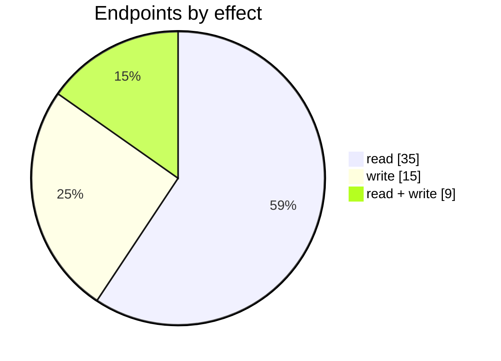
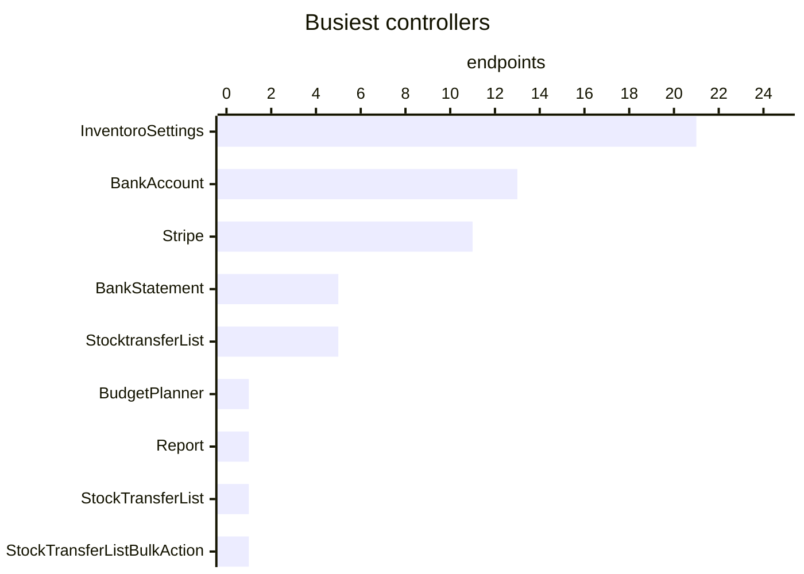

# Unassigned endpoints

Endpoints found in shared bundles that no menu page claims. Rebuild them where their name says they belong.

| 📄 Pages | 🧱 Models | 🔌 Endpoints | ✍️ Can write | 🌍 Public API |
|:-:|:-:|:-:|:-:|:-:|
| **0** | **0** + [shared](../00-shared/README.md) | **59** | 24 | **0** |

[🔌 Endpoints (59)](#internal-endpoints) · [🖼️ UI](UI.md)

## How to rebuild it

| # | Build | How |
|:-:|---|---|
| 1 | 🔌 Internal API | Each controller's verbs · [contract](../../docs/INTERNAL-API.md) · paged `{root, total}` · saves `{ID, HasErrors, Original, Updated}` |

## Internal endpoints

Grouped by controller. Effect: 🟢 read · 🟠 read + write at the same URL · 🔴 write. `api` = JSON under `/api/`, `mvc` = controller action.

### BankAccount

| URL | Kind | Methods | Effect | Params | Body keys | Reader root |
|---|---|---|---|---|---|---|
| `/api/BankAccount_Index_CreateDetailed` | api | POST | 🔴 write |  |  |  |
| `/api/BankAccount_Index_CreateReconcilation` | api | DELETE POST PUT | 🔴 write |  |  |  |
| `/api/BankAccount_Index_vBalance` | api | REST(GET read; POST/PUT/DELETE on store.sync) | 🟢 read | AccountId |  | root |
| `/api/BankAccount_Index_vBankAccounts` | api | REST(GET read; POST/PUT/DELETE on store.sync) | 🟢 read | excludeAccountId |  |  |
| `/api/BankAccount_Index_vChartOfAccounts` | api | REST(GET read; POST/PUT/DELETE on store.sync) | 🟢 read |  |  |  |
| `/api/BankAccount_Index_vComment` | api | PUT | 🔴 write |  |  |  |
| `/api/BankAccount_Index_vCustomerWithSuppliers` | api | REST(GET read; POST/PUT/DELETE on store.sync) | 🟢 read |  |  |  |
| `/api/BankAccount_Index_vReconcilation` | api | DELETE POST PUT REST(GET read; POST/PUT/DELETE on store.sync) | 🟠 read + write | accountId limit start statementId |  | root |
| `/api/BankAccount_Index_vSelectReconcilation` | api | DELETE POST PUT REST(GET read; POST/PUT/DELETE on store.sync) | 🟠 read + write | Id ReconcileID accountId option search transactionAmount |  | root |
| `/api/BankAccount_Index_vStatementList` | api | REST(GET read; POST/PUT/DELETE on store.sync) | 🟢 read | accountId |  | root |
| `/api/BankAccount_Index_vStatements` | api | REST(GET read; POST/PUT/DELETE on store.sync) | 🟢 read | accountId |  | root |
| `/api/BankAccount_Index_vTenantTaxationRule` | api | REST(GET read; POST/PUT/DELETE on store.sync) | 🟢 read | type |  |  |
| `/api/BankAccount_Index_vTransactions` | api | REST(GET read; POST/PUT/DELETE on store.sync) | 🟢 read | accountId |  | root |

### BankStatement

| URL | Kind | Methods | Effect | Params | Body keys | Reader root |
|---|---|---|---|---|---|---|
| `/BankStatement/List` | mvc |  | 🟢 read | statementId |  |  |
| `/BankStatement/Upload` | mvc | POST | 🔴 write |  |  |  |
| `/api/BankStatement_Index_vMapping` | api | DELETE PUT REST(GET read; POST/PUT/DELETE on store.sync) | 🟠 read + write | accountId operationId |  |  |
| `/api/BankStatement_Index_vProfile` | api | POST PUT REST(GET read; POST/PUT/DELETE on store.sync) | 🟠 read + write | Name accountId hash |  |  |
| `/api/BankStatement_Index_vTransactions` | api | REST(GET read; POST/PUT/DELETE on store.sync) | 🟠 read + write | statementId |  | root |

### BudgetPlanner

| URL | Kind | Methods | Effect | Params | Body keys | Reader root |
|---|---|---|---|---|---|---|
| `/api/BudgetPlanner_Index_Data` | api | GET POST | 🟠 read + write | mode |  |  |

### InventoroSettings

| URL | Kind | Methods | Effect | Params | Body keys | Reader root |
|---|---|---|---|---|---|---|
| `/InventoroSettings/ExportProducts` | mvc | POST | 🟢 read |  |  |  |
| `/InventoroSettings/ExportSuppliers` | mvc | POST | 🟢 read |  |  |  |
| `/api/InventoroSettings_Locations` | api | PUT REST(GET read; POST/PUT/DELETE on store.sync) | 🟠 read + write | customFilterId search showMode updateOnlyEmpty |  |  |
| `/api/InventoroSettings_Locations/RecalculateHierarchy` | api | POST | 🔴 write |  |  |  |
| `/api/InventoroSettings_Locations/boms` | api |  | 🟢 read |  |  |  |
| `/api/InventoroSettings_Logs` | api | REST(GET read; POST/PUT/DELETE on store.sync) | 🟢 read | endDate startDate username |  |  |
| `/api/InventoroSettings_Logs/filters/users` | api | REST(GET read; POST/PUT/DELETE on store.sync) | 🟢 read | Name |  |  |
| `/api/InventoroSettings_Logs/products/details` | api |  | 🟢 read | logID |  |  |
| `/api/InventoroSettings_ProductRules` | api | DELETE REST(GET read; POST/PUT/DELETE on store.sync) | 🟢 read | customFilterId search showMode |  |  |
| `/api/InventoroSettings_ProductRules/AffectedProducts` | api | REST(GET read; POST/PUT/DELETE on store.sync) | 🟢 read | customFilterId search showMode |  |  |
| `/api/InventoroSettings_ProductRules/ProductCounts` | api | POST | 🟢 read |  |  |  |
| `/api/InventoroSettings_ProductRules/ProductFilters` | api |  | 🟢 read |  |  |  |
| `/api/InventoroSettings_ProductRules/Reorder` | api | PUT | 🟢 read |  |  |  |
| `/api/InventoroSettings_ProductSegments` | api |  | 🟢 read | id |  |  |
| `/api/InventoroSettings_Products` | api | REST(GET read; POST/PUT/DELETE on store.sync) | 🟢 read | customFilterId isBundle search segmentID showMode |  |  |
| `/api/InventoroSettings_Products/update` | api | PUT | 🔴 write |  |  |  |
| `/api/InventoroSettings_ReferenceData` | api |  | 🟢 read |  |  |  |
| `/api/InventoroSettings_ReferenceData/Predecessors` | api | REST(GET read; POST/PUT/DELETE on store.sync) | 🟢 read | locationID productID |  |  |
| `/api/InventoroSettings_ReferenceData/RuleParameters` | api |  | 🟢 read |  |  |  |
| `/api/InventoroSettings_Strategy` | api | PUT | 🔴 write | strategy |  |  |
| `/api/InventoroSettings_Suppliers` | api | PUT REST(GET read; POST/PUT/DELETE on store.sync) | 🟢 read | customFilterId search showMode updateOnlyEmpty |  |  |

### Report

| URL | Kind | Methods | Effect | Params | Body keys | Reader root |
|---|---|---|---|---|---|---|
| `/api/Report_vReportCurrency` | api | REST(GET read; POST/PUT/DELETE on store.sync) | 🟢 read |  |  |  |

### StockTransferList

| URL | Kind | Methods | Effect | Params | Body keys | Reader root |
|---|---|---|---|---|---|---|
| `/api/StockTransferList_Index_StockTransferBulkPermissions` | api | REST(GET read; POST/PUT/DELETE on store.sync) | 🟠 read + write |  |  |  |

### StocktransferList

| URL | Kind | Methods | Effect | Params | Body keys | Reader root |
|---|---|---|---|---|---|---|
| `/api/StocktransferList_Index_vStockTransferTask` | api | GET(read) | 🟢 read | search status |  | root |
| `/api/StocktransferList_Index_vStockTransferTask/Filter` | api |  | 🟢 read |  |  |  |
| `/api/StocktransferList_Index_vStockTransferTask/GetAllFromLocations` | api |  | 🟢 read |  |  |  |
| `/api/StocktransferList_Index_vStockTransferTask/GetAllToLocations` | api |  | 🟢 read |  |  |  |
| `/api/StocktransferList_Index_vStockTransferTask/GetLocationBins` | api |  | 🟢 read |  |  |  |

### StockTransferListBulkAction

| URL | Kind | Methods | Effect | Params | Body keys | Reader root |
|---|---|---|---|---|---|---|
| `/api/StockTransferListBulkAction` | api | POST | 🔴 write | Action IDs |  |  |

### Stripe

| URL | Kind | Methods | Effect | Params | Body keys | Reader root |
|---|---|---|---|---|---|---|
| `/Stripe/Connect` | mvc |  | 🔴 write |  |  |  |
| `/Stripe/CreatePaymentIntent` | mvc | GET | 🔴 write | amount doc |  |  |
| `/Stripe/Disconnect` | mvc |  | 🔴 write |  |  |  |
| `/Stripe/PaidCallback` | mvc |  | 🔴 write | token |  |  |
| `/Stripe/Pay` | mvc |  | 🔴 write | doc |  |  |
| `/Stripe/SaveSettings` | mvc |  | 🔴 write |  |  |  |
| `/Stripe/TestPayment` | mvc |  | 🔴 write |  |  |  |
| `/api/Stripe_Index_Dashboard_Summary` | api | GET | 🟢 read |  |  |  |
| `/api/Stripe_Index_LogEntries` | api | REST(GET read; POST/PUT/DELETE on store.sync) | 🟠 read + write |  |  | root |
| `/api/Stripe_Index_vAccounts` | api | REST(GET read; POST/PUT/DELETE on store.sync) | 🟢 read |  |  |  |
| `/api/Stripe_PayDoc_Page` | api |  | 🟢 read | doc |  |  |
