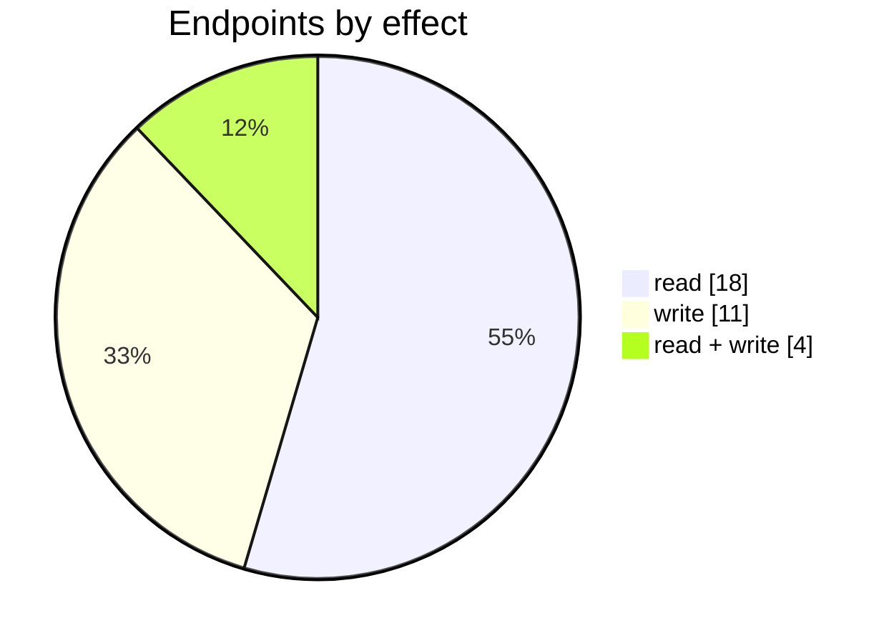
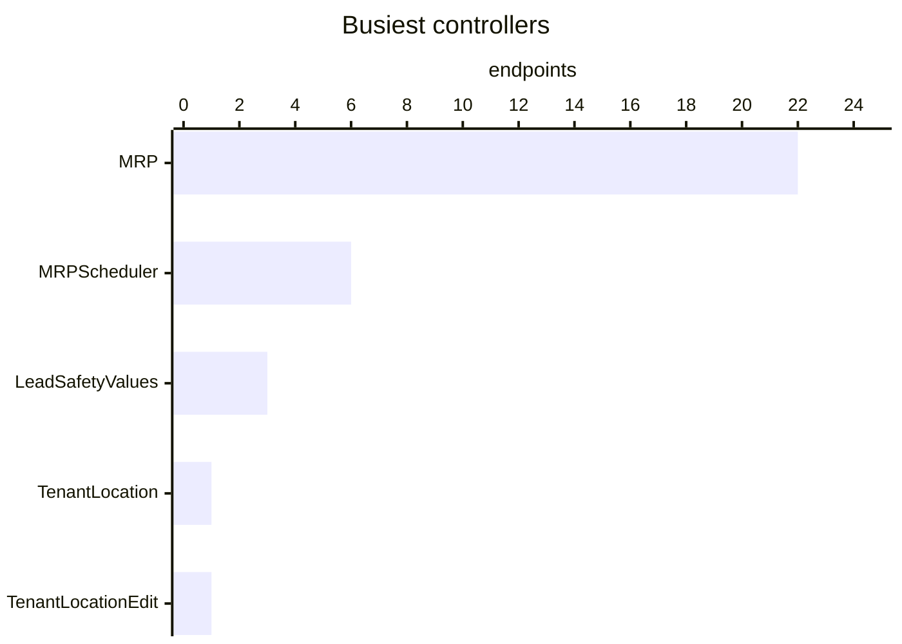
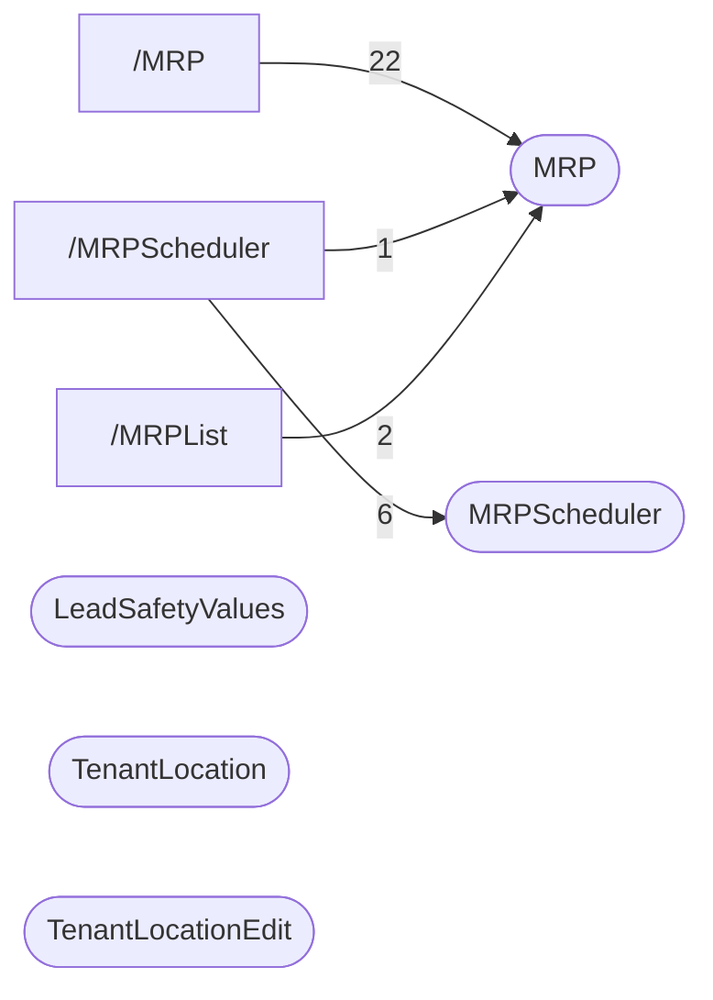

# MRP

Material requirements planning: MRP runs (`/MRPList`, `/MRP#<id>`) with their settings, demand, supply suggestions, errors and log; the MRP scheduler (`/MRPScheduler`); and confirming suggestions into purchases, production orders and transfers. Its inputs are edited elsewhere and listed here too: supply rules and transfer plans per location, logistics paths, and lead and safety values. The MRP demand grid is a report-service report (`/Report/MRPDemand`).

| 📄 Pages | 🧱 Models | 🔌 Endpoints | ✍️ Can write | 🌍 Public API |
|:-:|:-:|:-:|:-:|:-:|
| **3** | **15** + [shared](../00-shared/README.md) | **33** | 15 | **0** |

[📄 Pages (3)](#pages) · [🧱 Models (15)](#data-models) · [🔌 Endpoints (33)](#internal-endpoints) · [🖼️ UI](UI.md) · [🗄️ schema.sql](schema.sql)

Pages (left) and the controllers they call (right), busiest 3 pages and 5 controllers; numbers are endpoints.

## How to rebuild it

| # | Build | How |
|:-:|---|---|
| 1 | 🗄️ Schema | 15 tables from [`schema.sql`](schema.sql); GUID ids, join on `*ID` |
| 2 | 🔌 Internal API | Each controller's verbs · [contract](../../docs/INTERNAL-API.md) · paged `{root, total}` · saves `{ID, HasErrors, Original, Updated}` |
| 3 | 🖥️ Screens | Server-rendered shell + page app, record from `#<guid>` · [page model](../../docs/ARCHITECTURE.md#what-a-page-is) · every control in [UI.md](UI.md) |

## Pages

| Route | Menu label | Title | Bundle | Endpoints (write) |
|---|---|---|---|---:|
| `/MRP` | MRP run | MRP run settings | `ReportService MRPRunSettings` | 22 (13) |
| `/MRPList` | MRP | MRP list | `MRPList` | 3 (4) |
| `/MRPScheduler` | MRP scheduler | MRP Scheduler | `MRPScheduler` | 17 (2) |

## Data models

ExtJS models the pages use; `v` prefix = view-model. Full DDL in [`schema.sql`](schema.sql).

| Model | Fields |
|---|---|
| `vBrand` | BrandID:string, Name:string |
| `vCategory` | CategoryID:string, Name:string |
| `vCustomerID` | CustomerID:string, Name:string, MRPSettingsID:string |
| `vError` | Message:string |
| `vForecastError` | Line:int, DemandLocation:string, ProductSku:string, ProductName:string, Quantity:float, RequiredByDate:date, ValidationState:string, ValidationText:string |
| `vLocationID` | LocationID:string, Name:string, MRPSettingsID:string |
| `vLog` | LogID:string, Action:string, Message:string, AdditionalInfo:string, LogDate:date, Error:string, LogType:string, SyncID:string, AffectedEntitiesCount:int, ValidationText:string, ValidationState:string |
| `vMRP` | Number:string, CreatedBy:string, CreatedAt:date, Status:string |
| `vMRPSettings` | ID:string, Name:string, PlanningPeriodStart:date, PlanningPeriodEnd:date, SupplyCalculation:string, SupplyTask:int, IsIgnoreStockOnHand:bool, IsProcureUpToStockLevel:bool, IsProcureUpToMinimumBeforeReorder:bool, IsIncludePastDueDemand:bool, IsIncludeDraft:bool, IsBomExplosion:bool, IsIncludeForecast:bool, ForecastID:string, DemandSales:string, IsDemandProductionDraft:bool, IsDemandProductionPlanned:bool, IsDemandProductionReleased:bool, IsDemandAssemblyDraft:bool, IsDemandAssemblyReleased:bool, IsDemandTransferDraft:bool, SupplyTaskPurchaseStatus:string, SupplyTaskTransferStatus:string, Suppl… |
| `vSuggestionProduct` | ProductID:string, ProductCode:string, ProductName:string, Quantity:float, UnitOfMeasure:string, ProductBOM:string, MrpSupplySuggestionID:string, IsSplitted:bool |
| `vSupplyItem` | ID:string, Name:string |
| `vSupplyResult` | ID:string, TaskID:string, TaskNumber:string, TaskType:string, CreatedAt:date, SupplyName:string, DemandLocationName:string, RequiredByDate:date, TaskStatus:string, CreatedBy:string, TotalQuantity:float |
| `vSupplySuggestion` | ID:string, MRPID:string, SupplyTask:string, DemandLocationID:string, DemandLocationName:string, SupplyID:string, SupplyName:string, RequiredByDate:date, DocumentDate:date, TaskStatus:string, IsSelected:bool, ValidationState:string, ValidationText:string, IsSupplyTaskChanged:bool |
| `vSupplyTask` | Value:string |
| `vSuppySuggestionsWrapper` | ID:int |

## Internal endpoints

Grouped by controller. Effect: 🟢 read · 🟠 read + write at the same URL · 🔴 write. `api` = JSON under `/api/`, `mvc` = controller action.

### LeadSafetyValues

| URL | Kind | Methods | Effect | Params | Body keys | Reader root |
|---|---|---|---|---|---|---|
| `/LeadSafetyValues/Export` | mvc |  | 🟢 read |  |  |  |
| `/LeadSafetyValues/Import` | mvc | GET(navigate) | 🔴 write | ref |  |  |
| `/api/LeadSafetyValues_List` | api | REST(GET read; POST/PUT/DELETE on store.sync) | 🟢 read | search |  | root |

### MRP

| URL | Kind | Methods | Effect | Params | Body keys | Reader root |
|---|---|---|---|---|---|---|
| `/MRP/ImportForecast` | mvc | POST | 🔴 write |  |  |  |
| `/api/MRP_CheckLongExecution` | api | GET | 🟢 read |  |  |  |
| `/api/MRP_Complete` | api | POST | 🔴 write |  | MrpID |  |
| `/api/MRP_DemandDetails` | api | GET | 🟢 read |  |  |  |
| `/api/MRP_Errors` | api | REST(GET read; POST/PUT/DELETE on store.sync) | 🟢 read | MrpID errorType |  | root |
| `/api/MRP_LoadDataFromDB` | api | POST | 🟢 read |  |  |  |
| `/api/MRP_Logs` | api | REST(GET read; POST/PUT/DELETE on store.sync) | 🟢 read | MrpID |  | root |
| `/api/MRP_Operation` | api | POST | 🔴 write |  |  |  |
| `/api/MRP_Recalculate` | api | POST | 🔴 write |  |  |  |
| `/api/MRP_ReferenceData` | api | REST(GET read; POST/PUT/DELETE on store.sync) | 🟢 read |  |  |  |
| `/api/MRP_Results` | api | REST(GET read; POST/PUT/DELETE on store.sync) | 🟢 read | MrpID |  | root |
| `/api/MRP_Run` | api | POST | 🔴 write |  | Status |  |
| `/api/MRP_Split` | api | POST | 🔴 write |  | OriginalMrpID OriginalSuggestionID Suggestions |  |
| `/api/MRP_SupplySuggestionFilters` | api | POST(read) | 🟢 read |  |  |  |
| `/api/MRP_SupplySuggestionProducts` | api | POST | 🟢 read |  |  |  |
| `/api/MRP_SupplySuggestions` | api | POST(read) | 🟢 read |  |  | root |
| `/api/MRP_vMRP` | api | DELETE GET REST(GET read; POST/PUT/DELETE on store.sync) | 🟠 read + write | ID search |  | root |
| `/api/MRP_vMRPMerge` | api | POST | 🔴 write |  |  |  |
| `/api/MRP_vMRPReorder` | api | POST | 🔴 write |  |  |  |
| `/api/MRP_vMRPSettings` | api | DELETE POST REST(GET read; POST/PUT/DELETE on store.sync) | 🟠 read + write | limit |  |  |
| `/api/MRP_vMRPVoidTask` | api | POST | 🔴 write |  |  |  |
| `/api/MRP_vTenantLocation` | api | REST(GET read; POST/PUT/DELETE on store.sync) | 🟢 read | IsShopFloor |  |  |

### MRPScheduler

| URL | Kind | Methods | Effect | Params | Body keys | Reader root |
|---|---|---|---|---|---|---|
| `/api/MRPScheduler_Demand` | api |  | 🟢 read |  |  |  |
| `/api/MRPScheduler_ExistedSupply` | api |  | 🟢 read |  |  |  |
| `/api/MRPScheduler_LocationCalendar` | api |  | 🟢 read |  |  |  |
| `/api/MRPScheduler_MRP` | api |  | 🟢 read | mrpID |  |  |
| `/api/MRPScheduler_Supply` | api |  | 🟢 read |  |  |  |
| `/api/MRPScheduler_vMRPReorder` | api | POST | 🔴 write |  |  |  |

### TenantLocation

| URL | Kind | Methods | Effect | Params | Body keys | Reader root |
|---|---|---|---|---|---|---|
| `/api/TenantLocation_Index_LogisticsPath` | api | REST(GET read; POST/PUT/DELETE on store.sync) | 🟠 read + write |  |  |  |

### TenantLocationEdit

| URL | Kind | Methods | Effect | Params | Body keys | Reader root |
|---|---|---|---|---|---|---|
| `/api/TenantLocationEdit_vSupplyRule` | api | DELETE POST PUT REST(GET read; POST/PUT/DELETE on store.sync) | 🟠 read + write | ID limit locationID search |  | root |
